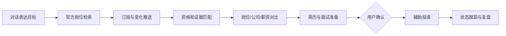
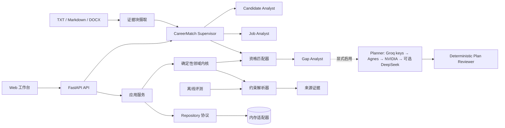

# Lina

> 一个面向个人求职者的、可解释且以用户确认为边界的求职 Agent。

Lina 将岗位发现、硬条件筛选、证据化匹配、岗位变化监控和投递记录整合到一个本地优先的工作台中。用户可以输入结构化画像或匿名测试资料，搜索官方 Careers 来源，查看岗位为什么匹配或不匹配，并在确认后保存岗位状态。项目强调确定性规则、可追溯证据和安全的人机协作，而不是未经确认地自动投递。

当前版本 `0.2.45` 已支持约 60 个官方 Careers 来源、岗位搜索与比较、每日推荐、岗位变化 Inbox、已投递岗位排除、浏览器文件 Agent、HTTP API 和 CLI。核心毕业年份、学历、经验与地点判断由 Python 领域规则完成；当前对话工具路由不需要模型 API key。可选 LLM 仅在显式启用时用于职业规划等扩展能力，凭据通过本地环境变量或私有文件提供，不应提交到仓库。

## 项目简介

Lina 适合作为求职 Agent、可解释推荐系统和人机协作工作流的工程样例，解决以下问题：

- 从可信招聘入口集中发现和监控岗位；
- 从 JD 中提取明确的毕业年份、学历、经验和地点约束；
- 基于候选人画像执行可复现的资格判断，并返回失败原因；
- 保存岗位来源证据、匹配结果和岗位变化，便于复核；
- 将已投递岗位从默认推荐中排除，同时保留手动搜索和撤销能力；
- 通过本地 SQLite、Web 工作台、FastAPI 和命令行工具提供可运行的 MVP。

当前版本是求职决策辅助内核，不是无人值守的自动投递系统：跨请求多轮记忆、外部推送、简历优化和受控投递仍属于后续工作。完整目标见 [产品愿景](docs/PRODUCT_VISION.md)，当前可用边界见 [使用手册](docs/USER_GUIDE.md)。

公司清单集中维护在 [`company_catalog.toml`](src/lina_agent/infrastructure/job_sources/company_catalog.toml)，便于人工审核名称、分组、官方入口、地区、关键词和关注理由。
本轮国内外科技公司 Top 10、榜单口径与补充结果见 [市值榜审核](docs/MARKET_CAP_TECH_REVIEW.md)。
公司入口健康、生命周期和自动轮换方案见 [公司清单运营计划](docs/COMPANY_CATALOG_OPERATIONS.md)。
当前进度、验证结果和唯一下一步见 [项目状态](docs/PROJECT_STATUS.md)；历史知识见 [开发知识库](docs/KNOWLEDGE_BASE.md)，路线见 [Coding Plan](docs/CODING_PLAN.md)，每次任务的沉淀规则见 [Copilot 工作规范](.github/copilot-instructions.md)。


当前版本：**0.2.45** · [查看发布记录](releaseNote.md)

## Lina 的工程价值

多数 Agent Demo 关注模型能完成多少任务。Lina 从另一组约束出发：

- **关键判断保持确定性**：毕业年份、学历、经验和地点检查由纯 Python 规则完成，而不是依赖模型意见。
- **持久化前先提供证据**：抽取结果保留原文和字符偏移，用户可以先确认字段来源，再决定是否保存。
- **在界面边界处显式确认**：抽取预览不会自动保存；当前工作台把用户检查字段后点击“保存目标岗位”视为确认。后端确认状态与证据持久化仍是下一阶段能力。
- **把评测作为产品能力**：使用版本化数据集、明确的 Precision/Recall 语义和具名失败案例评估解析器行为。
- **保证并发状态一致性**：过期的保存、抽取和匹配响应不能覆盖浏览器中的较新状态。

这些约束使职业决策成为一个适合验证 Agent 系统的场景：输入混乱、建议会产生真实影响，仅仅生成一句听起来合理的话不足以证明系统正确。

## 产品方向



近期唯一实现目标是为一个可稳定访问职位列表的官方来源完成真实岗位解析器。默认测试使用 Fixture，真实网络探针独立运行；来源失败不得伪装成零岗位。

## 产品流程

浏览器工作台支持一条完整、可复现的流程：

1. 创建结构化候选人画像。
2. 粘贴岗位描述并抽取明确约束。
3. 检查每个抽取值对应的原文证据。
4. 确认并保存结构化岗位。
5. 执行确定性资格检查，一次获取全部失败原因。

本地文件 Agent 支持另一条闭环：

1. 将 DOCX/TXT 简历和 Markdown JD 转为带指纹、分块与字符偏移的统一文档；
2. 解析岗位职责、要求、来源和上下线状态；
3. 从双方证据中识别规范化技能，区分明确要求、优先项和职责上下文；
4. 排除不可投递岗位，生成 Top-K 覆盖排序与逐岗位证据缺口；
5. 由 Gap Analyst 聚合多个岗位的高频缺口、影响范围与已有证据优势；
6. 仅在 `--use-llm` 时，由 Planner 生成带产出物和验收标准的计划，再由确定性 Reviewer 复核后接纳。

同一流程也可在浏览器“文件 Agent”区域运行：上传简历与 Markdown JD 目录，显式开启自动信号或 LLM，完成后查看 Top 匹配、gap 并自动刷新脱敏历史。


这个流程刻意保持可解释：候选人与岗位是独立领域实体；抽取是无副作用的预览操作；工作台只会对用户显式保存的结构化约束运行匹配。当前 API 尚未把“已确认”建模为独立的领域状态。

## 系统设计



代码采用精简的端口与适配器结构：

```text
src/lina_agent/
├── api/             # HTTP 路由与依赖装配
├── application/     # 应用用例与 Repository 协议
├── domain/          # 模型、解析、证据和匹配规则
├── evaluation/      # 数据集加载与指标计算
├── infrastructure/  # 可替换的 Repository 适配器
├── cli/             # 本地文件 Agent 入口
├── web/             # 无构建链的浏览器工作台
├── config.py
└── main.py
```

### 决策边界

Lina 不会把所有任务都交给 LLM，而是区分不同类型的工作：

| 工作类型 | 当前策略 | 原因 |
| --- | --- | --- |
| 明确约束 | 确定性解析器 | 可复现，易于回归测试 |
| 资格判断 | 纯领域规则 | 结果稳定，并能返回完整失败原因 |
| 模糊表达 | 警告 + 人工复核 | 避免把偏好条件误判为硬性要求 |
| 技能与决策信号 | 确定性词表 + 显式 opt-in 的证据化硬条件/方向抽取 | 未知状态不进入分数；自动基线与人工 oracle 分开评测 |
| 行动计划 | 显式 opt-in 的 Planner + 确定性 Reviewer | 输入最小化；输出必须通过 Schema、技能白名单和优先级复核 |
| 外部副作用 | 规划中的人工审批节点 | 让用户保持对高影响操作的控制权 |

这是项目最核心的架构判断：Agent 应当编排工具和不确定性，而不是用概率性行为替代可靠代码。

## 工程证据

| 信号 | 当前结果 |
| --- | --- |
| 自动化测试 | 234 个测试通过 |
| 推理实验测试 | 本机 16 项通过、6 项 CUDA 测试因无 NVIDIA 环境跳过 |
| 覆盖率 | 语句与分支覆盖率均为 100% |
| 静态分析 | Pyright strict，0 个错误 |
| Lint 与格式化 | Ruff + pre-commit |
| API 契约 | FastAPI + Pydantic v2 |
| 解析器评测 | Precision 1.0、Recall 0.625、Exact Match 0.5 |
| 评测语料 | 6 个合成、人工标注、版本化案例 |
| 技能证据评测 | 5 条真实匿名 JD；技能与匹配 Precision/Recall、引用有效率/支持率均为 1.0 |
| Top-K 排序基线 | 默认 Pairwise Accuracy 0.3、Top-1 0.0；仅调技能权重不足以拟合人工排序 |
| 决策信号消融 | 人工 hard + direction + skill 达到 Pairwise/Top-1 1.0；仅代表 oracle 上限 |
| 自动信号基线 | 方向确认后 5 JD 并列 Gold 上 Pairwise/Top-1 1.0/1.0；仍为实验性 opt-in |
| 多 Gold 稳定性 | 2 个冻结集、11 个岗位；扩展集 Pairwise 0.933，保留 1 个技能缺口逆序 |
| PyTorch 推理证据 | MPS `94.5k tokens/s`、相对 CPU `3.28x`，最大绝对误差 `1.19e-6` |
| C++ 扩展证据 | RMSNorm C++ `0.136ms`、相对 Python `1.60x`，最大误差 `1.91e-6` |
| CUDA 扩展状态 | Kernel、runner preflight 和 GPU workflow 已完成；真实 NVIDIA artifact 待运行 |
| 结构化持久化 | Web 候选人画像与岗位使用本地 SQLite，跨服务重启可恢复 |
| Agent Run 历史 | 脱敏 Snapshot 可跨重启查询；不保存原文、offset 或私密文件名 |
| 输入版本关联 | Snapshot v2 关联 metadata-only 文档引用和候选确认版本 |
| Run 历史比较 | 不加载正文即可比较输入、确认、排名、分数、gap 和计划变化 |
| 历史工作台 | 最近 Run、基线/目标选择和结构化 Diff，桌面/移动端可用 |
| 公司覆盖与每周监控 | 内部维护 60 个官方入口；每周更新来源健康，不公开公司分层 |
| 硬条件逐项基线 | 18 项状态和证据指标为 1.0；确认后逐项已知率 1.0、hard MAE 0.0 |
| 浏览器验收 | 24 个 Playwright 测试覆盖首屏岗位、移动对话入口、筛选、简历初筛、页面拆分与历史 |
| 真实文件验收 | 7/7 DOCX 本地解析；29 个 JD 岗位解析，默认 28 个进入排序 |
| 官方岗位核验 | 覆盖国内外 30 余家公司，5 条上海 AI 实习进入优先投递池 |
| Provider | Groq、Agnes、DeepSeek 无隐私真实探针通过；NVIDIA 为免费降级；DeepSeek 默认不自动付费 |

当前解析器优先保证 Precision，而不是 Recall。基线结果为 `10 TP / 0 FP / 6 FN`；这是小型合成语料上的回归指标，不代表生产准确率。漏掉字段时，用户仍可手工补充；错误生成硬性要求则可能误判一个本可申请的机会，因此后者成本更高。

回归测试覆盖的代表性解析问题包括：

- 区分 `硕士及以上学历优先` 和真正的学历硬性要求；
- 保留地名 `新疆和田`，同时将 `北京和上海` 识别为无法可靠拆分的自然语言地点列表；
- 空评测数据集必须报错，而不能返回看似完美的指标。

编辑或重置表单后，过期的成功与失败响应不会污染新状态；这些路径已固化为仓库内 Playwright 自动化测试，并在 Linux 与 Windows CI 中使用 Chromium 运行。

指标定义和失败分析详见 [解析器评测报告](docs/evaluations/JD_PARSER_BASELINE.md) 与 [推送前审查加固记录](docs/iterations/006-pre-push-review-hardening.md)。

## 本地运行

环境要求：Python 3.12+。

使用 VS Code 开发时，可直接打开仓库内的工作区：

```powershell
code Lina_Agent.code-workspace
```

仓库已经固化推荐扩展、FastAPI/匿名 Agent/当前测试调试入口，以及依赖安装、快速测试和完整质量门禁任务。首次打开后只需为 Windows 或 WSL 选择各自的 Python 解释器；完整说明见 [工程代码技术书](docs/ENGINEERING_HANDBOOK.md#8-vs-code-开发工作区)。

```bash
uv sync --extra dev --locked
uv run --extra dev --locked playwright install chromium
uv run --extra dev --locked uvicorn lina_agent.main:app --app-dir src --reload --port 8000
```

Linux 首次安装浏览器时使用 `playwright install --with-deps chromium`，同时安装 Chromium 所需系统库。

启动后访问：

- 机会首页：<http://127.0.0.1:8000/>
- 决策工具：<http://127.0.0.1:8000/workbench>
- OpenAPI 文档：<http://127.0.0.1:8000/docs>
- 健康检查：<http://127.0.0.1:8000/health>

点击 **载入匿名示例**，再依次保存候选人画像和岗位，即可复现上面的完整流程。

运行本地文件 Agent（路径含空格时加引号）：

```bash
uv run --locked lina-match \
  --resume "data/private/your-resume.docx" \
  --jobs "data/private/AI_Agent_JD.md" \
  --top 5
```

实验性综合排序需显式增加 `--auto-decision-signals`。可同时用 `--candidate-weekly-days`、`--candidate-duration-months` 和五个 `--direction-*` 参数提供人工确认的投入条件与方向偏好；确认来源独立记录，不伪造成简历证据。未知硬条件进入警告而不会被默认为兼容。

加入 `--use-llm` 才会联网生成智能计划。默认 `auto` 依次使用多个 Groq 凭据、Agnes 和 NVIDIA；DeepSeek 需要显式选择或允许付费回退。密钥文件、环境变量和实际发送字段见 [使用手册](docs/USER_GUIDE.md)。

运行质量门禁：

```bash
uv lock --check
uv run --extra dev --locked ruff format --check .
uv run --extra dev --locked ruff check .
uv run --extra dev --locked pyright
uv run --extra dev --locked pytest --browser chromium --tracing=retain-on-failure \
    --cov=lina_agent --cov-branch --cov-fail-under=100
```

独立运行解析器评测：

```bash
uv run --locked python -m lina_agent.evaluation.job_parser \
    tests/fixtures/job_parser_evaluation.json
```

运行私有技能证据与 Top-K 校准：

```bash
uv run --locked python -m lina_agent.evaluation.career_matching \
  data/private/evaluation/career_matching_gold_v1.json --ablate
```

运行多个冻结 Gold 的自动信号稳定性汇总：

```bash
uv run --locked python -m lina_agent.evaluation.career_matching \
  data/private/evaluation/career_matching_gold_suite_v1.json --auto-signal-suite
```

从冻结 Gold 为指定岗位生成确定性技能证据计划：

```bash
uv run --locked python -m lina_agent.evaluation.career_matching \
  data/private/evaluation/career_matching_gold_v3.json --evidence-plan-for 6
```

运行 PyTorch CPU/MPS 推理基线：

```bash
uv sync --extra dev --extra inference --locked
uv run --extra inference --locked python -m experiments.pytorch_inference.benchmark \
  --devices auto \
  --output data/private/evaluation/pytorch_inference_baseline_v1.json
```

编译并运行 PyTorch C++ RMSNorm benchmark：

```bash
uv run --extra dev --extra inference --locked pytest \
  experiments/pytorch_inference experiments/pytorch_cpp_extension
uv run --extra inference --locked python -m experiments.pytorch_cpp_extension.benchmark \
  --output data/private/evaluation/pytorch_cpp_rms_norm_v3.json
```

检查 CUDA runner；GPU 机器上再运行 kernel 测试与 benchmark：

```bash
uv run --extra inference --locked python -m experiments.pytorch_cuda_extension.runner_preflight
uv run --extra dev --extra inference --locked pytest experiments/pytorch_cuda_extension
uv run --extra inference --locked python -m experiments.pytorch_cuda_extension.benchmark \
  --output data/private/evaluation/pytorch_cuda_rms_norm_v1.json
```

## API 接口

| 方法 | 路径 | 用途 |
| --- | --- | --- |
| `GET` | `/health` | 检查服务健康状态 |
| `POST` | `/profiles` | 校验并保存候选人画像 |
| `POST` | `/jobs/parse` | 预览约束及其来源证据 |
| `POST` | `/jobs` | 保存用户确认后的岗位 |
| `POST` | `/matches` | 执行确定性硬条件检查 |
| `POST` | `/agent/runs` | 以 Base64 文件运行证据 Agent；`use_llm=true` 时显式启用计划与复核 |
| `GET` | `/agent/runs/{run_id}` | 查询单条版本化脱敏 Agent Run Snapshot |
| `GET` | `/agent/runs?limit=20` | 按创建时间倒序查询最近 Snapshot |
| `GET` | `/agent/documents/{reference_id}` | 查询不含正文/文件名的文档 metadata 引用 |
| `GET` | `/agent/confirmations/{version_id}` | 查询一次用户确认事实版本 |
| `GET` | `/agent/runs/{base}/diff/{target}` | 比较两个脱敏 Snapshot 的结构化变化 |

抽取示例：

```bash
curl -X POST http://127.0.0.1:8000/jobs/parse \
  -H 'Content-Type: application/json' \
  -d '{"description":"工作地点：上海。要求 2027 届本科及以上学历。"}'
```

完整操作流程和请求载荷见 [使用手册](docs/USER_GUIDE.md)。

## 当前范围

已经实现：

- 类型化候选人、岗位、约束和证据模型；
- 支持偏好语气识别的可解释中文约束抽取；
- 可返回多个失败原因的确定性资格检查；
- Repository 协议与隔离对象引用的内存适配器；
- 具备过期响应保护的浏览器工作流；
- API、领域层、应用层、基础设施层和评测测试；
- TXT、Markdown、DOCX 统一证据摄取与文本框兜底；
- 真实 JD 目录解析、技能证据 Top-K、Supervisor Trace 和本地 CLI；
- 跨 Top-K 的能力缺口聚合、证据优势汇总和确定性优先级；
- 支持 Groq、Agnes、NVIDIA、DeepSeek 的免费优先 Provider 路由与显式 opt-in 智能行动计划；
- 带目标技能、产出物、验收标准和时间预算的计划契约，以及拒绝无证据技能的 Reviewer；
- 模型失败时保留确定性结果并返回 `degraded` 的可观测降级状态；
- 可复跑的官方公开 JD 离线摄取脚本，以及私有原始快照与匿名副本分层；
- 版本化评测数据与工程迭代记录。

当前尚未实现，也不会提前宣称：

- 尚不支持 PDF、扫描件 OCR、页眉页脚或图片内文字；
- 当前 Agent 可显式启用自动硬条件/方向抽取，但综合排序默认仍关闭；
- 尚不支持产品内在线岗位采集、持续监控或公司调研；当前只有人工触发的离线摄取与官网核验；
- 结构化 Web 候选人/岗位与脱敏 Agent Run Snapshot 已使用本地 SQLite 持久化；原始文档、evidence 和执行检查点仍未持久化，也没有公开部署。

当前可以称为有界多节点工作流 Agent：一个 Supervisor 编排可独立测试的文档、画像、岗位、匹配、缺口、计划和复核角色。国内外 11 岗进入双 Gold 套件，唯一逆序已转化为技能证据计划；PyTorch CPU/MPS、C++ RMSNorm 已实测，CUDA kernel 已实现但仍等待真实 NVIDIA artifact。综合排序继续保持显式 opt-in。

## 参考文档

所有重要文档都从这里直接进入；每次版本更新按文档治理清单统一 Review。

| 文档 | 用途 |
| --- | --- |
| [当前版本使用手册](docs/USER_GUIDE.md) | 安装、启动、页面流程、API、隐私和故障处理 |
| [产品愿景与边界](docs/PRODUCT_VISION.md) | 目标体验、自治等级、保留资产、新增领域和成功指标 |
| [公司与岗位准入标准](docs/COMPANY_SELECTION.md) | 公司池准入、岗位值得投判断、Garena 与 TapTap 结论 |
| [Release Notes](releaseNote.md) | 已发布版本、验证结果与已知限制 |
| [Coding Plan](docs/CODING_PLAN.md) | 阶段路线、依赖关系和验收标准 |
| [Agent 架构与数据流](docs/AGENT_ARCHITECTURE.md) | 当前入口、模块、输入输出、传输方向、脚本边界与收敛方案 |
| [工程代码技术书](docs/ENGINEERING_HANDBOOK.md) | 代码框架、领域契约、数据流、VS Code 调试、测试方法、扩展规范和未来行动 |
| [开发指南](docs/DEVELOPMENT.md) | 开发流程、质量门禁和发布步骤 |
| [0.2.0 发布测试手册](docs/RELEASE_TESTING_0.2.0.md) | 从多节点缺口、LLM 计划、Reviewer、降级到 Web 边界的逐步验收 |
| [文档治理](docs/DOCUMENTATION_GOVERNANCE.md) | 重要文档职责、事实来源和版本 Review 清单 |
| [数据匿名化与标注指南](docs/DATA_ANNOTATION.md) | JD/简历匿名化、Gold Label 和人工复核方法 |
| [决策信号行为准则](docs/DECISION_SIGNAL_RULES.md) | 自动抽取、未知状态、最小证据、Gold 与发布规则 |
| [知识库与迭代索引](docs/KNOWLEDGE_BASE.md) | 迭代 001 至今的决策、失败、心得和面试素材 |
| [MVP 实现记录](docs/MVP_IMPLEMENTATION.md) | 首个工作台的实现过程与历史复盘 |
| [解析器评测基线](docs/evaluations/JD_PARSER_BASELINE.md) | 指标口径、基线结果和失败分类 |
| [技能证据与 Top-K 基线](docs/evaluations/CAREER_MATCHING_BASELINE.md) | 真实匿名 Gold、引用支持率、排序指标和权重校准结论 |
| [岗位发现与推送设计](docs/JOB_MONITORING.md) | 尚未实现的来源适配、搜索、订阅、变化检测和通知契约 |
| [公开 JD 摄取记录](docs/iterations/017-public-jd-ingestion.md) | 官方来源、匿名化边界和正式岗负例数据 |
| [上海实习范围修正](docs/iterations/018-shanghai-ai-internship-scope.md) | 目标约束修正和腾讯职位族证据边界 |
| [国内外大厂实习核验](docs/iterations/019-official-internship-verification.md) | 30 余家公司官网覆盖、资格证据和优先投递池 |
| [技能证据与 Top-K Gold 基线](docs/iterations/020-career-matching-gold-baseline.md) | 完整 JD 快照、人工标注、首轮排序和校准失败分析 |
| [决策信号桥接与排序消融](docs/iterations/021-decision-signal-ablation.md) | 人工硬条件/方向信号、三组消融与自动抽取边界 |
| [自动决策信号基线](docs/iterations/022-automatic-decision-signal-baseline.md) | 证据化状态、独立自动评测和首轮误差基线 |
| [硬条件逐项 Gold 与范围表达](docs/iterations/023-hard-constraint-item-gold.md) | 18 项状态/证据基线与 unknown 语义 |
| [候选人投入确认领域契约](docs/iterations/024-candidate-availability-confirmation-contract.md) | 到岗/时长确认来源与文档证据分离 |
| [候选人投入确认 Gold 复跑](docs/iterations/025-confirmed-availability-gold-rerun.md) | 真实确认后的逐项、证据与排序指标 |
| [排序并列与逆序对分析](docs/iterations/026-ranking-ties-and-inversion-analysis.md) | 并列 Gold、逐岗分量和真实排序误差 |
| [方向偏好确认契约](docs/iterations/027-direction-preference-confirmation-contract.md) | 类型化方向强度、来源分离和私有 Gold 验证 |
| [方向偏好入口接线](docs/iterations/028-direction-preference-entry-wiring.md) | Agent、API、CLI 透传与入口校验 |
| [多冻结 Gold 套件基线](docs/iterations/029-multi-gold-suite-baseline.md) | 方向族覆盖、宏平均、最差集与扩展边界 |
| [第二个冻结 Gold 与官方 JD 回归](docs/iterations/030-second-gold-official-jd.md) | 官方正文、coverage 缺口和真实措辞回归 |
| [国内外大厂 JD 扩展](docs/iterations/031-domestic-global-jd-expansion.md) | 多城市、范围、方向、hard veto 与保留逆序 |
| [确定性技能证据计划](docs/iterations/032-deterministic-skill-evidence-plan.md) | PyTorch/C++/CUDA 产出物、验收与 Reviewer |
| [PyTorch LLM 推理基线](docs/iterations/033-pytorch-inference-baseline.md) | CPU/MPS 延迟、吞吐、内存、误差与可复现环境 |
| [PyTorch C++ RMSNorm 扩展](docs/iterations/034-pytorch-cpp-rmsnorm-extension.md) | ATen custom op、负结果、优化与误差基准 |
| [CUDA RMSNorm 实现与验证契约](docs/iterations/035-cuda-rmsnorm-contract.md) | CUDA kernel、环境探针、条件测试与 GPU workflow |
| [CUDA Runner 设置](docs/CUDA_RUNNER_SETUP.md) | NVIDIA 主机要求、安全注册、labels、preflight 与 artifact 验收 |
| [CUDA Runner Preflight](docs/iterations/036-cuda-runner-preflight.md) | 外部硬件门禁、阻塞事实和 token 安全边界 |
| [SQLite 结构化状态持久化](docs/iterations/037-sqlite-structured-state-persistence.md) | Repository 替换、跨重启恢复、并发与隐私边界 |
| [版本化 Agent Run Snapshot](docs/iterations/038-versioned-agent-run-snapshots.md) | 脱敏投影、schema v2、历史查询与恢复边界 |
| [文档引用与候选确认版本](docs/iterations/039-document-and-confirmation-versions.md) | 内容/角色/事件 ID、facts hash 与 SQLite schema v3 |
| [Agent Run Snapshot Diff](docs/iterations/040-agent-run-snapshot-diff.md) | 输入 hash、排名位移、分数、gap 与计划变化 |
| [Run 历史与 Diff 工作台](docs/iterations/041-run-history-workbench.md) | 只读历史、异步状态、隐私与响应式验收 |
| [浏览器文件 Agent](docs/iterations/042-browser-file-agent.md) | 文件上传、显式自动信号/LLM、结果渲染与历史自动刷新 |
| [产品方向调整](docs/iterations/043-product-direction-reset.md) | 从匹配工作台转向岗位发现、监控、决策和受控投递 |
| [岗位 Feed 与对话预览](docs/iterations/044-opportunity-feed-chat-preview.md) | 历史核验岗位自动展示、只传简历初筛和类型化对话入口 |
| [岗位发现契约与手动搜索](docs/iterations/045-job-discovery-contract.md) | JobLead、来源健康、跨来源去重、快照适配器和搜索 API/界面 |
| [Lina 每周官方来源监控](docs/iterations/046-weekly-source-monitoring.md) | 7 源注册、周次幂等、HTTP 健康分类、CLI、schedule 和 artifact |
| [主池与专注型 AI 公司宇宙](docs/iterations/047-balanced-company-universe.md) | 首批 21 家双池公司目录、地区/方向/理由和网页公司雷达 |
| [个性化 Top 9 与探索池扩容](docs/iterations/048-personalized-top-nine.md) | 31 家公司、每周轮换、浏览器偏好和 3×3 推荐入口 |
| [首页发现模式与公司准入](docs/iterations/049-home-discovery-and-company-criteria.md) | 上海早期岗位默认值、主页拆分及 Garena/TapTap 评估 |
| [Live 推荐边界与目标审计](docs/iterations/050-live-recommendation-boundary.md) | live-only Top 9、内部池隔离、岗位复核和全局文档收敛 |
| [首页首屏与对话入口精简](docs/iterations/051-first-viewport-home.md) | 岗位进入首屏、紧凑筛选和醒目的 Lina 对话按钮 |
| [右侧停靠 Agent 对话栏](docs/iterations/052-docked-agent-chat.md) | 默认展开、可调宽、可收起并记忆偏好的 Copilot 式对话布局 |
| [宽松岗位与快捷对话](docs/iterations/053-roomy-jobs-and-chat-prompts.md) | 两列岗位卡、公司 logo、折叠筛选和一键提示词 |
| [六岗位推荐配额](docs/iterations/054-six-job-recommendations.md) | 每日两列三行推荐与国内大厂、国外大厂、探索型 2+2+2 配额 |
| [可审核公司清单](docs/iterations/055-reviewable-company-catalog.md) | TOML 单一数据源、强类型加载和唯一性校验 |
| [科技市值榜扩容](docs/iterations/056-market-cap-company-expansion.md) | 国内外 Top 10 口径、14 家补充与排名元数据 |
| [NVIDIA 实时岗位解析器](docs/iterations/057-nvidia-live-job-source.md) | Workday 分页、字段规范化、离线 Fixture 和手动搜索接入 |
| [持续项目记忆与进度闭环](docs/iterations/058-continuous-project-memory.md) | 每次任务同步知识、总览、进度与下一步 |
| [NVIDIA 岗位变化检测](docs/iterations/059-job-change-tracking.md) | 详情指纹、SQLite 批次与四类变化事件 |
| [岗位变化 Inbox](docs/iterations/060-job-change-inbox.md) | 独立事件页、筛选、收藏、忽略和待比较 |
| [用户指定大厂补充](docs/iterations/061-requested-major-companies.md) | 15 家核对、14 家补充与官方入口验证 |
| [自然语言工具对话](docs/iterations/062-natural-language-tool-dialogue.md) | 搜索、动态、比较和主动追问 |
| [已投递岗位推荐排除](docs/iterations/063-applied-job-exclusion.md) | 标记、撤销、持久化和推荐过滤 |

## 欢迎讨论

我尤其希望围绕以下问题交流：

- 确定性工具应当在哪里结束，模型推理又应当从哪里开始？
- 除了原文精确匹配，还应如何评估引用是否真正支撑结论？
- 对早期产品而言，低召回、高精度是否是合理的抽取策略？
- 如何把当前应用服务演进为可恢复的 Agent 状态图，同时避免把领域逻辑隐藏在框架节点中？
- 哪些故障注入场景最容易暴露不可靠的 Agent 行为？

## 许可证

保留所有权利。目前尚未授予可复用的开源许可证。
