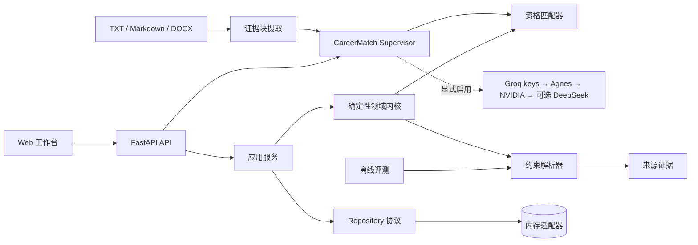

# Lina

> 一个面向高风险职业决策、以证据为基础的决策系统，也是 Agent 工程实践与验证平台。

Lina 关注一个实际的 Agent 工程问题：**当部分决策必须保持确定性、抽取事实需要在确认前提供来源证据，并且用户必须始终拥有控制权时，AI 系统应当如何给出有用的建议？**

职业规划是 Lina 的第一个垂直场景。当前版本既保留结构化工作台，也能读取本地 TXT、Markdown 和 DOCX 简历，将真实 JD 目录拆成独立岗位，生成带原文坐标的技能覆盖排序与 Agent Trace。用户显式启用时，经济型模型 Provider 只根据匿名化技能与匹配摘要生成结构化行动计划。Lina 刻意不止于聊天界面，也不把自己包装成自主运行的黑箱。


当前版本：**0.1.2** · [查看发布记录](releaseNote.md)

## Lina 的工程价值

多数 Agent Demo 关注模型能完成多少任务。Lina 从另一组约束出发：

- **关键判断保持确定性**：毕业年份、学历、经验和地点检查由纯 Python 规则完成，而不是依赖模型意见。
- **持久化前先提供证据**：抽取结果保留原文和字符偏移，用户可以先确认字段来源，再决定是否保存。
- **在界面边界处显式确认**：抽取预览不会自动保存；当前工作台把用户检查字段后点击“保存目标岗位”视为确认。后端确认状态与证据持久化仍是下一阶段能力。
- **把评测作为产品能力**：使用版本化数据集、明确的 Precision/Recall 语义和具名失败案例评估解析器行为。
- **保证并发状态一致性**：过期的保存、抽取和匹配响应不能覆盖浏览器中的较新状态。

这些约束使职业决策成为一个适合验证 Agent 系统的场景：输入混乱、建议会产生真实影响，仅仅生成一句听起来合理的话不足以证明系统正确。

## 产品流程

浏览器工作台支持一条完整、可复现的流程：

1. 创建结构化候选人画像。
2. 粘贴岗位描述并抽取明确约束。
3. 检查每个抽取值对应的原文证据。
4. 确认并保存结构化岗位。
5. 执行确定性资格检查，一次获取全部失败原因。

本地文件 Agent 支持另一条闭环：

1. 将 DOCX/TXT 简历和 Markdown JD 转为带指纹、分块与字符偏移的统一文档；
2. 解析岗位职责、要求、来源和上下线状态；
3. 从双方证据中识别规范化技能，区分明确要求、优先项和职责上下文；
4. 排除不可投递岗位，生成 Top-K 覆盖排序、缺口和五步 Supervisor Trace；
5. 仅在 `--use-llm` 时，将匿名化结构数据交给免费优先 Provider 生成行动计划。


这个流程刻意保持可解释：候选人与岗位是独立领域实体；抽取是无副作用的预览操作；工作台只会对用户显式保存的结构化约束运行匹配。当前 API 尚未把“已确认”建模为独立的领域状态。

## 系统设计



代码采用精简的端口与适配器结构：

```text
src/lina_agent/
├── api/             # HTTP 路由与依赖装配
├── application/     # 应用用例与 Repository 协议
├── domain/          # 模型、解析、证据和匹配规则
├── evaluation/      # 数据集加载与指标计算
├── infrastructure/  # 可替换的 Repository 适配器
├── cli/             # 本地文件 Agent 入口
├── web/             # 无构建链的浏览器工作台
├── config.py
└── main.py
```

### 决策边界

Lina 不会把所有任务都交给 LLM，而是区分不同类型的工作：

| 工作类型 | 当前策略 | 原因 |
| --- | --- | --- |
| 明确约束 | 确定性解析器 | 可复现，易于回归测试 |
| 资格判断 | 纯领域规则 | 结果稳定，并能返回完整失败原因 |
| 模糊表达 | 警告 + 人工复核 | 避免把偏好条件误判为硬性要求 |
| 技能证据映射 | 当前确定性词表；待真实标注校准 | 先获得可重复基线，再引入语义抽取 |
| 行动计划 | 显式 opt-in 的结构化模型节点 | 输入最小化，输出必须通过 Schema |
| 外部副作用 | 规划中的人工审批节点 | 让用户保持对高影响操作的控制权 |

这是项目最核心的架构判断：Agent 应当编排工具和不确定性，而不是用概率性行为替代可靠代码。

## 工程证据

| 信号 | 当前结果 |
| --- | --- |
| 自动化测试 | 88 个测试通过 |
| 覆盖率 | 语句与分支覆盖率均为 100% |
| 静态分析 | Pyright strict，0 个错误 |
| Lint 与格式化 | Ruff + pre-commit |
| API 契约 | FastAPI + Pydantic v2 |
| 解析器评测 | Precision 1.0、Recall 0.625、Exact Match 0.5 |
| 评测语料 | 6 个合成、人工标注、版本化案例 |
| 浏览器验收 | 8 个 Playwright 竞态测试覆盖候选人保存、岗位保存、抽取、匹配的过期成功与失败响应；桌面端与移动端布局仍为手工验收 |
| 真实文件验收 | 7/7 DOCX 本地解析；29 个 JD 岗位解析，默认 28 个进入排序 |
| Provider | Groq、Agnes、DeepSeek 无隐私真实探针通过；NVIDIA 为免费降级；DeepSeek 默认不自动付费 |

当前解析器优先保证 Precision，而不是 Recall。基线结果为 `10 TP / 0 FP / 6 FN`；这是小型合成语料上的回归指标，不代表生产准确率。漏掉字段时，用户仍可手工补充；错误生成硬性要求则可能误判一个本可申请的机会，因此后者成本更高。

回归测试覆盖的代表性解析问题包括：

- 区分 `硕士及以上学历优先` 和真正的学历硬性要求；
- 保留地名 `新疆和田`，同时将 `北京和上海` 识别为无法可靠拆分的自然语言地点列表；
- 空评测数据集必须报错，而不能返回看似完美的指标。

编辑或重置表单后，过期的成功与失败响应不会污染新状态；这些路径已固化为仓库内 Playwright 自动化测试，并在 Linux 与 Windows CI 中使用 Chromium 运行。

指标定义和失败分析详见 [解析器评测报告](docs/evaluations/JD_PARSER_BASELINE.md) 与 [推送前审查加固记录](docs/iterations/006-pre-push-review-hardening.md)。

## 本地运行

环境要求：Python 3.12+。

```bash
uv sync --extra dev --locked
uv run --extra dev --locked playwright install chromium
uv run --extra dev --locked uvicorn lina_agent.main:app --app-dir src --reload --port 8000
```

Linux 首次安装浏览器时使用 `playwright install --with-deps chromium`，同时安装 Chromium 所需系统库。

启动后访问：

- 工作台：<http://127.0.0.1:8000/>
- OpenAPI 文档：<http://127.0.0.1:8000/docs>
- 健康检查：<http://127.0.0.1:8000/health>

点击 **载入匿名示例**，再依次保存候选人画像和岗位，即可复现上面的完整流程。

运行本地文件 Agent（路径含空格时加引号）：

```bash
uv run --locked lina-match \
  --resume "data/private/your-resume.docx" \
  --jobs "data/private/AI_Agent_JD.md" \
  --top 5
```

加入 `--use-llm` 才会联网生成智能计划。默认 `auto` 依次使用多个 Groq 凭据、Agnes 和 NVIDIA；DeepSeek 需要显式选择或允许付费回退。密钥文件、环境变量和实际发送字段见 [使用手册](docs/USER_GUIDE.md)。

运行质量门禁：

```bash
uv lock --check
uv run --extra dev --locked ruff format --check .
uv run --extra dev --locked ruff check .
uv run --extra dev --locked pyright
uv run --extra dev --locked pytest --browser chromium --tracing=retain-on-failure \
    --cov=lina_agent --cov-branch --cov-fail-under=100
```

独立运行解析器评测：

```bash
uv run --locked python -m lina_agent.evaluation.job_parser \
    tests/fixtures/job_parser_evaluation.json
```

## API 接口

| 方法 | 路径 | 用途 |
| --- | --- | --- |
| `GET` | `/health` | 检查服务健康状态 |
| `POST` | `/profiles` | 校验并保存候选人画像 |
| `POST` | `/jobs/parse` | 预览约束及其来源证据 |
| `POST` | `/jobs` | 保存用户确认后的岗位 |
| `POST` | `/matches` | 执行确定性硬条件检查 |
| `POST` | `/agent/runs` | 以 Base64 文件运行确定性证据匹配 Agent |

抽取示例：

```bash
curl -X POST http://127.0.0.1:8000/jobs/parse \
  -H 'Content-Type: application/json' \
  -d '{"description":"工作地点：上海。要求 2027 届本科及以上学历。"}'
```

完整操作流程和请求载荷见 [使用手册](docs/USER_GUIDE.md)。

## 当前范围

已经实现：

- 类型化候选人、岗位、约束和证据模型；
- 支持偏好语气识别的可解释中文约束抽取；
- 可返回多个失败原因的确定性资格检查；
- Repository 协议与隔离对象引用的内存适配器；
- 具备过期响应保护的浏览器工作流；
- API、领域层、应用层、基础设施层和评测测试；
- TXT、Markdown、DOCX 统一证据摄取与文本框兜底；
- 真实 JD 目录解析、技能证据 Top-K、Supervisor Trace 和本地 CLI；
- 支持 Groq、Agnes、NVIDIA、DeepSeek 的免费优先 Provider 路由与显式 opt-in 智能行动计划；
- 版本化评测数据与工程迭代记录。

当前尚未实现，也不会提前宣称：

- 尚不支持 PDF、扫描件 OCR、页眉页脚或图片内文字；
- 当前技能匹配是确定性词表覆盖，尚未完成人工 Top-K 与语义抽取评测；
- 尚不支持在线岗位采集或公司调研；
- 尚未接入持久化数据库，也没有公开部署。

当前可以称为有界工作流 Agent：它具备目标、类型化工具、状态、证据、停止条件、Trace 和可选模型节点，但还没有持久化恢复、开放式任务规划、自然语言会话或多智能体协作。下一步先为真实匿名简历与岗位建立人工技能/Top-K 标注，校准词表、权重和引用支持率，再持久化文档、确认状态与 Agent Run；PDF 与爬虫不会先于这条质量基线。

## 参考文档

所有重要文档都从这里直接进入；每次版本更新按文档治理清单统一 Review。

| 文档 | 用途 |
| --- | --- |
| [当前版本使用手册](docs/USER_GUIDE.md) | 安装、启动、页面流程、API、隐私和故障处理 |
| [Release Notes](releaseNote.md) | 已发布版本、验证结果与已知限制 |
| [Coding Plan](docs/CODING_PLAN.md) | 阶段路线、依赖关系和验收标准 |
| [开发指南](docs/DEVELOPMENT.md) | 开发流程、质量门禁和发布步骤 |
| [文档治理](docs/DOCUMENTATION_GOVERNANCE.md) | 重要文档职责、事实来源和版本 Review 清单 |
| [数据匿名化与标注指南](docs/DATA_ANNOTATION.md) | JD/简历匿名化、Gold Label 和人工复核方法 |
| [知识库与迭代索引](docs/KNOWLEDGE_BASE.md) | 迭代 001 至今的决策、失败、心得和面试素材 |
| [MVP 实现记录](docs/MVP_IMPLEMENTATION.md) | 首个工作台的实现过程与历史复盘 |
| [解析器评测基线](docs/evaluations/JD_PARSER_BASELINE.md) | 指标口径、基线结果和失败分类 |
| [岗位监控设计](docs/JOB_MONITORING.md) | 尚未实现的来源适配、快照、去重和周报设计 |

## 欢迎讨论

我尤其希望围绕以下问题交流：

- 确定性工具应当在哪里结束，模型推理又应当从哪里开始？
- 除了原文精确匹配，还应如何评估引用是否真正支撑结论？
- 对早期产品而言，低召回、高精度是否是合理的抽取策略？
- 如何把当前应用服务演进为可恢复的 Agent 状态图，同时避免把领域逻辑隐藏在框架节点中？
- 哪些故障注入场景最容易暴露不可靠的 Agent 行为？

## 许可证

保留所有权利。目前尚未授予可复用的开源许可证。
