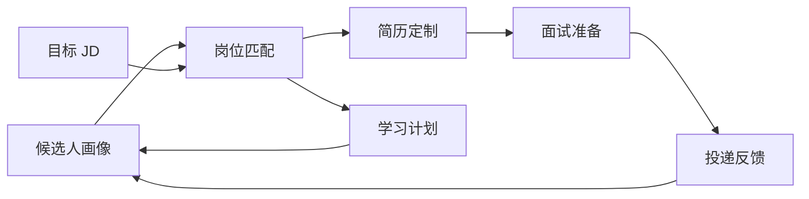
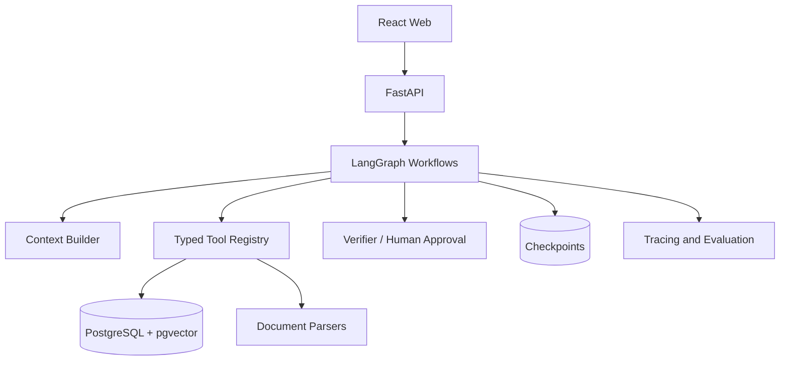

# Lina Career Agent

一个面向个人求职全流程的可解释 AI Agent：帮助候选人筛选岗位、优化简历、规划就业方向与学习路径，并把投递反馈沉淀为下一轮决策依据。

> 当前状态：**Phase 1 开发中**。Python API、领域模型、测试与 CI 基线已经建立。

## 为什么做这个项目

求职不是一次问答，而是一组持续变化、相互依赖的决策：候选人的能力证据在增加，岗位要求在变化，投递反馈也会修正原有判断。Lina 的目标不是简单生成文本，而是将这些信息组织成可追踪的 Agent 工作流。

项目同时用于：

- **解决真实问题**：降低岗位筛选、简历定制、学习规划和投递复盘的重复成本。
- **学习 Agent 工程**：实践状态建模、上下文工程、工具编排、RAG、评测和可观测性。
- **形成作品证据**：用架构决策、测试、评测报告和线上 Demo 展示端到端 Agent 研发能力。

## 核心体验



### 岗位筛选

先用确定性规则检查学历、毕业时间、地点和经验等硬条件，再结合技能、项目证据、偏好与成长空间进行语义分析。结果展示命中项、缺口、风险、证据和置信度，不用一个看似精确的总分掩盖判断过程。

### 简历优化

围绕目标 JD 给出逐条修改建议，同时展示原文、改写、理由和来源证据。Agent 不得虚构经历，所有事实性变更必须由用户确认后才能进入新版本。

### 就业方向咨询

对比一组真实岗位，识别候选人的优势、限制和可迁移能力，形成带证据的方向建议。系统会明确区分事实、推断和需要用户补充的信息。

### 学习建议

聚合目标岗位中的高频缺口，结合时间预算生成可执行任务。每项任务都包含学习理由、优先级、产出物和验收标准，并在完成后更新候选人画像、重新评估岗位匹配。

### 后续能力

面试模拟、STAR 素材库、投递看板、岗位市场分析和 GitHub 项目证据分析将在核心闭环稳定后加入。

## Agent 不是聊天框

Lina 首版采用“单个协调 Agent + 显式状态图 + 确定性工具”的设计：



关键设计原则：

- **结构化**：模型输出必须通过 Pydantic Schema 校验。
- **可追溯**：重要结论必须引用简历或 JD 中的原始证据。
- **可控制**：确定性任务不用 LLM；外部写操作和事实修改必须人工确认。
- **可恢复**：工具具有超时、重试、幂等约束，工作流支持检查点恢复。
- **可评测**：Prompt、模型和工作流版本均通过固定数据集做回归比较。
- **隐私优先**：真实资料本地优先存储，日志脱敏，公开 Demo 使用匿名数据。

## 技术路线

| 领域 | 计划选型 |
| --- | --- |
| 后端 | Python 3.12+、FastAPI、Pydantic v2 |
| Agent | LangGraph、模型 Provider 抽象 |
| 数据 | PostgreSQL、pgvector |
| 文件 | PyMuPDF、python-docx |
| 可观测性 | OpenTelemetry、Langfuse |
| 测试与质量 | pytest、Ruff、Pyright、pre-commit、GitHub Actions |
| 前端 | React、TypeScript、Vite |

框架只负责基础设施，领域模型、评分规则、上下文构建和工具协议保持独立并可单元测试。

## 本地开发

前置条件：Python 3.12+ 和 [uv](https://docs.astral.sh/uv/)。

```bash
cp .env.example .env
uv sync --extra dev
uv run uvicorn lina_agent.main:app --reload
```

启动后访问：

- API 文档：<http://127.0.0.1:8000/docs>
- 健康检查：<http://127.0.0.1:8000/health>

提交代码前运行完整质量检查：

```bash
uv run ruff format --check .
uv run ruff check .
uv run pyright
uv run pytest --cov
```

当前代码结构：

```text
src/lina_agent/
├── api/          # HTTP 路由与 API Schema
├── domain/       # 不依赖 Web/LLM 的领域模型与确定性规则
├── config.py     # 类型化环境配置
└── main.py       # FastAPI 应用工厂
tests/            # 与生产代码对应的自动化测试
```

## 与目标岗位的对应关系

这个项目刻意覆盖目标 Agent 开发岗位关注的核心能力：

| 岗位能力 | 项目证明方式 |
| --- | --- |
| 需求理解与端到端 Agent 研发 | 完整求职闭环与显式状态图 |
| 任务规划、上下文构建 | Planner、Context Builder、上下文预算与证据选择 |
| 多工具调用与结果汇总 | 类型化 Tool Registry、条件路由与 Verifier |
| 可复用 Agent 框架 | 统一状态、节点、工具、错误和副作用协议 |
| 稳定性与可靠性 | 超时、重试、幂等、检查点、降级和故障注入 |
| 调试与评测 | Trace、离线评测集、回归报告和失败案例库 |
| 测试生成、代码评审与缺陷发现 | 进阶阶段的 GitHub 项目证据分析与代码智能工具 |

项目不会用技术名词清单宣称能力，而会保留可复现的代码、测试、指标和设计决策作为证据。

## 开发路线

1. **需求与基线**：准备匿名化简历、真实 JD 和人工标注结果。
2. **确定性内核**：领域模型、存储接口、硬条件过滤和 CI。
3. **解析与证据链**：结构化抽取简历/JD，保留原文引用。
4. **匹配工作流**：状态图、上下文构建、验证、重试和人工确认。
5. **简历版本治理**：受约束改写、事实检查、批准与 Diff。
6. **行动闭环**：学习计划、完成证据和画像更新。
7. **工程强化**：评测、Trace、故障注入和隐私保护。
8. **产品发布**：Web 工作台、演示数据、部署和技术复盘。

每阶段的任务、验收标准和面试表达详见 [Coding Plan](docs/CODING_PLAN.md)。

## 如何一起开发与学习

每个阶段都按“概念预习 -> 设计追问 -> 小任务编码 -> 测试验证 -> 代码 Review -> 面试复述”推进。项目作者负责关键路径编码，AI 助手默认以提示和 Review 为主；遇到阻塞时共同定位，修复后再独立完成相邻用例。

每个里程碑至少留下四类产物：

- 可运行的代码和自动化测试；
- 一份设计决策或开发日志；
- 一组评测结果与失败案例；
- 一段可以用事实和指标支撑的面试讲述。

## 当前评审事项

进入 Agent 工作流开发前，请确认：

- P0 功能是否符合近期真实求职需求；
- 是否采用 Python + LangGraph + FastAPI + React；
- 是否接受先做本地单用户版本，再发布匿名 Demo；
- 每周可投入时间、首个模型 Provider 和预算；
- 是否能准备匿名化简历和至少 8 个真实 JD；
- 首版是否只支持粘贴文本和上传文件，不依赖招聘网站自动抓取。

当前建议先完成 [第一个开发任务](docs/DEVELOPMENT.md)，再建立人工标注基线，不要直接调用模型。

## 文档

- [详细 Coding Plan](docs/CODING_PLAN.md)
- [开发指南与第一个任务](docs/DEVELOPMENT.md)
- 架构决策记录、评测报告、开发日志：随实现阶段逐步补充

## License

License 将在首次公开发布前确定。