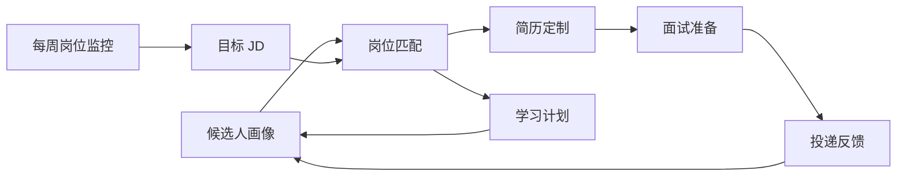
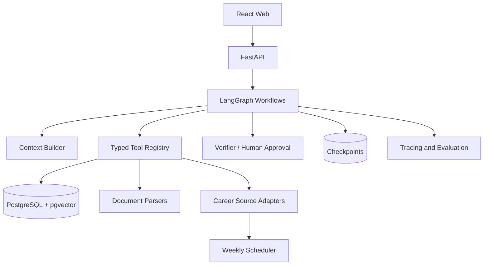

# Lina Career Agent

**Lina** 是一个正在演进中的可解释求职 Agent 项目。当前版本提供本地岗位硬条件解析与匹配工作台；对话编排、联网搜索、公司调研、简历优化和学习规划属于后续目标，尚不可用。

> 当前状态：**Phase 2 已开始**。浏览器工作台已打通候选人录入、JD 明确硬条件提取与证据预览、岗位保存和匹配；持久化数据库、文件解析、岗位采集和 LLM 工作流尚未实现。

## 现在可以做什么

当前可用：

- 手工录入候选人的毕业年份、学历、经验、技能和意向地点；
- 粘贴 JD，并确定性提取明确写出的毕业年份、最低学历、经验和工作地点；
- 查看每个提取结果对应的原文证据；
- 人工确认后保存岗位，运行硬条件匹配并查看全部失败原因；
- 使用匿名示例在一分钟内体验完整流程。
- 使用“开始新一轮”安全清空状态并连续分析多个场景。

当前不可用：

- 自然语言对话或多轮会话；
- 联网搜索岗位、公司资料或招聘动态；
- 上传 PDF、DOCX 并自动生成候选人画像；
- 技能语义匹配、岗位排序、简历优化或学习计划；
- 跨重启持久化、账号系统或公网部署。

完整操作、API 示例、支持的 JD 表达和故障处理见 [当前版本使用手册](docs/USER_GUIDE.md)。

## 当前项目状态

| 能力 | 状态 | 当前证据 |
| --- | --- | --- |
| Python 工程与 API | 已完成基线 | FastAPI 应用工厂、类型化配置、`GET /health` |
| 领域建模 | 已完成第一版 | 候选人、岗位、约束条件和来源证据模型 |
| 工程质量 | 已完成基线 | Ruff、Pyright、pytest、pre-commit、GitHub Actions |
| 硬条件匹配 | 已完成第一版 | 毕业年份、学历、经验、地点过滤与多失败原因返回 |
| 岗位与画像存储 | 已完成内存版 | Repository 协议、深拷贝隔离、保存、读取和更新 |
| 匿名基线数据 | 已完成第一版 | 1 个候选人样例、6 个 JD 解析标注案例 |
| 每周岗位监控 | 已完成设计 | 已确定来源、关键词、数据流、调度和验收指标 |
| Web 工作台 | 已完成 MVP | 浏览器内完成画像、岗位和匹配三步闭环 |
| JD 硬条件解析 | 已完成第一版 | 确定性提取、字符偏移证据、人工确认预览 |
| JD 解析评测 | 已完成基线 | Precision 100%、Recall 62.5%、Exact Match 50% |
| 简历解析与 Agent 工作流 | 待开发 | 下一步扩展匿名评测集和文件解析 |
| 持久化与部署 | 待开发 | 当前数据随服务重启清空 |

## 为什么做这个项目

求职不是一次问答，而是一组持续变化、相互依赖的决策：候选人的能力证据在增加，岗位要求在变化，投递反馈也会修正原有判断。Lina 的目标不是简单生成文本，而是将这些信息组织成可追踪的 Agent 工作流。

项目同时用于：

- **解决真实问题**：降低岗位筛选、简历定制、学习规划和投递复盘的重复成本。
- **学习 Agent 工程**：实践状态建模、上下文工程、工具编排、RAG、评测和可观测性。
- **形成作品证据**：用架构决策、测试、评测报告和线上 Demo 展示端到端 Agent 研发能力。

## 核心体验



### 岗位筛选

先用确定性规则检查学历、毕业时间、地点和经验等硬条件，再结合技能、项目证据、偏好与成长空间进行语义分析。结果展示命中项、缺口、风险、证据和置信度，不用一个看似精确的总分掩盖判断过程。

### 每周岗位监控（规划中）

Lina 每周检查目标公司的官方招聘来源，识别新增、更新、关闭和重新开放的岗位，先执行地点、毕业时间、经验等硬条件过滤，再按个人画像做可解释排序。周报只推送值得查看的变化，并保留来源 URL、抓取时间、岗位快照和匹配理由。

首批监控范围：

| 来源 | 重点方向 |
| --- | --- |
| [腾讯招聘](https://careers.tencent.com/) | Agent Memory、RAG、知识图谱、评测、向量检索 |
| [字节跳动招聘](https://joinbytedance.com/) | 大模型应用、搜索、数据算法、AI 产品 |
| [阿里招聘](https://talent.alibaba.com/) | 搜索推荐、智能客服、AI 应用 |
| [蚂蚁招聘](https://talent.antgroup.com/) | 大模型评测、金融 AI、Agent、数据智能 |
| [Microsoft Careers](https://careers.microsoft.com/) | Applied Science、Data Science、AI Engineering |
| [Amazon 上海](https://www.amazon.jobs/en/search?base_query=intern&loc_query=Shanghai%2C%20China) | OpenSearch、SDE、AI/ML |
| [Meltwater Careers](https://www.meltwater.com/en/careers) | AI、Data、Product Analytics |

监控只访问公开、允许访问的官方页面或 API，不绕过登录、验证码或反爬限制。来源不可用时生成失败记录并提示手动补充，不把“抓取失败”误判为“本周无岗位”。完整设计见 [每周岗位监控设计](docs/JOB_MONITORING.md)。

### 简历优化（规划中）

围绕目标 JD 给出逐条修改建议，同时展示原文、改写、理由和来源证据。Agent 不得虚构经历，所有事实性变更必须由用户确认后才能进入新版本。

### 就业方向咨询（规划中）

对比一组真实岗位，识别候选人的优势、限制和可迁移能力，形成带证据的方向建议。系统会明确区分事实、推断和需要用户补充的信息。

### 学习建议（规划中）

聚合目标岗位中的高频缺口，结合时间预算生成可执行任务。每项任务都包含学习理由、优先级、产出物和验收标准，并在完成后更新候选人画像、重新评估岗位匹配。

### 后续能力

Lina 将逐步形成以下能力：

- 定时发现岗位变化，生成个性化周报和待办；
- 解析简历与 JD，建立带原文证据的候选人能力画像；
- 执行硬条件过滤、语义匹配、岗位对比和投递优先级排序；
- 在不虚构经历的前提下定制简历，并保留逐条审批与版本 Diff；
- 聚合目标岗位能力缺口，生成有产出物和验收标准的学习计划；
- 生成面试问题、组织 STAR 素材并复盘投递反馈；
- 分析 GitHub 项目，将代码、测试和文档映射为岗位能力证据；
- 通过 Trace、评测集和失败案例持续评估 Agent 的准确性与可靠性。

## 目标 Agent 架构（规划中）

当前版本尚未接入 LLM、对话状态图或 Tool Registry。目标架构采用“单个协调 Agent + 显式状态图 + 确定性工具”：



关键设计原则：

- **结构化**：模型输出必须通过 Pydantic Schema 校验。
- **可追溯**：重要结论必须引用简历或 JD 中的原始证据。
- **可控制**：确定性任务不用 LLM；外部写操作和事实修改必须人工确认。
- **可恢复**：工具具有超时、重试、幂等约束，工作流支持检查点恢复。
- **可评测**：Prompt、模型和工作流版本均通过固定数据集做回归比较。
- **隐私优先**：真实资料本地优先存储，日志脱敏，公开 Demo 使用匿名数据。

## 技术路线

| 领域 | 计划选型 |
| --- | --- |
| 后端 | Python 3.12+、FastAPI、Pydantic v2 |
| Agent | LangGraph、模型 Provider 抽象 |
| 数据 | PostgreSQL、pgvector |
| 文件 | PyMuPDF、python-docx |
| 可观测性 | OpenTelemetry、Langfuse |
| 测试与质量 | pytest、Ruff、Pyright、pre-commit、GitHub Actions |
| 前端 | React、TypeScript、Vite |

框架只负责基础设施，领域模型、评分规则、上下文构建和工具协议保持独立并可单元测试。

## 快速开始

前置条件：Python 3.12+。首次安装：

```bash
cp .env.example .env
python3.12 -m venv .venv
.venv/bin/python -m pip install -e '.[dev]'
```

启动：

```bash
.venv/bin/python -m uvicorn lina_agent.main:app --app-dir src --reload --port 8000
```

启动后访问：

- Lina 工作台：<http://127.0.0.1:8000/>
- API 文档：<http://127.0.0.1:8000/docs>
- 健康检查：<http://127.0.0.1:8000/health>

### 使用当前 MVP

推荐直接打开 Lina 工作台，点击“载入匿名示例”，从岗位描述提取并确认硬条件，再依次保存候选人画像和目标岗位，最后运行匹配。也可以通过 API 完成相同流程：

```bash
curl -X POST http://127.0.0.1:8000/jobs/parse \
    -H 'Content-Type: application/json' \
    -d '{
        "description": "工作地点：上海。要求 2027 届本科及以上学历。"
    }'

curl -X POST http://127.0.0.1:8000/profiles \
    -H 'Content-Type: application/json' \
    --data @tests/fixtures/candidate_profile.json

curl -X POST http://127.0.0.1:8000/jobs \
    -H 'Content-Type: application/json' \
    --data @tests/fixtures/target_job.json

curl -X POST http://127.0.0.1:8000/matches \
    -H 'Content-Type: application/json' \
    -d '{
        "candidate_id": "f7ea0c79-f85e-43f7-afd4-7cb1df360000",
        "job_id": "1d46a09b-3be0-41ce-95bf-9d1768db0000"
    }'
```

目标 JD 要求 2027 届，而匿名候选人画像为 2028 年毕业，因此当前响应为：

```json
{
    "is_eligible": false,
    "reasons": ["graduation_year"]
}
```

当前使用 app 级内存 Repository，服务重启后数据会清空。它适合验证领域流程，不是最终持久化方案；后续 PostgreSQL 适配器会复用相同 Repository 接口。

提交代码前运行完整质量检查：

```bash
.venv/bin/ruff format --check .
.venv/bin/ruff check .
.venv/bin/pyright
.venv/bin/python -m pytest --cov --cov-branch
```

运行 JD 解析离线评测：

```bash
PYTHONPATH=src .venv/bin/python -m lina_agent.evaluation.job_parser \
    tests/fixtures/job_parser_evaluation.json
```

当前代码结构：

```text
src/lina_agent/
├── api/          # HTTP 路由与 API Schema
├── application/  # 用例编排与 Repository 接口
├── domain/       # 不依赖 Web/LLM 的领域模型与确定性规则
├── infrastructure/ # 内存、数据库和外部服务适配器
├── config.py     # 类型化环境配置
└── main.py       # FastAPI 应用工厂
tests/            # 与生产代码对应的自动化测试
```

## 与目标岗位的对应关系

这个项目刻意覆盖目标 Agent 开发岗位关注的核心能力：

| 岗位能力 | 项目证明方式 |
| --- | --- |
| 需求理解与端到端 Agent 研发 | 完整求职闭环与显式状态图 |
| 任务规划、上下文构建 | Planner、Context Builder、上下文预算与证据选择 |
| 多工具调用与结果汇总 | 类型化 Tool Registry、条件路由与 Verifier |
| 可复用 Agent 框架 | 统一状态、节点、工具、错误和副作用协议 |
| 稳定性与可靠性 | 超时、重试、幂等、检查点、降级和故障注入 |
| 调试与评测 | Trace、离线评测集、回归报告和失败案例库 |
| 测试生成、代码评审与缺陷发现 | 进阶阶段的 GitHub 项目证据分析与代码智能工具 |

项目不会用技术名词清单宣称能力，而会保留可复现的代码、测试、指标和设计决策作为证据。

## 开发路线

1. **需求与基线**：准备匿名化简历、真实 JD 和人工标注结果。
2. **确定性内核**：领域模型、存储接口、硬条件过滤和 CI。
3. **解析与证据链**：结构化抽取简历/JD，保留原文引用。
4. **匹配工作流**：状态图、上下文构建、验证、重试和人工确认。
5. **每周岗位监控**：来源适配器、快照、变更检测、个性化周报和失败告警。
6. **简历版本治理**：受约束改写、事实检查、批准与 Diff。
7. **行动闭环**：学习计划、完成证据和画像更新。
8. **工程强化**：评测、Trace、故障注入和隐私保护。
9. **产品发布**：Web 工作台、演示数据、部署和技术复盘。

每阶段的任务、验收标准和面试表达详见 [Coding Plan](docs/CODING_PLAN.md)。

## 如何一起开发与学习

每个阶段都按“概念预习 -> 设计追问 -> 小任务编码 -> 测试验证 -> 代码 Review -> 面试复述”推进。项目作者负责关键路径编码，AI 助手默认以提示和 Review 为主；遇到阻塞时共同定位，修复后再独立完成相邻用例。

每个里程碑至少留下四类产物：

- 可运行的代码和自动化测试；
- 一份设计决策或开发日志；
- 一组评测结果与失败案例；
- 一段可以用事实和指标支撑的面试讲述。

## 当前评审事项

进入 Agent 工作流开发前，请确认：

- P0 功能是否符合近期真实求职需求；
- 是否采用 Python + LangGraph + FastAPI + React；
- 是否接受先做本地单用户版本，再发布匿名 Demo；
- 每周可投入时间、首个模型 Provider 和预算；
- 是否能准备匿名化简历和至少 8 个真实 JD；
- 首版是否只支持粘贴文本和上传文件，不依赖招聘网站自动抓取。

当前建议将匿名化人工标注基线扩展到至少 5 个 JD，再开始文档解析与证据链，不要直接调用模型。

## 文档

- [详细 Coding Plan](docs/CODING_PLAN.md)
- [开发指南与第一个任务](docs/DEVELOPMENT.md)
- [当前版本使用手册](docs/USER_GUIDE.md)
- [每周岗位监控设计](docs/JOB_MONITORING.md)
- [MVP 实现日志与面试素材](docs/MVP_IMPLEMENTATION.md)
- [开发知识库索引](docs/KNOWLEDGE_BASE.md)
- [JD 硬条件解析迭代](docs/iterations/002-jd-constraint-extraction.md)
- [JD 解析基线评测报告](docs/evaluations/JD_PARSER_BASELINE.md)
- 架构决策记录与评测报告：随后续阶段逐步补充

## License

License 将在首次公开发布前确定。