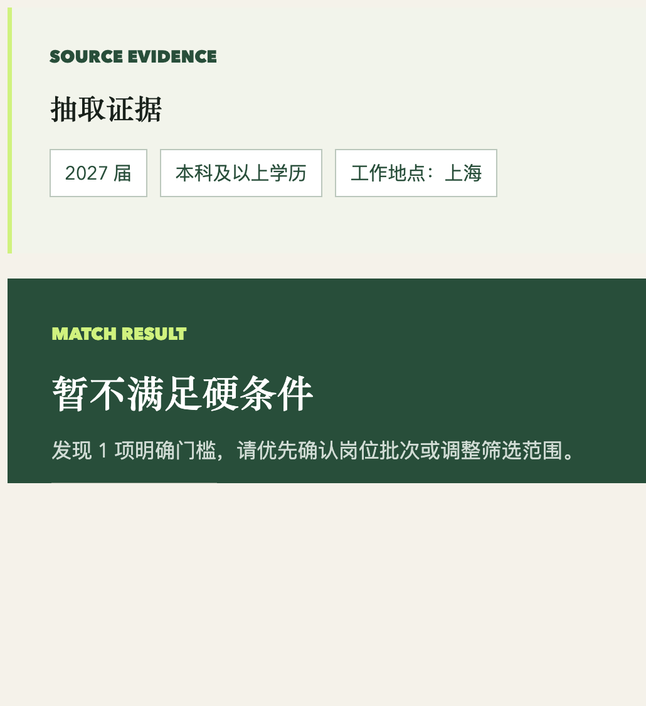
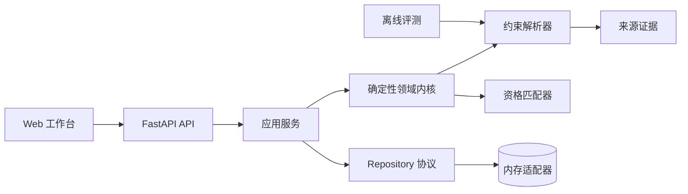

# Lina

> 一个面向高风险职业决策、以证据为基础的决策系统，也是 Agent 工程实践与验证平台。

Lina 关注一个实际的 Agent 工程问题：**当部分决策必须保持确定性、抽取事实需要在确认前提供来源证据，并且用户必须始终拥有控制权时，AI 系统应当如何给出有用的建议？**

职业规划是 Lina 的第一个垂直场景。当前版本把非结构化岗位描述和候选人约束转化为可审查的决策流程：抽取要求、展示来源证据、由用户核验，再执行确定性的资格检查。目前证据属于抽取预览；让已确认岗位和匹配报告持续保留来源信息，是后续规划中的能力。Lina 刻意不止于聊天界面，也不把自己包装成自主运行的黑箱。


当前版本：**0.1.0** · [查看发布记录](releaseNote.md)

## Lina 的工程价值

多数 Agent Demo 关注模型能完成多少任务。Lina 从另一组约束出发：

- **关键判断保持确定性**：毕业年份、学历、经验和地点检查由纯 Python 规则完成，而不是依赖模型意见。
- **持久化前先提供证据**：抽取结果保留原文和字符偏移，用户可以先确认字段来源，再决定是否保存。
- **在边界处引入人工确认**：抽取预览不会静默变成持久化事实；结构化数据只有经过用户确认，才会影响后续决策。
- **把评测作为产品能力**：使用版本化数据集、明确的 Precision/Recall 语义和具名失败案例评估解析器行为。
- **保证并发状态一致性**：过期的保存、抽取和匹配响应不能覆盖浏览器中的较新状态。

这些约束使职业决策成为一个适合验证 Agent 系统的场景：输入混乱、建议会产生真实影响，仅仅生成一句听起来合理的话不足以证明系统正确。

## 产品流程

浏览器工作台支持一条完整、可复现的流程：

1. 创建结构化候选人画像。
2. 粘贴岗位描述并抽取明确约束。
3. 检查每个抽取值对应的原文证据。
4. 确认并保存结构化岗位。
5. 执行确定性资格检查，一次获取全部失败原因。



这个流程刻意保持可解释：候选人与岗位是独立领域实体；抽取是无副作用的预览操作；匹配只消费经过用户确认的结构化约束。

## 系统设计



代码采用精简的端口与适配器结构：

```text
src/lina_agent/
├── api/             # HTTP 路由与依赖装配
├── application/     # 应用用例与 Repository 协议
├── domain/          # 模型、解析、证据和匹配规则
├── evaluation/      # 数据集加载与指标计算
├── infrastructure/  # 可替换的 Repository 适配器
├── web/             # 无构建链的浏览器工作台
├── config.py
└── main.py
```

### 决策边界

Lina 不会把所有任务都交给 LLM，而是区分不同类型的工作：

| 工作类型 | 当前策略 | 原因 |
| --- | --- | --- |
| 明确约束 | 确定性解析器 | 可复现，易于回归测试 |
| 资格判断 | 纯领域规则 | 结果稳定，并能返回完整失败原因 |
| 模糊表达 | 警告 + 人工复核 | 避免把偏好条件误判为硬性要求 |
| 语义证据映射 | 规划中的结构化模型节点 | 需要概率性理解与结果验证 |
| 外部副作用 | 规划中的人工审批节点 | 让用户保持对高影响操作的控制权 |

这是项目最核心的架构判断：Agent 应当编排工具和不确定性，而不是用概率性行为替代可靠代码。

## 工程证据

| 信号 | 当前结果 |
| --- | --- |
| 自动化测试 | 35 个测试通过 |
| 覆盖率 | 语句与分支覆盖率均为 100% |
| 静态分析 | Pyright strict，0 个错误 |
| Lint 与格式化 | Ruff + pre-commit |
| API 契约 | FastAPI + Pydantic v2 |
| 解析器评测 | Precision 1.0、Recall 0.625、Exact Match 0.5 |
| 评测语料 | 6 个合成、人工标注、版本化案例 |
| 浏览器验收 | 手工 Playwright 验证桌面端、移动端和延迟响应；自动化仍待完成 |

当前解析器优先保证 Precision，而不是 Recall。基线结果为 `10 TP / 0 FP / 6 FN`；这是小型合成语料上的回归指标，不代表生产准确率。漏掉字段时，用户仍可手工补充；错误生成硬性要求则可能误判一个本可申请的机会，因此后者成本更高。

回归测试覆盖的代表性解析问题包括：

- 区分 `硕士及以上学历优先` 和真正的学历硬性要求；
- 保留地名 `新疆和田`，同时将 `北京和上海` 识别为无法可靠拆分的自然语言地点列表；
- 空评测数据集必须报错，而不能返回看似完美的指标。

编辑或重置表单后，过期的成功与失败响应不会污染新状态；这些路径已通过延迟响应浏览器场景验证。将其转换为仓库内正式的 Playwright 自动化测试，仍是待完成事项。

指标定义和失败分析详见 [解析器评测报告](docs/evaluations/JD_PARSER_BASELINE.md) 与 [推送前审查加固记录](docs/iterations/006-pre-push-review-hardening.md)。

## 本地运行

环境要求：Python 3.12+。

```bash
cp .env.example .env
python3.12 -m venv .venv
.venv/bin/python -m pip install -e '.[dev]'
.venv/bin/python -m uvicorn lina_agent.main:app --app-dir src --reload --port 8000
```

启动后访问：

- 工作台：<http://127.0.0.1:8000/>
- OpenAPI 文档：<http://127.0.0.1:8000/docs>
- 健康检查：<http://127.0.0.1:8000/health>

点击 **载入匿名示例**，再依次保存候选人画像和岗位，即可复现上面的完整流程。

运行质量门禁：

```bash
.venv/bin/ruff format --check src tests
.venv/bin/ruff check src tests
.venv/bin/pyright
.venv/bin/python -m pytest --cov=lina_agent --cov-branch --cov-fail-under=100
```

独立运行解析器评测：

```bash
PYTHONPATH=src .venv/bin/python -m lina_agent.evaluation.job_parser \
    tests/fixtures/job_parser_evaluation.json
```

## API 接口

| 方法 | 路径 | 用途 |
| --- | --- | --- |
| `GET` | `/health` | 检查服务健康状态 |
| `POST` | `/profiles` | 校验并保存候选人画像 |
| `POST` | `/jobs/parse` | 预览约束及其来源证据 |
| `POST` | `/jobs` | 保存用户确认后的岗位 |
| `POST` | `/matches` | 执行确定性硬条件检查 |

抽取示例：

```bash
curl -X POST http://127.0.0.1:8000/jobs/parse \
  -H 'Content-Type: application/json' \
  -d '{"description":"工作地点：上海。要求 2027 届本科及以上学历。"}'
```

完整操作流程和请求载荷见 [使用手册](docs/USER_GUIDE.md)。

## 当前范围

已经实现：

- 类型化候选人、岗位、约束和证据模型；
- 支持偏好语气识别的可解释中文约束抽取；
- 可返回多个失败原因的确定性资格检查；
- Repository 协议与隔离对象引用的内存适配器；
- 具备过期响应保护的浏览器工作流；
- API、领域层、应用层、基础设施层和评测测试；
- 版本化评测数据与工程迭代记录。

当前尚未实现，也不会提前宣称：

- 当前版本尚未接入 LLM 或多轮对话；
- 尚不支持简历文件解析、语义匹配或自主规划；
- 尚不支持在线岗位采集或公司调研；
- 尚未接入持久化数据库，也没有公开部署。

当前确定性版本是未来 Agent 工作流的控制面，而不是一个已经实现自主运行的 Agent。下一阶段也不是简单地“增加一个聊天框”，而是实现用于语义证据映射的结构化模型节点，并加入 Provider 抽象、Schema 校验、引用验证和回归评测。PostgreSQL、文档解析、检查点和 Trace 只会在工作流真正需要时引入。

## 设计与开发记录

仓库将实现决策和失败实验与代码一起保存：

- [知识库与迭代索引](docs/KNOWLEDGE_BASE.md)
- [MVP 实现记录](docs/MVP_IMPLEMENTATION.md)
- [解析器评测基线](docs/evaluations/JD_PARSER_BASELINE.md)
- [开发指南](docs/DEVELOPMENT.md)
- [架构与交付路线](docs/CODING_PLAN.md)
- [岗位监控设计](docs/JOB_MONITORING.md)

## 欢迎讨论

我尤其希望围绕以下问题交流：

- 确定性工具应当在哪里结束，模型推理又应当从哪里开始？
- 除了原文精确匹配，还应如何评估引用是否真正支撑结论？
- 对早期产品而言，低召回、高精度是否是合理的抽取策略？
- 如何把当前应用服务演进为可恢复的 Agent 状态图，同时避免把领域逻辑隐藏在框架节点中？
- 哪些故障注入场景最容易暴露不可靠的 Agent 行为？

## 许可证

保留所有权利。目前尚未授予可复用的开源许可证。
