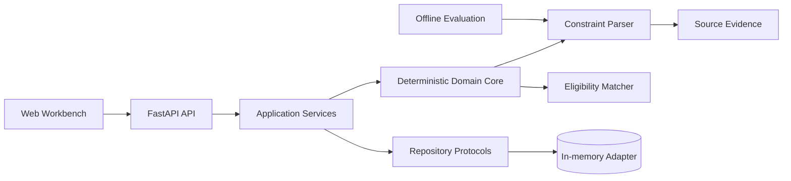

# Lina

> An evidence-grounded decision system and Agent engineering testbed for high-stakes career decisions.

Lina explores a practical question in Agent engineering: **how should an AI system make useful recommendations when some decisions must be deterministic, extracted facts need source evidence before confirmation, and users must remain in control?**

Career planning is the first vertical scenario. The current release turns unstructured job descriptions and candidate constraints into a reviewable decision workflow: extract requirements, surface source evidence, let the user verify them, and run deterministic eligibility checks. Evidence currently belongs to the extraction preview; persisting provenance with confirmed jobs and match reports is planned work. It is deliberately more than a chat wrapper and deliberately less than an autonomous black box.


## Why Lina Is Interesting

Most Agent demos optimize for how much the model can do. Lina starts with a different set of constraints:

- **Deterministic where correctness matters**: graduation year, education, experience, and location checks are pure Python rules rather than model opinions.
- **Evidence before persistence**: extracted requirements retain their source text and character offsets, so users can inspect why a field was produced before confirming it.
- **Human approval at the boundary**: extraction previews never silently become persisted facts; users confirm structured data before it affects a decision.
- **Evaluation as a product feature**: parser behavior is measured with a versioned dataset, explicit Precision/Recall semantics, and named failure cases.
- **State consistency under concurrency**: stale save, extraction, and matching responses cannot overwrite newer browser state.

These constraints make the career domain useful as an Agent systems testbed: the inputs are messy, recommendations are consequential, and a plausible sentence is not enough to establish correctness.

## Product Walkthrough

The browser workbench supports one complete, reproducible workflow:

1. Create a structured candidate profile.
2. Paste a job description and extract explicit constraints.
3. Inspect the original evidence behind every extracted value.
4. Confirm and save the structured job.
5. Run deterministic eligibility checks and receive all failure reasons.


The example above is intentionally explainable: the candidate and role are separate domain entities, extraction is a side-effect-free preview, and matching consumes only confirmed structured constraints.

## System Design



The code follows a small ports-and-adapters structure:

```text
src/lina_agent/
├── api/             # HTTP routes and dependency wiring
├── application/     # use cases and repository protocols
├── domain/          # models, parsing, evidence, matching rules
├── evaluation/      # dataset loading and metric computation
├── infrastructure/  # replaceable repository adapters
├── web/             # no-build browser workbench
├── config.py
└── main.py
```

### Decision Boundary

Lina separates three kinds of work instead of sending everything to an LLM:

| Work type | Current strategy | Reason |
| --- | --- | --- |
| Explicit constraints | Deterministic parser | Reproducible and easy to regression-test |
| Eligibility decisions | Pure domain rules | Stable outcomes with complete failure reasons |
| Ambiguous language | Warning + human review | Avoid turning preferences into false hard requirements |
| Semantic evidence mapping | Planned structured model node | Requires probabilistic interpretation and verification |
| External side effects | Planned approval gate | Users retain control over consequential actions |

This boundary is the core architectural idea: an Agent should orchestrate tools and uncertainty, not replace reliable code with probabilistic behavior.

## Engineering Evidence

| Signal | Current result |
| --- | --- |
| Automated tests | 35 passing |
| Coverage | 100% statements and branches |
| Static analysis | Pyright strict, 0 errors |
| Lint and formatting | Ruff + pre-commit |
| API contract | FastAPI + Pydantic v2 |
| Parser evaluation | Precision 1.0, Recall 0.625, Exact Match 0.5 |
| Evaluation corpus | 6 synthetic, manually labeled, versioned cases |
| Browser validation | manual Playwright checks for desktop/mobile and delayed responses; automation pending |

The parser currently favors Precision over Recall. Its baseline contains `10 TP / 0 FP / 6 FN`; these are regression numbers on a small synthetic corpus, not production accuracy. A missed field asks the user for input, while a false hard requirement can incorrectly reject an opportunity.

Notable parser failure cases covered by regression tests include:

- distinguishing `硕士及以上学历优先` from a required degree;
- preserving the place name `新疆和田` while treating `北京和上海` as an ambiguous natural-language list;
- rejecting an empty evaluation dataset instead of reporting perfect metrics.

Stale success and error responses after edits or resets were validated through delayed-response browser scenarios. Converting those scenarios into committed Playwright tests remains open work.

See the [evaluation report](docs/evaluations/JD_PARSER_BASELINE.md) and [review hardening log](docs/iterations/006-pre-push-review-hardening.md) for metric definitions and failure analysis.

## Run Locally

Requirements: Python 3.12+.

```bash
cp .env.example .env
python3.12 -m venv .venv
.venv/bin/python -m pip install -e '.[dev]'
.venv/bin/python -m uvicorn lina_agent.main:app --app-dir src --reload --port 8000
```

Open:

- Workbench: <http://127.0.0.1:8000/>
- OpenAPI: <http://127.0.0.1:8000/docs>
- Health check: <http://127.0.0.1:8000/health>

Click **载入匿名示例**, then save the profile and role to reproduce the workflow shown above.

Run the quality gates:

```bash
.venv/bin/ruff format --check src tests
.venv/bin/ruff check src tests
.venv/bin/pyright
.venv/bin/python -m pytest --cov=lina_agent --cov-branch --cov-fail-under=100
```

Run the parser evaluation independently:

```bash
PYTHONPATH=src .venv/bin/python -m lina_agent.evaluation.job_parser \
    tests/fixtures/job_parser_evaluation.json
```

## API Surface

| Method | Endpoint | Purpose |
| --- | --- | --- |
| `GET` | `/health` | service health |
| `POST` | `/profiles` | validate and save a candidate profile |
| `POST` | `/jobs/parse` | preview constraints with source evidence |
| `POST` | `/jobs` | save a user-confirmed job |
| `POST` | `/matches` | evaluate deterministic hard constraints |

Example extraction:

```bash
curl -X POST http://127.0.0.1:8000/jobs/parse \
  -H 'Content-Type: application/json' \
  -d '{"description":"工作地点：上海。要求 2027 届本科及以上学历。"}'
```

The detailed workflow and payloads are documented in the [user guide](docs/USER_GUIDE.md).

## Current Scope

Implemented today:

- typed candidate, job, constraint, and evidence models;
- explainable Chinese constraint extraction with preference handling;
- deterministic multi-reason eligibility checks;
- repository protocols with an isolated in-memory adapter;
- browser workflow with stale-response protection;
- API, domain, application, infrastructure, and evaluation tests;
- versioned evaluation data and engineering iteration logs.

Deliberately not claimed yet:

- no LLM or multi-turn conversation is wired into the current release;
- no resume file ingestion, semantic matching, or autonomous planning;
- no online job collection or company research;
- no persistent database or public deployment.

The current deterministic release is the control plane on which an Agent workflow can be built; it is not presented as an already autonomous Agent. The next milestone is not “add a chat box.” It is a structured model node for semantic evidence mapping, with provider abstraction, schema validation, citation verification, and regression evaluation. PostgreSQL, document ingestion, checkpoints, and tracing follow only when the workflow needs them.

## Design Notes

The repository keeps implementation decisions and failed experiments close to the code:

- [Knowledge base and iteration index](docs/KNOWLEDGE_BASE.md)
- [MVP implementation notes](docs/MVP_IMPLEMENTATION.md)
- [Parser evaluation baseline](docs/evaluations/JD_PARSER_BASELINE.md)
- [Development guide](docs/DEVELOPMENT.md)
- [Architecture and delivery roadmap](docs/CODING_PLAN.md)
- [Job monitoring design](docs/JOB_MONITORING.md)

## Conversation Starters

I would especially value discussion around:

- where deterministic tools should end and model reasoning should begin;
- how to evaluate citation fidelity beyond exact source-text matching;
- whether low-recall/high-precision extraction is the right early product tradeoff;
- how to evolve the current application service into a recoverable Agent graph without hiding domain logic inside framework nodes;
- what failure-injection scenarios best expose unreliable Agent behavior.

## License

All rights reserved. A reusable open-source license has not been granted yet.
