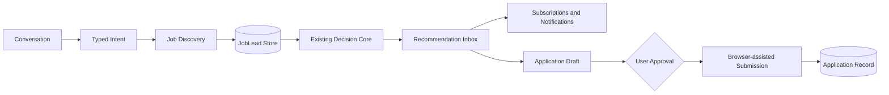
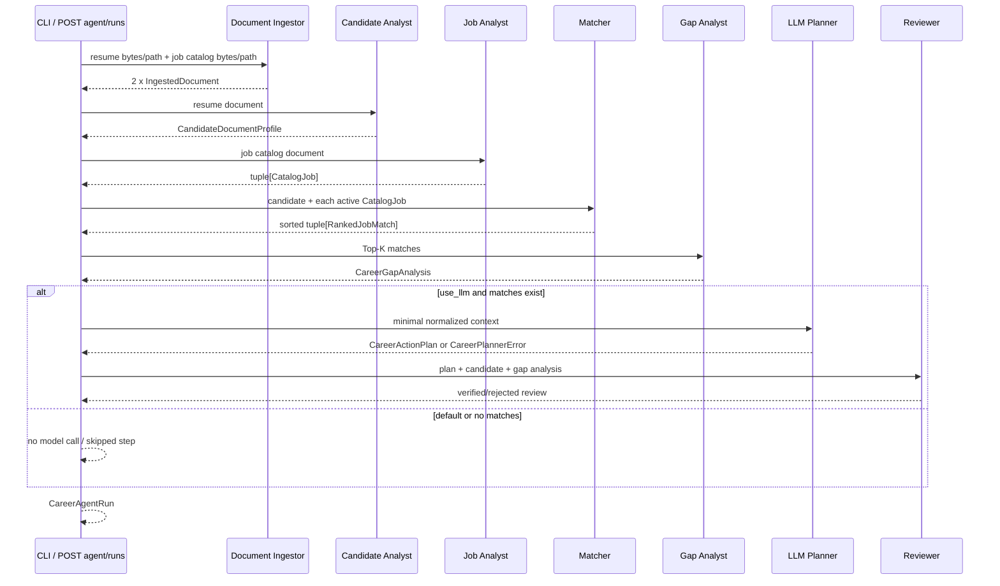
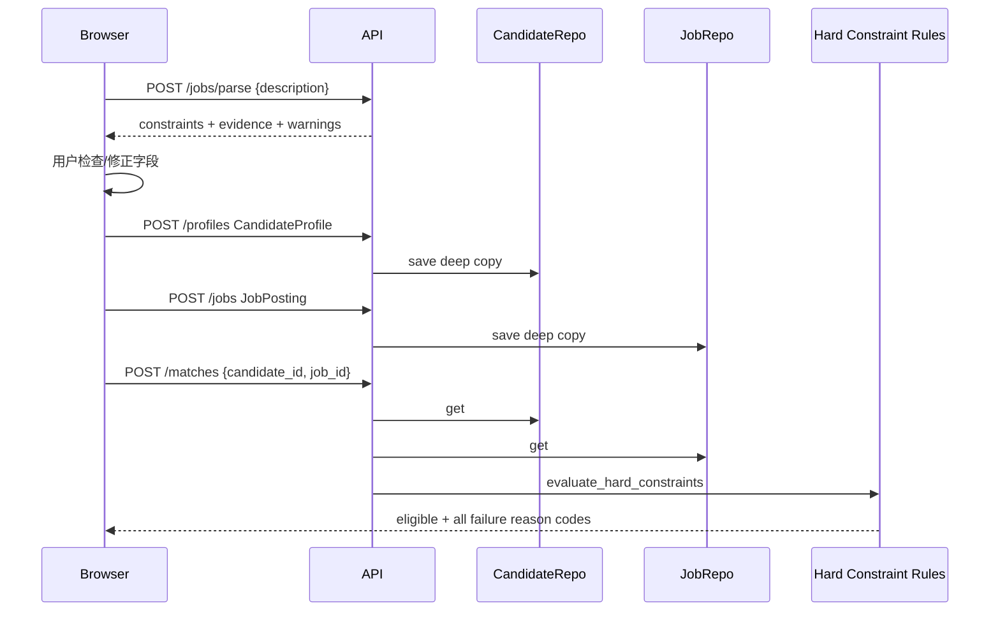
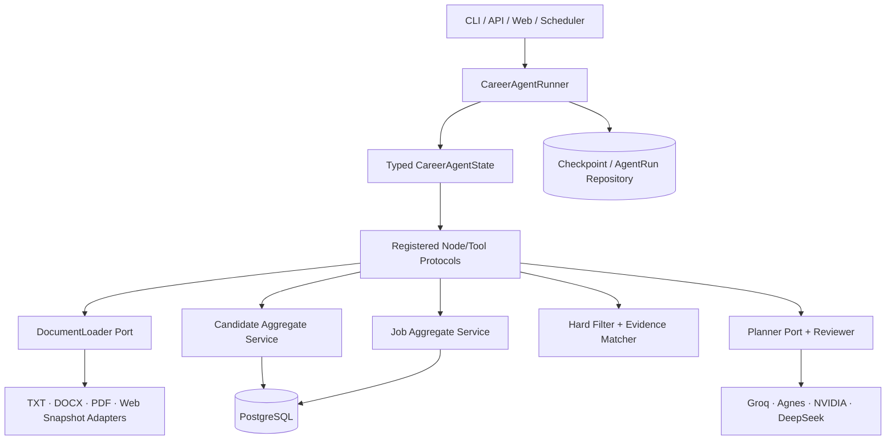

# Lina Agent 工程架构与数据流基线

> 适用版本：0.2.32
> 核心实现基线：`9782913`（`Build verifiable multi-node agent core`）
> 文档目的：明确当前真实代码边界、输入输出、数据传输方向和后续收敛顺序，不把路线图写成已实现能力。

## 1. 一句话结论

Lina 的目标架构是“对话编排 + 岗位发现与监控 + 可信决策内核 + 受控执行”。当前代码实现了三条协作流程：

1. **结构化 Web 决策链**：手工画像、单个 JD 硬条件抽取、SQLite 保存和资格判断；
2. **文件 Agent 分析链**：TXT/Markdown/DOCX 证据摄取、JD 目录解析、技能 Top-K、缺口聚合、可选 LLM 计划和确定性复核；
3. **岗位发现与监控链**：内部公司目录、来源健康、岗位去重、live-only Top 9、手动搜索和每周调度。

三条链共用 FastAPI 进程和部分基础领域类型，但还没有统一的候选人/岗位聚合或执行检查点。结构化实体、脱敏 Agent Run Snapshot、metadata-only 文档引用与确认版本已持久化；浏览器可直接创建文件 Agent Run。岗位发现已建立 32 个内部来源，但大部分实时岗位解析器尚未实现。

### 1.1 方向调整后的目标边界



新增层必须调用现有确定性规则和证据模型，不能在对话 Prompt 中复制匹配逻辑。投递执行属于高风险副作用，必须经过可持久化审批；验证码、登录和歧义字段会暂停工作流。

## 2. 系统边界总图

```mermaid
flowchart LR
    subgraph Inputs[输入]
        WEB[浏览器表单]
        PATHS[本地文件路径]
        B64[Base64 文件请求]
        DATASET[评测 JSON]
        ENV[环境变量 / 私有 Key 文件]
    end

    subgraph Legacy[结构化 Web 决策链]
        WEBAPI[/profiles · /jobs · /matches]
        MEM[(SQLite Repository)]
        HARD[硬条件规则]
    end

    subgraph Agent[文件 Agent 分析链]
        LOAD[Document Ingestor]
        PROFILE[Candidate Analyst]
        JOB[Job Analyst]
        MATCH[Matcher]
        GAP[Gap Analyst]
        PLAN[LLM Career Planner]
        REVIEW[Deterministic Reviewer]
    end

    subgraph Outputs[输出]
        HARDOUT[HardConstraintResult]
        RUN[CareerAgentRun]
        REPORT[Markdown / JSON stdout]
        EVAL[EvaluationReport JSON]
    end

    WEB --> WEBAPI --> MEM --> HARD --> HARDOUT
    PATHS --> LOAD
    B64 --> LOAD
    LOAD --> PROFILE --> MATCH
    LOAD --> JOB --> MATCH --> GAP
    GAP -. use_llm=true .-> PLAN --> REVIEW
    ENV --> PLAN
    MATCH --> RUN
    GAP --> RUN
    REVIEW --> RUN
    RUN --> REPORT
    DATASET --> EVAL
```

关键方向：

- 原始文件只进入 `LocalDocumentLoader`；
- 确定性节点消费带字符偏移的证据；
- LLM 只接收规范化技能和岗位摘要，不接收原始简历文本；
- 文件 Agent 的完整结果返回调用方；服务端只保存不含原文 evidence 的版本化 Snapshot；
- Web SQLite Repository 只保存旧的 `CandidateProfile` 和 `JobPosting`，不会保存文件、证据、Top-K 或计划。
- `company_pool` 与 `deduplication_key` 是内部发现字段，通过 Pydantic exclude 从公共响应中移除；公司目录和监控注册表没有公共 HTTP 路由。

## 3. 运行入口与外部契约

| 入口 | 输入 | 主要处理 | 输出 | 状态副作用 |
| --- | --- | --- | --- | --- |
| `GET /` | 无 | 渲染版本号并返回静态工作台 | HTML/CSS/JS | 无 |
| `GET /health` | 无 | 读取应用设置与运行时版本 | `HealthResponse` | 无 |
| `POST /profiles` | `CandidateProfile` JSON | Pydantic 校验并保存 | 201 + 同一画像 | 写本地 SQLite 候选人表 |
| `POST /jobs/parse` | `{description}` | 确定性硬条件解析 | `JobConstraintExtraction` | 无，只预览 |
| `POST /jobs` | `JobPosting` JSON | Pydantic 校验并保存 | 201 + 同一岗位 | 写本地 SQLite 岗位表 |
| `POST /matches` | 候选人 UUID + 岗位 UUID | 加载实体并执行硬条件规则 | `HardConstraintResult` | 无 |
| `POST /agent/runs` | 两个 Base64 文档、Top-K、开关 | 运行文件 Agent | `CareerAgentRun` | 写脱敏 Snapshot；可选外部 LLM 调用 |
| `GET /opportunities` | 无 | 返回 9 条已复核推荐岗位 | `OpportunityFeed` | 无；不访问公网 |
| `POST /opportunities/search` | 关键词、公司、地点、limit | 调用所有来源并跨来源去重 | `JobDiscoveryResult` | 无；当前仅快照适配器 |
| `POST /assistant/messages` | 单条自然语言消息 | 类型化预览意图路由 | `AssistantMessageResponse` | 无；无会话记忆或 LLM 调用 |
| `POST /opportunities/recommended` | 公司/方向/地点/类型/近期偏好、周次 | 过滤 live 岗位并执行内部多样性配额 | `JobDiscoveryResult` | 无；内部池字段不序列化 |
| `GET /workbench` | 无 | 渲染结构化画像、单 JD 决策和历史审计工具 | HTML/CSS/JS | 无 |
| `lina-monitor` | 可选周一日期、输出路径 | 并行检查官方入口并汇总来源健康 | `WeeklyMonitoringRun` JSON | 写指定报告文件或 stdout |
| `GET /agent/runs/{run_id}` | Run UUID | 加载脱敏历史 | `AgentRunSnapshot` | 无 |
| `GET /agent/runs?limit=N` | 1..100 | 按创建时间查询最近历史 | `AgentRunSnapshot[]` | 无 |
| `GET /agent/documents/{reference_id}` | Reference UUID | 加载 metadata-only 文档版本 | `DocumentReference` | 无 |
| `GET /agent/confirmations/{version_id}` | Version UUID | 加载用户确认版本 | `CandidateConfirmationVersion` | 无 |
| `GET /agent/runs/{base}/diff/{target}` | 两个 Run UUID | 比较版本、排序、分数、gap 和计划 | `AgentRunDiff` | 无，不加载正文 |
| `lina-match` | 简历路径、JD 路径、CLI 参数 | 运行同一文件 Agent | Markdown 或 JSON stdout | 当前无持久化；可选外部 LLM 调用 |
| `python -m lina_agent.evaluation.job_parser` | 标注数据集路径 | 运行 JD 解析评测 | JSON stdout | 无 |
| `uvicorn lina_agent.main:app` | 环境配置 | 装配 FastAPI、Repository、路由和静态文件 | HTTP 服务 | development/production 连接本地 SQLite |

### 3.1 CLI 参数

| 参数 | 类型/默认值 | 进入的内部字段 |
| --- | --- | --- |
| `--resume` | 必填 `Path` | `LocalDocumentLoader.load(resume_path)` |
| `--jobs` | 必填 `Path` | `LocalDocumentLoader.load(job_catalog_path)` |
| `--top` | 整数，默认 5 | `top_k` |
| `--include-inactive` | 默认 false | 是否保留已下线岗位 |
| `--auto-decision-signals` | 默认 false | 启用证据化硬条件与方向综合分 |
| `--candidate-weekly-days` / `--candidate-duration-months` | 可选确认值 | `CandidateAvailabilityConfirmation` |
| 六个 `--direction-*` | 可选 `0..1` | `CandidateDirectionPreferenceConfirmation` |
| `--use-llm` | 默认 false | 是否构造 `LLMCareerPlanner` |
| `--format` | `markdown` / `json` | stdout 序列化方式 |

CLI 文件读取或参数错误当前直接以异常结束；它还没有稳定的退出码枚举或机器可读错误信封。

### 3.2 文件 Agent API 输入

`CareerAgentRequest`：

```text
resume.filename          -> 扩展名决定 TXT / Markdown / DOCX reader
resume.content           -> Pydantic Base64Bytes 解码为 bytes
job_catalog.filename     -> 必须带受支持扩展名
job_catalog.content      -> Base64Bytes 解码为 bytes
top_k                    -> 1..50，默认 5
include_inactive         -> 默认 false
auto_decision_signals    -> 默认 false
candidate_availability   -> 可选投入确认；依赖 auto_decision_signals=true
candidate_direction_preferences -> 可选六类方向确认；依赖 auto_decision_signals=true
use_llm                  -> 默认 false
```

API 不接受服务端文件路径，避免调用方读取任意服务器文件。

## 4. 工程目录和职责

```text
src/lina_agent/
├── api/                 HTTP 输入校验、状态码和依赖读取
├── application/         用例编排、Repository/Planner Protocol、运行状态
├── domain/              纯领域模型、解析、匹配、缺口与复核规则
├── infrastructure/      文件、LLM、内存与 SQLite Repository 适配器
├── cli/                 本地文件 Agent 命令行入口和报告格式化
├── evaluation/          固定数据集评测
├── web/                 旧结构化工作台静态页面
├── config.py            FastAPI 应用设置
└── main.py              Composition Root
```

期望依赖方向：

```text
API / CLI / main
        ↓
Application Protocol + Use Case
        ↓
Domain
        ↑
Infrastructure Adapter
```

当前有两处尚未完全遵循该方向：

- `CareerMatchAgent` 直接依赖 `LocalDocumentLoader` 具体类；
- `/agent/runs` 路由直接构造 `LocalDocumentLoader` 和 `LLMCareerPlanner`。

这使单元测试仍可运行，但后续接数据库、对象存储、异步任务或其他 Loader 时，需要修改应用层/路由而不是只替换适配器。应在持久化迭代前补 `DocumentLoader` 和 `CareerAgentRunner` Protocol/工厂注入。

## 5. 数据契约地图

### 5.1 两套候选人模型

| 模型 | 来源 | 拥有的数据 | 缺失的数据 | 当前消费者 |
| --- | --- | --- | --- | --- |
| `CandidateProfile` | Web JSON 表单 | 毕业年份、学历、经验、技能集合、意向地点 | 原文、证据、文件指纹、确认状态 | 硬条件匹配 |
| `CandidateDocumentProfile` | 简历文档 | 文档 ID、来源名、规范化技能及原文偏移证据 | 学历、年份、经验、地点、用户确认 | 文件 Agent 技能匹配 |

二者没有 mapper 或共同聚合根。结果是：文件 Agent 目前不会执行毕业年份、学历、经验和地点过滤；Web 工作台也不会使用文档证据、Top-K 或缺口分析。

### 5.2 两套岗位模型

| 模型 | 来源 | 拥有的数据 | 缺失的数据 | 当前消费者 |
| --- | --- | --- | --- | --- |
| `JobPosting` | Web JSON | 标题、公司、完整描述、结构化硬条件 | 抽取证据持久化、状态、URL、目录编号、技能要求 | 硬条件匹配 |
| `CatalogJob` | Markdown JD 目录 | 标题/公司证据、基本信息、职责、要求、URL、上下线状态、原文 | 统一硬条件对象、确认状态、持久化 ID | 文件 Agent Top-K |

二者同样没有统一映射。后续不应再添加第三套岗位对象；应引入包含 `constraints + skill_requirements + evidence + lifecycle` 的统一 `JobAggregate`，或者先用明确的 mapper 将两套模型收敛。

### 5.3 统一证据基元

`SourceEvidence` 是当前最值得保留的跨流程基元：

```text
document_id
text
start_offset
end_offset
```

`DocumentBlock` 和 `IngestedDocument` 在此基础上补充块类型、SHA-256 指纹、稳定 UUIDv5 和规范化全文。未来 PDF、网页和数据库快照都应适配这个证据坐标契约，而不是让每种 Reader 返回自己的文本结构。

## 6. 文件 Agent 的逐节点数据流



### 6.1 Document Ingestor

输入：文件路径或 `filename + bytes`。

处理：

- `.txt` / `.md` 按 `UTF-8-SIG` 解码并规范换行；
- `.docx` 作为 OOXML ZIP 读取 `word/document.xml`，提取段落、表格和文本框中的 `w:t`；
- 根据标题、列表或段落建立 `DocumentBlock`；
- 使用原始 bytes 的 SHA-256 生成指纹和稳定 UUIDv5；
- 在规范化文本上重建连续字符偏移。

输出：`IngestedDocument`。

不支持：PDF、OCR、图片文字、页眉页脚、批注和复杂版面坐标。

### 6.2 Candidate Analyst

输入：简历 `IngestedDocument`。

处理：用版本内固定 `SKILL_TAXONOMY` 扫描别名，命中时保留最多三段原文证据。

输出：`CandidateDocumentProfile(document_id, source_name, skills)`。

这不是 LLM 语义抽取；未在词表中的表达不会进入画像。

### 6.3 Job Analyst

输入：JD 目录 `IngestedDocument`。

处理：

- 标题必须符合 `### 序号. 岗位 | 公司`；
- 识别基本信息、岗位职责、任职要求、状态与来源四类章节；
- 从原文识别 URL 和招聘中/下线状态；
- 将每个条目转成带偏移的 `SourceEvidence`。

输出：`tuple[CatalogJob, ...]`。

### 6.4 Matcher

输入：候选人技能画像、单个 `CatalogJob` 及岗位技能画像。

处理：

- 将任职要求分成 required / preferred；
- 将职责中的剩余技能作为 contextual；
- 构造双方证据对 `EvidenceMatch`；
- 计算 required 0.7、preferred 0.2、contextual 0.1 的加权覆盖率；
- 对不存在的维度重新归一化；
- 按分数降序、目录编号升序排序并截取 Top-K。

输出：`tuple[RankedJobMatch, ...]`。

当前分数是词表证据覆盖度，不包含 Web 链中的硬条件，也不是录取概率。

### 6.5 Gap Analyst

输入：已经截断的 Top-K `RankedJobMatch`。

处理：

- 聚合 missing required 和 missing preferred；
- required 按 1.0、preferred 按 0.35 计算相对影响；
- 输出 high / medium / low；
- 保留影响的岗位编号和 JD 证据；
- 汇总候选人已有技能覆盖了多少个 Top 岗位。

输出：`CareerGapAnalysis(gaps, strengths)`。

缺口只代表当前 Top-K，改变 `top_k` 会改变聚合结果。

### 6.6 LLM Planner

触发条件：显式 `--use-llm` 或 `use_llm=true`，并且至少有一个匹配岗位。

发送给外部 Provider 的字段：

```text
candidate_skills[]
skill_gaps[].skill
skill_gaps[].required_by_jobs
skill_gaps[].preferred_by_jobs
skill_gaps[].priority_score
top_jobs[].title / company
top_jobs[].evidence_coverage_score
top_jobs[].matched_required / missing_required
top_jobs[].matched_preferred / matched_contextual
```

明确不发送：简历文件名、联系方式、原文证据、完整简历和完整 JD。

输出必须满足 `CareerActionPlan`：1–3 项行动，每项包含目标技能、行动、理由、产出物、验收标准和 1–80 小时时间预算。

Provider 自动路由顺序：多个 Groq key → Agnes → NVIDIA → 显式允许时 DeepSeek。Groq Qwen 使用 JSON mode 和 `reasoning_effort=none`；其他兼容服务不接收 Groq 专属 reasoning 参数。

### 6.7 Plan Reviewer

输入：模型计划、候选人技能、聚合缺口。

确定性检查：

- 优先级必须从 1 连续递增；
- 行动文本不能重复；
- 目标技能必须来自候选人证据或 JD 缺口。

输出：`CareerPlanReview(verified/rejected, issues)`。

Reviewer 通过才把计划放进正式 `action_plan`。失败时运行状态为 `degraded`，但确定性匹配和缺口仍返回。

## 7. CareerAgentRun 输出契约

| 字段 | 来源节点 | 语义 |
| --- | --- | --- |
| `run_id` | Supervisor | 本次运行随机 UUID；用于 Snapshot 主键 |
| `state` | Supervisor | `complete` 或模型增强失败后的 `degraded` |
| `candidate` | Candidate Analyst | 候选人技能及证据 |
| `job_catalog_document_id` | Document Ingestor | JD 文档稳定 ID |
| `total_jobs` | Job Analyst | 解析出的全部岗位数 |
| `considered_jobs` | Supervisor | 实际参与排序数 |
| `excluded_inactive_jobs` | Supervisor | 默认排除的下线岗位数 |
| `matches` | Matcher | Top-K 证据匹配 |
| `gap_analysis` | Gap Analyst | Top-K 缺口和优势 |
| `action_plan` | Planner + Reviewer | 仅经过复核的正式计划 |
| `action_plan_review` | Reviewer | 复核状态、已验证技能和拒绝原因 |
| `steps` | 各节点 | 角色、`complete/failed/skipped` 和摘要 |
| `warnings` | Supervisor | 分数边界、排除项、降级原因 |

输出目前有三个去向：

- CLI 将其格式化为 Markdown 或完整 JSON 后写 stdout；
- API 将其序列化为 HTTP JSON。
- API 成功后将脱敏、版本化 Snapshot 写入 SQLite。

Snapshot 不保存原文 evidence、offset、Base64 输入、源文件名或 step summary；完整响应仍由调用方负责。

## 8. Web 结构化决策链



浏览器通过 `state.revision` 和保存实体 ID 丢弃过期异步响应，Playwright 已覆盖竞态。但这条链的证据预览不会与保存后的 `JobPosting` 建立持久关联，服务重启后 Repository 清空。

## 9. 错误、状态和降级方向

| 故障 | 入口行为 | 对结果的影响 |
| --- | --- | --- |
| JSON/Pydantic 字段无效 | FastAPI 自动 422 | 不进入应用层 |
| 不支持文件类型、坏 DOCX、空文档 | API 422；CLI 抛异常 | 无 Agent Run |
| JD 目录标题不合法 | API 422；CLI 抛异常 | 无 Agent Run |
| Web 实体 UUID 不存在 | `/matches` 404 | 无硬条件结果 |
| 无技能命中 | 返回 warning | 仍可排序，但分数信息有限 |
| 全部岗位下线 | Planner skipped | `complete`，matches 为空 |
| Provider 未配置、网络、限流、服务错误 | `CareerPlannerError` | `degraded`，保留确定性结果 |
| LLM 坏 JSON/Schema | `CareerPlannerError` | `degraded`，保留确定性结果 |
| Reviewer 拒绝计划 | review=`rejected` | `degraded`，不发布 action_plan |
| 编程缺陷或非预期异常 | 不被宽泛捕获 | 使测试/请求显式失败 |

`degraded` 只表示可选模型增强失败，不表示确定性 Top-K 失败。

## 10. 状态存储和数据生命周期

| 状态 | 位置 | 生命周期 | 可恢复性 |
| --- | --- | --- | --- |
| Web 候选人/岗位 | `data/lina.db` SQLite Repository | 本地数据库文件 | 服务重启后可恢复 |
| Agent 中间状态 | Python 局部变量 | 单次请求/CLI 进程 | 不可恢复 |
| Agent Run Snapshot | `agent_run_snapshots` SQLite 表 | 本地数据库文件 | 可查询历史，不可恢复执行 |
| 文档引用 | `document_references` SQLite 表 | metadata-only，本地数据库文件 | 可关联内容身份，不保存正文 |
| 候选人确认版本 | `candidate_confirmation_versions` SQLite 表 | 本地数据库文件 | 可比较确认事实和事件版本 |
| 文档身份 | SHA-256 + UUIDv5 | 同一 bytes 稳定 | 可重新计算 |
| LLM Key | `.env`、环境变量、私有 key 文件 | 本机配置 | 不进入响应或 Git |
| Playwright Trace | `test-results/` | 测试失败 | CI artifact，可复现前端失败 |

文档引用与确认版本已经实现；下一阶段的数据主线是 `JobLead`、来源运行和搜索结果持久化。检查点表在定时监控与受控投递出现跨步骤恢复需求时引入。Snapshot 继续只保存稳定引用和脱敏结果。

## 11. 工程脚本与自动化

### 11.1 已发布且可复现

| 脚本/配置 | 作用 | 输入 | 输出/副作用 |
| --- | --- | --- | --- |
| `lina-match` | 文件 Agent CLI | 本地简历/JD | stdout；可选 LLM |
| `evaluation.job_parser` | JD 规则离线评测 | JSON Gold Set | JSON report stdout |
| `.github/workflows/ci.yml` | Linux/Windows 质量门禁 | Git commit + `uv.lock` | Ruff、Pyright、pytest、Chromium、coverage artifact |
| `.pre-commit-config.yaml` | 本地提交前格式/lint | 暂存 Python 文件 | Ruff 自动修复/格式化 |
| `uv.lock` | 固化 Python 依赖图 | `pyproject.toml` | 跨平台可复现环境 |

CI 在 Ubuntu 和 Windows 上执行锁文件检查、依赖同步、Chromium 安装、Ruff、Pyright strict、pytest 和 100% 覆盖率；失败时上传 Playwright Trace。

### 11.2 官方 JD 离线摄取

`scripts/ingest_amazon_ai_jobs.py` 使用官方公开接口抓取固定职位集合，并将原始快照和匿名副本分层写入 `data/private/`。脚本不绕过登录、验证码或 TLS 校验；固定职位消失时明确失败，避免数据集随搜索排序静默漂移。

该脚本是人工触发的数据准备工具，不属于 Agent Tool Registry，也不代表产品已实现在线岗位采集。原始职位对象、完整正文和匿名结果均受 Git 忽略规则保护；正式接入 Supervisor 前仍需统一到 `IngestedDocument`、来源失败分类、内容指纹和可审计 Trace。

## 12. 隐私与传输边界

```text
本地原始简历/JD
    ├─ 确定性节点：可读取全文和证据偏移
    ├─ HTTP 响应：当前可返回证据片段
    └─ LLM：只发送规范化技能、岗位标题/公司、覆盖项和缺口统计
```

仍需注意：技能组合、目标岗位标题和公司名称也是个人派生数据。`use_llm` 必须保持显式 opt-in；未来日志和持久化默认不得记录完整原文或 Authorization header。

登录浏览器 Profile、cookie 派生信息和认证页面快照属于更高敏感级别，应与普通公开 Fixture 分开存储、设置保留期限，并禁止进入模型上下文。

## 13. 当前架构缺口与影响

| 优先级 | 缺口 | 直接影响 |
| --- | --- | --- |
| P0 | 两套候选人/岗位模型未统一 | 硬条件和技能 Top-K 无法同时参与一次决策 |
| P0 | 5 条 Gold 缺少硬条件与方向适配标签 | 能测量词表与引用，但无法解释人工 Top-K |
| P0 | 文档、证据和确认版本未持久化 | Snapshot 可查询，但无法做证据 diff、重放或恢复 |
| P1 | Loader/Planner 在应用层和路由直接构造 | 难以替换适配器、做后台任务和故障注入 |
| P1 | API LLM 调用同步且逐 Provider 最长 30 秒 | 多 key 连续失败时请求延迟可能累积 |
| P1 | 采集脚本未形成 Source Adapter | 无幂等、快照、去重、变更检测和统一错误 |
| P2 | 没有 OpenTelemetry/Langfuse 或节点耗时 | Trace 只有摘要，没有耗时、输入哈希和调用预算 |
| P2 | CLI 没有稳定错误 JSON/退出码 | 难以被调度器可靠调用 |

## 14. 建议的目标收敛结构



建议统一聚合：

```text
CandidateAggregate
  identity/preferences/constraints
  skill claims
  evidence references
  confirmation status
  source document versions

JobAggregate
  source/lifecycle/snapshot
  hard constraints
  required/preferred/contextual skills
  evidence references
  normalization and confirmation status

CareerAgentState
  run id + workflow version
  input document/snapshot ids
  node outputs and statuses
  token/cost/time budgets
  pending human decisions
  final report id
```

## 15. 后续迭代顺序

### Iteration A：Gold Set 与契约冻结（已完成首轮）

1. 从私有真实样本制作匿名候选人技能标注、JD required/preferred 标注和人工 Top-K；
2. 为 Gold 数据集增加版本化 Schema、一致性校验和边界测试；
3. 输出技能 Precision/Recall、引用支持率、Top-K 一致性，而不仅是代码覆盖率。

完成标准：修改词表、权重或 Prompt 时能量化回归。

当前结果：技能、匹配和引用指标均为 `1.0`；默认排序 Pairwise Accuracy 为 `0.3`，20 组权重搜索最高 `0.4`，证明排序缺少硬条件与方向适配特征。

### Iteration B：统一模型桥接（进行中）

1. 定义 `CandidateAggregate` / `JobAggregate` 或过渡 mapper；
2. 把 Web 硬条件过滤放到文件 Agent 排序之前；
3. 保证同一结论同时引用硬条件事实和技能证据。

当前已完成已确认 `DecisionSignals` 桥接与显式 opt-in 的自动证据抽取；逐项人工确认、持久化和默认启用仍未完成。

完成标准：一次 Agent Run 同时给出硬条件结果和证据 Top-K。

### Iteration C：持久化与检查点

1. 先定义 Repository Protocol 和迁移，再实现 PostgreSQL 适配器；
2. 保存文档快照、证据、确认状态、节点输出、错误和模型用量；
3. 支持按 `run_id` 查询与从失败节点恢复。

完成标准：服务重启后可追溯同一 Run，重复请求不制造重复实体。

### Iteration D：LLM 语义抽取

1. LLM 只补充词表无法覆盖的候选技能/JD 语义；
2. 每项声明必须引用输入证据范围；
3. 无效引用、冲突或低置信度进入人工确认，不直接参与匹配。

完成标准：真实 Gold Set 上相对确定性基线有可测提升。

### Iteration E：Source Adapter 与监控

1. 将本地 CJS 实验重写/封装为 `JobSourceAdapter`；
2. 明确公开页面与认证页面的授权边界；
3. 加入快照指纹、幂等、去重、变化检测和失败分类。

完成标准：单来源失败不被解释为“无岗位”，认证数据不会进入 Git 或 LLM。

### Iteration F：功能展示

只有前述契约稳定后，再把文件上传、节点 Trace、缺口、计划复核和历史 Run 接到 Web。前端应消费同一个 `CareerAgentRun`/查询 API，不再复制业务规则。

## 16. 后续开发不可破坏的约束

1. 原始文档只能通过 Loader/Source Adapter 进入领域层；
2. 每个结论必须能追溯 `SourceEvidence` 或明确标记为模型建议；
3. 硬条件、分数、去重和 Reviewer 保持确定性；
4. LLM 输入最小化，外部写操作必须人工确认；
5. 所有节点使用类型化输入输出，不传未约束 `dict`；
6. 模型失败不得抹掉已完成的确定性结果；
7. 持久化前先定义幂等键、版本和迁移；
8. 实验脚本未具备依赖锁、Schema、测试和隐私策略前，不注册为正式 Tool；
9. Web、CLI、API 最终必须消费同一个应用用例；
10. 代码覆盖率不能替代领域 Gold Set 指标。
