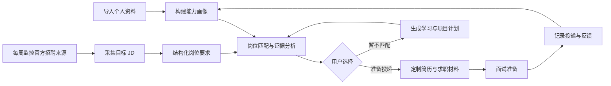
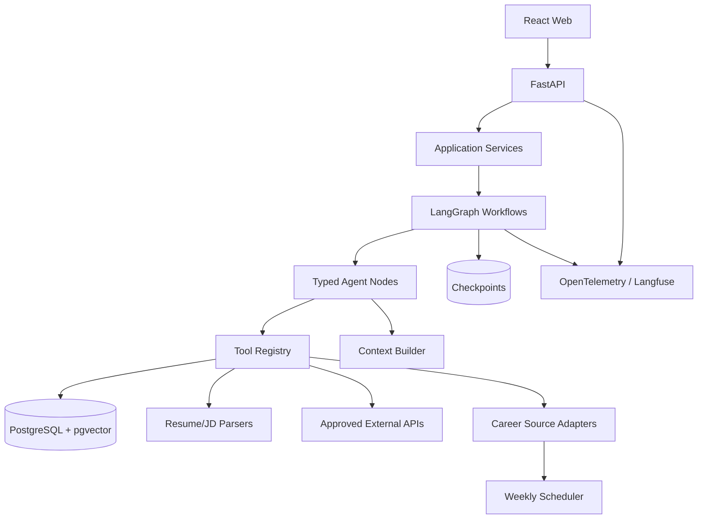

# Lina Career Agent Coding Plan

> 状态：0.2.25 已完成可信匹配内核与浏览器文件 Agent。产品主线现已调整为“对话式岗位发现、持续监控、决策支持和受控投递”。

> 唯一下一步：实现首个官方招聘来源适配器、统一 `JobLead` 契约和手动搜索 API，用真实来源完成“搜索 -> 规范化 -> 去重 -> 匹配 -> 返回来源”的最短闭环。

> 能力边界：当前没有对话、产品内联网搜索、定时推送或自动投递。LLM 只用于显式 opt-in 的结构化行动计划。任何发送、投递、账号操作或包含隐私数据的外部写操作都必须经过用户确认。

当前执行顺序以依赖关系为准：

```text
TXT/Markdown/DOCX 统一证据摄取（已完成）
   -> 真实 JD 目录与确定性技能 Top-K（已完成）
   -> 经济型 Provider 与结构化行动计划（已完成）
   -> 多岗位缺口聚合、计划复核与失败降级（已完成）
   -> 匿名人工技能/排序标注与回归评测（已完成首轮）
   -> 人工确认硬条件/方向信号与排序消融（已完成）
   -> 自动信号抽取与独立评测（已完成 MVP）
   -> 逐项 Gold 与范围表达（已完成）
   -> 候选人投入事实确认领域契约（已完成）
   -> Agent/API/CLI 确认输入接线（已完成）
   -> 真实确认值逐项 Gold 复跑（已完成）
   -> 方向标签与排序逆序对分析（已完成）
   -> 类型化方向偏好确认（领域与评测已完成）
   -> Agent/API/CLI 方向偏好接线（已完成）
   -> 多 Gold 套件与跨岗位族指标（已完成）
   -> 获取完整官方 JD 并冻结第二个 Gold（已完成单岗位集）
   -> 扩展第二集并确认内部排序/ties（已完成）
   -> 针对真实逆序生成技能证据计划（已完成）
   -> 执行 PyTorch 推理基线项目（已完成）
   -> 实现 C++ PyTorch 扩展与误差基准（已完成）
   -> CUDA Kernel 源码与验证契约（已完成）
   -> CUDA runner preflight 与安全注册契约（已完成）
   -> 外部 NVIDIA runner online 并产出 GPU artifact（延期外部任务）
   -> 结构化 Web 画像/岗位 SQLite 持久化（已完成）
   -> 版本化 Agent Run Snapshot 与 Repository（已完成）
   -> DocumentReference 与 CandidateConfirmationVersion（已完成）
   -> Snapshot diff 与历史比较 API（已完成）
   -> 工作台 Run 历史与 Diff 只读视图（已完成）
   -> 浏览器文件 Agent 运行入口与历史自动刷新（已完成）
   -> 产品方向调整：可信匹配内核转为求职助理决策内核（已完成）
   -> 官方来源适配器 + JobLead + 手动搜索 API（下一步）
   -> 搜索结果收件箱、收藏、忽略和岗位对比
   -> 求职偏好 Profile 与对话式搜索入口
   -> 搜索订阅、调度、变化检测和站内推送
   -> 公司/薪资/职业发展调查报告
   -> 简历版本、面试准备与投递看板
   -> 浏览器辅助填写 + 投递前审批 + 回执留存
   -> 执行检查点、重放与恢复
   -> 邮件等外部推送渠道
```

对话是类型化求职工具的入口，不是绕过证据、权限和确认的自由执行通道。岗位检索先接官方公开来源；持续监控复用 SQLite、文档指纹和 Snapshot 思路；投递只做“辅助填写 + 最终确认”，不做无人值守海投。

## 1. 项目目标

Lina Career Agent 是一个面向个人求职全流程的主动型 AI 助理。用户通过对话表达目标后，Lina 应持续从可信招聘来源发现岗位，结合个人证据筛选和解释，主动推送值得关注的变化，并在用户确认后协助完成投递与跟踪。

目标体验不是“用户先准备好 JD 再上传分析”，而是：

```text
说出求职目标
   -> Lina 搜索公司官网和受支持招聘系统
   -> 去重、核验有效性并计算匹配
   -> 解释推荐、比较岗位、调查公司与薪资
   -> 订阅后持续推送新增/变化/截止提醒
   -> 用户批准材料和表单后协助投递
   -> 跟踪面试与反馈，更新职业策略
```

这个项目同时服务三个目标：

1. **真实使用**：减少岗位搜索、信息核验、筛选、材料准备、投递和复盘中的重复劳动。
2. **系统学习**：掌握 Agent 状态建模、上下文工程、工具调用、结构化输出、RAG、评测与可观测性。
3. **求职展示**：用代码、测试、评测集、架构文档和线上 Demo 证明目标 JD 要求的工程能力。

## 2. 目标 JD 拆解

根据目标职位描述，项目需要有意识地提供以下证据，而不只是“调用过大模型 API”。

| JD 关注点 | 计划提供的实现证据 |
| --- | --- |
| 端到端 Agent 工作流 | 从 JD 采集、画像抽取、匹配分析到行动计划的状态图 |
| 任务规划 | Planner 将模糊求职目标拆成可执行、可检查的步骤 |
| 上下文构建 | 基于用户画像、目标 JD、历史版本和证据片段组装最小上下文 |
| 多工具调用与编排 | JD 解析、简历解析、检索、评分、文档生成、日历/任务工具 |
| 结果汇总与验证 | JSON Schema、事实一致性检查、引用证据、人工确认节点 |
| 可复用 Agent 框架 | 统一 Tool 接口、状态模型、节点协议、错误与重试策略 |
| 稳定性与可靠性 | 超时、退避重试、幂等、断点恢复、降级和审计日志 |
| 测试生成/代码评审/缺陷发现 | 测试 Agent 节点与工具契约；后期加入代码仓库作品分析工具 |
| 调试与评测能力 | Trace、离线数据集、节点级指标、回归评测和失败案例库 |
| Python/Agent 生态 | Python、FastAPI、Pydantic、LangGraph、pytest、Langfuse |
| 开源与技术表达 | ADR、开发日志、评测报告、技术博客和清晰提交历史 |

## 3. 用户与核心场景

### 3.1 目标用户

第一阶段只服务单用户，也就是项目作者本人。这样可以使用真实简历和真实求职反馈快速迭代，同时避免过早建设账号、权限和多租户系统。

### 3.2 核心闭环



## 4. 功能范围

### 4.1 P0：必须完成的作品主线

1. **长期画像与对话入口**
   - 保存简历证据、求职偏好、地点、岗位类型、目标公司和现实约束。
   - 将自然语言映射为搜索、筛选、比较、订阅和准备投递等类型化意图。
   - 高影响事实缺失时主动澄清，不从聊天上下文臆测。
2. **官方岗位发现与监控**
   - 通过统一适配器查询公司官网和条款允许的招聘系统，失败时支持手动导入。
   - 保留官方 URL、来源时间、内容指纹和来源健康，完成规范化与跨来源去重。
   - 即时搜索与 Saved Search 共用一条数据链，支持新增、更新、关闭、重开和临近截止事件。
3. **岗位匹配、调查与对比**
   - 先执行毕业时间、地点、经验等硬条件过滤，再进行语义评分。
   - 输出匹配项、缺口、风险、证据和置信度，而不是单一总分。
   - 支持岗位、公司、薪资、地点成本和成长方向对比；未知数据保持 unknown。
4. **主动 Inbox 与推送**
   - 对新增和重要变化生成去重的推荐 Inbox，并支持收藏、忽略、比较和准备投递。
   - 用户控制订阅条件、阈值、摘要频率和静默期。
   - 先实现站内提醒，再接入明确授权的邮件等外部渠道。
5. **材料与面试支持**
   - 基于目标 JD 定制摘要、技能顺序和项目要点。
   - 禁止虚构经历；每条改写都显示“原文、建议、理由、证据”。
   - 生成面试清单、模拟问题和 STAR 素材；用户逐条批准后才能导出简历版本。
6. **职业与学习顾问**
   - 根据岗位集合识别高频能力缺口，区分“必须补齐”和“边做边学”。
   - 生成带优先级、时间预算、产出物和验收方式的学习计划。
   - 使用收藏、投递和面试反馈更新职业路线与推荐策略。
7. **受控投递与跟踪**
   - 创建关联岗位、简历版本和表单字段的投递草稿。
   - 提交前展示完整预览并逐次确认；验证码、登录和歧义字段暂停交给用户。
   - 保存官方回执、投递阶段、面试反馈和下一步任务。
8. **Agent 评测与追踪**
   - 记录每次运行的状态变化、工具调用、耗时、Token 和错误。
   - 建立来源、去重、变化检测、匹配、工具选择、投递字段和建议事实性的固定评测。
   - 支持比较来源解析器、Prompt、模型或工作流版本，防止改动造成回归。

### 4.2 P1：完成 P0 后扩展

- 作品仓库分析：读取 GitHub 仓库，提取与 JD 对应的工程证据。
- 多岗位市场分析：统计技能频率、岗位族群和个人机会地图。
- 日历和任务系统集成；任何外部写操作都必须人工确认。
- 在证据源稳定后扩展 offer 决策、税后收入与跨城市生活成本分析。

### 4.3 暂不实现

- 自动海投、自动绕过招聘网站反爬或登录限制。
- 未经用户确认自动发送消息、修改简历或创建日历事件。
- 保存账号密码、验证码、Cookie 或招聘网站会话 Token。
- 多租户、复杂 RBAC、付费系统和原生移动端。
- 自研向量数据库、自研模型训练和无明确收益的多 Agent 群聊。

## 5. 技术方案

### 5.1 建议技术栈

| 层级 | 选择 | 学习价值 |
| --- | --- | --- |
| 语言 | Python 3.12+ | 对齐 JD，生态完整，便于快速实验 |
| API | FastAPI + Pydantic v2 | 类型化接口、OpenAPI、结构化校验 |
| Agent 编排 | LangGraph | 显式状态图、条件路由、检查点、人工介入 |
| 模型适配 | LiteLLM 或自建轻量 Provider 接口 | 避免绑定单模型，便于评测对比 |
| 数据库 | PostgreSQL + pgvector | 业务数据与向量检索统一，降低早期复杂度 |
| 文件解析 | PyMuPDF、python-docx | 支持常用求职材料格式 |
| 后台任务 | 首版 FastAPI BackgroundTasks，必要时升级 Celery/Redis | 避免过早引入分布式组件 |
| 可观测性 | OpenTelemetry + Langfuse | Trace、Prompt、成本和评测统一关联 |
| 测试 | pytest、pytest-asyncio、respx | 覆盖节点、工具、API 和模型 Mock |
| 前端 | React + TypeScript + Vite | 构建可交互作品 Demo；在 API 稳定后开始 |
| 工程质量 | uv、Ruff、Pyright、pre-commit、GitHub Actions | 展示可复现和质量保障能力 |

### 5.2 为什么选择单 Agent 状态图

首版采用“一个有显式状态的协调 Agent + 多个确定性工具/专业节点”，而不是多个自主 Agent 自由对话。这样更容易：

- 观察每一步输入和输出；
- 编写节点级测试；
- 控制成本、循环次数和失败恢复；
- 判断问题来自模型、上下文、工具还是业务规则。

只有当某个子任务拥有独立目标、上下文和评测标准时，才升级为独立 Agent。

### 5.3 建议架构



### 5.4 核心工程约束

- LLM 输出先进入 Pydantic 模型，业务层不消费自由文本。
- 能用确定性代码完成的过滤、计算和校验，不交给 LLM。
- 所有结论包含来源证据；没有证据时明确标记为推断。
- Tool 声明输入/输出、超时、错误类型、幂等性和副作用等级。
- 外部写操作、事实性简历改写和高风险建议设置人工确认节点。
- Prompt 与评测样例版本化；日志默认脱敏，不记录完整简历正文。

## 6. 数据与 Agent 设计

### 6.1 关键领域对象

- `CandidateProfile`：基本约束、技能、经历、证据和偏好。
- `JobPosting`：原始快照、结构化要求、来源和有效状态。
- `JobSource`：招聘来源、访问策略、关键词、地点、游标和健康状态。
- `JobSnapshot`：某次采集获得的不可变原始岗位快照与内容指纹。
- `JobChange`：新增、更新、关闭、重新开放或不确定的岗位变化事件。
- `MonitoringRun`：计划运行时间、来源级结果、失败分类和周报状态。
- `MatchReport`：硬条件结果、各维度评分、缺口、证据和置信度。
- `ResumeVersion`：目标岗位、改写建议、批准状态和版本差异。
- `LearningPlan`：目标能力、任务、时间预算、产出物和完成证据。
- `Application`：投递阶段、事件、反馈和下一步行动。
- `AgentRun`：状态快照、Trace、工具调用、模型版本和评测结果。

### 6.2 匹配评分原则

评分用于辅助比较，不能替代解释。建议初始维度如下，权重必须可配置：

$$
S = H \times (0.35S_{skill} + 0.25S_{evidence} + 0.20S_{experience} + 0.10S_{preference} + 0.10S_{growth})
$$

其中 $H \in \{0, 1\}$ 表示硬条件是否通过。每个子分数都必须返回命中项、缺失项和证据，不允许只展示最终数字。后续使用真实投递反馈校准权重，而不是把模型主观评分当作真值。

### 6.3 代表性工作流：岗位分析

1. 载入并校验 `CandidateProfile` 与 `JobPosting`。
2. 规则节点检查毕业时间、城市、学历和经验等硬条件。
3. Context Builder 只选择与当前 JD 要求相关的候选人证据。
4. LLM 节点生成结构化的能力映射和缺口分析。
5. Verifier 检查引用是否存在、分数是否符合规则、结论是否矛盾。
6. 低置信度或冲突结果进入人工确认，高置信度结果生成报告。
7. 保存状态、Trace 和评测所需的中间产物。

### 6.4 代表性工作流：岗位发现与订阅

1. 即时搜索或调度器创建带唯一运行键的 `MonitoringRun`，防止重复执行。
2. 各来源适配器读取公开官方页面或 API；遵守站点条款、robots 和速率限制。
3. 将来源字段规范化为统一 `JobPosting`，保存原始快照、URL、抓取时间和内容指纹。
4. 使用公司、外部职位 ID、规范化标题、地点和 URL 去重，并与上次成功快照比较。
5. 规则节点执行地点、毕业年份、学历和经验过滤；语义节点只处理通过硬条件的岗位。
6. Verifier 检查来源证据、重复项和异常数量；失败来源进入告警而不是输出“无新增”。
7. 汇总新增、更新、高匹配和待人工复核岗位，更新 Inbox，并按订阅策略生成提醒或摘要。
8. 用户可收藏、比较或创建投递草稿；真实提交必须经过最终预览和确认。

详细来源与契约见 [岗位发现与推送设计](JOB_MONITORING.md)。

## 7. 分阶段 Coding 路线

建议以每周 8-12 小时为基准。进度按验收标准推进，不按日历强行赶工。

### Phase 0：需求与基线（2-3 天）

**学习主题**：Agent 与普通 LLM 应用的区别、需求切片、评测先行。

**你亲手完成**：

- 用自己的简历和 8-10 个真实 JD 建立匿名化样例集。
- 手工写出每个 JD 的硬条件、关键技能和期望匹配结论。
- 定义隐私边界、成功指标和第一版 ADR。

**验收**：至少 5 个样例有人工标注期望结果；敏感信息不进入 Git。

**面试表达**：先建立基线再写 Agent，避免只凭 Demo 观感判断质量。

### Phase 1：领域模型与确定性内核（第 1 周）

**学习主题**：分层架构、Pydantic、依赖倒置、规则与模型的边界。

**你亲手完成**：

- 创建 Python 工程、质量工具和 CI。
- 实现核心领域对象、Repository 接口和硬条件过滤器。
- 为模型校验和过滤规则写参数化单元测试。

**验收**：不调用 LLM 也能完成资料存储、JD 存储和硬条件筛选；CI 全绿。

**面试表达**：把确定性逻辑与概率模型隔离，降低不可预测范围。

### Phase 2：资料/JD 解析与证据链

**学习主题**：结构化输出、文档解析、Prompt 契约、来源追踪。

#### Phase 2A：JD 文本规则与评测基线（已完成）

- 从粘贴的 JD 文本确定性提取毕业年份、学历、经验和地点。
- 保存原文证据与字符偏移，并在工作台中先预览、后保存。
- 用 6 例合成标注集建立 Precision、Recall、Exact Match 和证据指标。

#### Phase 2B：真实基线与统一文件摄取（已完成首轮）

- 已准备 10 个匿名正式岗 JD 负例、1 份匿名简历和 5 条上海 AI 实习完整官方快照。
- 已建立匿名技能/Top-K Gold，技能、匹配和引用指标均为 `1.0`；排序 Pairwise Accuracy 为 `0.3`，权重网格最高 `0.4`。
- 已定义统一 `IngestedDocument`、块类型、字符坐标、内容指纹和解析错误模型。
- 已实现 TXT、Markdown、DOCX 到规范化文本的确定性解析；PDF 与扫描件仍明确不支持。
- 使用真实失败案例扩展 JD 规则，每条正例都配容易误判的反例。

**验收**：匿名真实集可重复运行；技能抽取、证据映射和 Top-K 有人工标签及基线指标；已支持格式的逻辑文本和来源位置可对照；敏感资料不进入 Git。

#### Phase 2B.1：硬条件与方向适配排序（自动抽取基线完成）

- 将毕业年份、地点、学历、到岗天数和持续月份映射到文件 Agent 的统一岗位模型。
- 增加人工可审查的岗位方向标签，不让 LLM 直接决定排序。
- 在冻结 Gold 上比较技能-only、硬条件+技能、硬条件+方向+技能三组消融结果。

已完成可选决策信号接口、三组消融、确定性自动抽取、18 项状态/证据 Gold、候选人投入确认闭环和并列排序诊断。真实确认后逐项已知率为 `1.0`、hard MAE 为 `0.0`；并列 Gold 上自动 Pairwise 为 `0.778`，两个剩余逆序对均指向方向偏好强度缺失，因此默认 CLI/API 仍使用 skill-only。

**验收**：技能与引用指标不回退；排序改进来自新增特征而非在 5 条样本上过拟合权重；一次 Agent Run 同时返回资格结论和证据 Top-K。

#### Phase 2C：结构化语义映射与证据持久化

- 复用已完成的轻量 LLM Provider Protocol、Fake Provider 测试、超时、故障切换和调用预算。
- 用 Pydantic Schema 接收证据级语义关系，验证引用确实落在本次 Context Builder 允许的输入中。
- 让确定性 Scorer 只消费通过 Verifier 的映射，并区分 lexical baseline、semantic verified 与 semantic degraded。
- 在语义契约稳定后引入数据库迁移和 Repository 适配器，持久化文档快照、证据、确认状态、Prompt 版本和 Agent Run。
- 无 Provider、坏 JSON、无效引用或超时时，确定性路径继续可用并给出明确降级状态。

**验收**：服务重启后证据仍可追溯；未确认抽取不能参与匹配；规则与模型在同一评测集比较；错误能定位到文件解析、模型输出或引用验证。

**面试表达**：用 Schema 和证据引用约束模型，而不是依赖 Prompt 中一句“不要幻觉”。

### Phase 3：官方岗位发现（当前）

- 定义 `JobLead`、搜索请求、来源健康和适配器 Protocol；
- 实现 Fixture 来源和一个条款允许的真实官方来源；
- 完成规范化、指纹、去重和手动搜索 API；
- 将结果映射到现有匹配内核并返回官方 URL、获取时间、匹配摘要和失败状态。

**验收**：默认测试不依赖公网；真实探针独立运行；空结果与来源失败可区分；重复搜索不产生重复岗位。

### Phase 4：搜索 Inbox 与岗位对比

- 保存搜索结果、收藏、忽略和用户处置；
- 支持按公司、地点、岗位族、硬条件和匹配分筛选；
- 横向展示资格、技能、方向、主要风险和来源新鲜度；
- 先使用来源可证实字段，薪资未知时保持 unknown。

**验收**：用户能从一次搜索走到“收藏/忽略/准备投递”；所有比较字段可追溯来源。

### Phase 5：求职偏好与对话入口

- 持久化 `SearchProfile` 和 `SavedSearch`；
- 将自然语言映射为搜索、筛选、比较和订阅等类型化工具调用；
- 对地点、岗位类型、毕业年份、到岗时间等缺失事实主动澄清；
- 对话历史引用结果 ID，不复制私密原文。

**验收**：固定意图集的工具选择和参数准确率可评测；对话不能绕过 Pydantic 校验或审批。

### Phase 6：持续监控与推送

- 本地调度 Saved Search，生成新增、更新、关闭、重开和临近截止事件；
- 建立站内 Inbox、去重键、静默期和摘要频率；
- 增加来源健康、部分失败和补跑；
- 稳定后接入用户授权的邮件等外部通知。

**验收**：来源失败不产生伪关闭；重复运行不重复通知；用户可暂停和删除订阅。

### Phase 7：调查报告与职业建议

- 为公司、薪资、地点成本和职业发展接入独立证据源；
- 生成岗位调查报告和可配置决策矩阵；
- 将多岗位 gap 转为项目、学习和职业路线建议；
- 记录事实、估计和主观建议的不同置信等级。

**验收**：公司与薪资结论显示来源和时间；无法核验的数据不得生成确定性结论。

### Phase 8：材料、面试与投递看板

- 建立证据约束的简历版本和逐条审批；
- 生成 JD 定向面试清单、模拟问题和 STAR 素材；
- 保存 `ApplicationDraft`、投递阶段、面试反馈和后续任务；
- 使用真实反馈更新推荐和职业计划。

**验收**：未批准或缺少证据的内容不能进入导出材料；每次投递关联明确简历版本。

### Phase 9：受控投递与可恢复执行

- 浏览器辅助填写招聘表单，提交前展示完整预览；
- 每次投递需要用户最终确认，验证码和歧义字段暂停处理；
- 保存官方回执、操作日志和失败原因；
- 为跨来源长流程增加检查点、重试、恢复和取消。

**验收**：无审批无法产生外部提交；秘密不进入日志；失败后可恢复且不会重复投递。

## 8. 测试与评测策略

### 8.1 测试金字塔

- **单元测试**：领域规则、评分、Context Builder、脱敏和数据转换。
- **契约测试**：Tool 输入输出、模型结构化响应、数据库 Repository。
- **工作流测试**：使用 Fake LLM 验证状态迁移、分支、重试和人工确认。
- **集成测试**：真实数据库与少量模型调用，检查关键链路。
- **端到端测试**：从导入 JD 到导出简历版本的主路径。

### 8.2 首批指标

| 能力 | 指标 |
| --- | --- |
| JD/简历抽取 | 字段级 Precision、Recall、Schema 通过率 |
| 证据链 | 引用存在率、引用支持结论率 |
| 岗位筛选 | 硬条件准确率、Top-K 与人工排序一致性 |
| 简历优化 | 事实保真率、建议采纳率、关键词覆盖变化 |
| 工具调用 | 正确工具选择率、参数正确率、成功恢复率 |
| 岗位发现与推送 | 来源成功率、岗位去重准确率、变化检测准确率、有效链接率、提醒新鲜度和重复通知率 |
| 工程运行 | P95 延迟、单次成本、失败率、恢复率 |

LLM-as-judge 只评价风格、相关性等主观维度，并使用人工抽查校准；事实性和规则优先使用确定性验证。

## 9. 教学与协作方式

后续每个阶段采用同一节奏，确保代码主要由你理解并完成：

1. **概念预习**：我用当前任务解释一个核心概念，并给出最小阅读清单。
2. **设计追问**：你先回答数据如何流动、哪里可能失败、如何测试。
3. **结对实现**：我拆出 30-90 分钟的小任务；你先编码，我做 Review 和追问。
4. **验证修复**：先运行最小测试，再处理失败，不凭肉眼宣布完成。
5. **阶段复盘**：输出一页开发日志，记录决策、失败、指标变化和下一步。
6. **面试演练**：用 STAR 和系统设计问答复述该阶段，不背抽象定义。

我提供的帮助会区分为三种模式：

- **提示模式**：只给目标、接口和测试，不给完整实现。
- **结对模式**：你写主路径，我补测试、Review 或局部示例。
- **救援模式**：卡住时共同定位根因，但修复后由你复述原因并独立写一个相邻用例。

## 10. 每阶段必须沉淀的面试材料

- 一张不断更新的系统架构图和 2-4 份关键 ADR。
- 一组匿名化评测数据及版本对比报告。
- 至少 3 个完整失败案例：现象、定位、根因、修复、回归测试。
- 一份 Agent 调试手册：模型、Prompt、上下文、工具和编排如何逐层排查。
- 一篇项目复盘，重点写取舍和指标，不写技术名词清单。
- 2-3 条有数据支撑的简历项目描述，数据必须来自真实评测和使用记录。

建议的面试叙述框架：

> 当前我先用合成标注集建立评测口径，再用匿名真实 JD 校准分布。系统按确定性规则、结构化模型节点、Agent 状态图和工具层逐步演进；每个模型结论绑定来源证据，并通过验证节点和人工确认控制幻觉。随后使用 Trace 和离线评测定位失败属于抽取、上下文、工具还是编排，用具体指标证明迭代效果。

## 11. 风险与应对

| 风险 | 应对 |
| --- | --- |
| 范围过大导致无法完成 | P0 只做单用户与一条完整闭环，P1 后置 |
| 招聘网站反爬或页面变化 | 支持文本粘贴、快照和合法公开接口，不绕过限制 |
| 监控把采集失败误判为无岗位 | 来源健康状态与岗位结果分离，失败必须在周报中显式展示 |
| 同一岗位跨来源或跨周重复 | 优先使用外部职位 ID，再用规范化字段和内容指纹去重 |
| 模型虚构简历事实 | 证据约束、事实验证、逐条批准、不可自动发布 |
| 评分看似精确但不可信 | 展示维度和证据，用真实反馈校准而非宣称客观真值 |
| 真实简历泄露 | 本地优先、日志脱敏、演示数据、敏感文件忽略提交 |
| 过度依赖框架 | 领域模型和 Tool 协议独立于 LangGraph，关键逻辑可单测 |
| API 成本失控 | 小模型优先、上下文预算、缓存、调用上限和成本 Trace |

## 12. 开工前评审清单

在搭建脚手架前，需要确认：

- [ ] P0 功能是否覆盖你近期真实求职流程。
- [ ] 是否接受 Python + LangGraph + FastAPI + React 技术路线。
- [ ] 是否先做本地单用户版本，再部署公开 Demo。
- [ ] 是否能准备匿名化简历和至少 8 个真实 JD 作为基线数据。
- [ ] 每周可投入时间，以便调整阶段粒度。
- [ ] 首个模型 Provider 和预算上限。
- [ ] 首版是否仅支持文本/文件导入，不依赖招聘网站自动抓取。

评审通过后的第一项工作不是写 Agent，而是完成 Phase 0 的匿名化数据集与成功指标。
