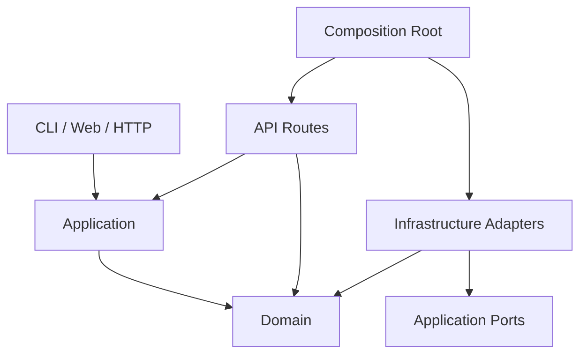
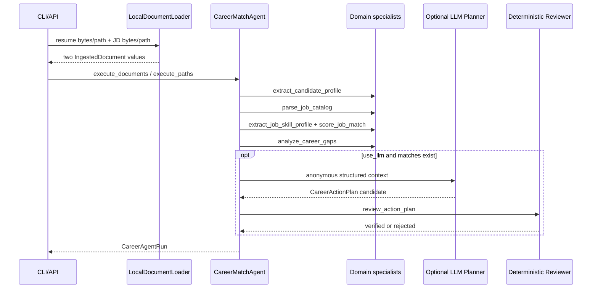
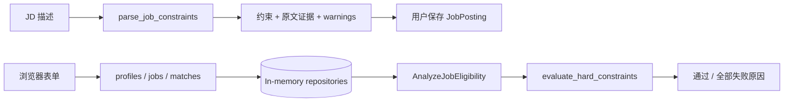

# Lina 工程代码技术书

> 适用基线：`0.2.0` 与其后的未发布工程文档整理。  
> 读者：项目作者、后续协作者、代码评审者，以及希望从源码理解 Agent 工程的人。  
> 事实原则：本书只把已经存在于代码和测试中的行为写成“当前能力”；目标设计与未来能力会明确标为“计划”。

## 1. 这本书解决什么问题

Lina 已经不是一个空目录或单 Prompt Demo。它包含两条可执行链路、类型化领域对象、API、CLI、浏览器工作台、经济型模型路由、测试与 CI。继续开发时真正的风险不是“代码不够多”，而是：

1. 不知道应该从哪个入口读代码；
2. 混淆当前 Web 硬条件链与文件 Agent 证据链；
3. 把 LLM 生成、确定性评分与证据验证写进同一个函数；
4. 在没有 Gold Set 的情况下修改权重或 Prompt，无法判断效果是变好还是变坏；
5. 为了增加功能直接连接爬虫、PDF、数据库和前端，导致核心匹配契约仍不稳定；
6. 在 Windows、WSL、CI 中使用不同依赖或编码，形成“只在本机能跑”的项目。

本书因此提供五个统一入口：

- **代码地图**：每层负责什么、允许依赖谁；
- **数据地图**：输入怎样变成证据、匹配、缺口和计划；
- **运行地图**：Web、API、CLI、LLM 分别怎样启动和调试；
- **质量地图**：测试、评测、静态检查和 CI 各自防什么错误；
- **演进地图**：未来核心模块的开发顺序与每一步完成标准。

更细的当前数据流可交叉阅读 [Agent 架构与数据流](AGENT_ARCHITECTURE.md)，面向最终使用者的操作见 [使用手册](USER_GUIDE.md)。

## 2. 当前工程结论

### 2.1 当前能否称为 Agent

可以称为**有界、可验证、可降级的多节点工作流 Agent**，理由不是“调用了大模型”，而是它已经具备：

- Supervisor 负责按确定顺序编排多个职责节点；
- 文档读取、候选人分析、岗位分析、匹配、缺口分析、计划和复核各自有明确输入输出；
- 运行结果包含 `steps` Trace，而不只是一段最终文本；
- LLM 计划是可选节点，失败后保留确定性分析并返回 `degraded`；
- LLM 输出必须通过 Pydantic Schema 和确定性 Reviewer 才能进入正式结果；
- CLI 与 API 复用同一 Agent 核心，而不是各写一套业务逻辑。

它目前还不是自主通用 Agent，也不是多 Agent 群聊系统。它没有动态工具规划、持久化检查点、会话记忆、跨运行恢复和自主外部写操作。这样的边界是工程事实，不是缺陷包装。

### 2.2 当前 LLM 在哪里

当前 LLM 只参与 `career_planner` 节点：读取匿名化的候选人技能、岗位匹配摘要和聚合缺口，生成最多三项结构化行动。它**不参与当前 Top-K 排名**，也不决定候选人与岗位是否语义等价。

因此当前结果应解释为：

- 无 LLM：确定性词表证据覆盖基线；
- 有 LLM：同一覆盖基线，加上经 Reviewer 验证的行动计划；
- 尚未实现：由 LLM 或嵌入模型完成的证据级语义映射。

未来的最终语义匹配可以要求成功调用语义模型，但系统仍应保留无模型的基线和降级结果。不能让网络失败把已经完成的文件读取与证据抽取一并变成不可用。

### 2.3 当前最重要的架构债务

仓库里存在两条尚未统一的业务链：

| 链路 | 输入 | 核心判断 | 输出 | 当前入口 |
| --- | --- | --- | --- | --- |
| Web 硬条件链 | `CandidateProfile`、`JobPosting` | 毕业年、学历、经验、地点规则 | `HardConstraintResult` | 工作台与 `/matches` |
| 文件证据 Agent 链 | `IngestedDocument`、`CatalogJob` | 词表技能覆盖与缺口聚合 | `CareerAgentRun` | `lina-match` 与 `/agent/runs` |

文件 Agent 还没有使用 Web 链的硬条件，Web 链也没有使用文件证据、Top-K 和 Gap Analyst。后续开发的目标不是继续复制第三条链，而是让两条链收敛到统一的候选人、岗位、证据与 Agent Run 契约。

## 3. 仓库框架

### 3.1 顶层目录

```text
Lina_Agent/
├── .github/workflows/ci.yml       # Linux + Windows 质量门禁
├── .vscode/                       # 可提交的编辑、调试、测试与任务配置
├── data/
│   └── private/                   # 私有简历、JD、Key；始终被 Git 忽略
├── docs/                          # 架构、使用、评测、迭代与本技术书
├── src/lina_agent/                # 生产代码
├── tests/                         # 与生产层对应的自动化测试
├── .editorconfig                  # UTF-8、LF、缩进与尾部空格规范
├── .env.example                   # 无秘密的配置模板
├── Lina_Agent.code-workspace      # VS Code 一键工作区入口
├── pyproject.toml                 # 包、依赖、工具和测试配置
├── uv.lock                        # Linux/Windows 共用的锁定依赖图
├── README.md                      # 项目主页与文档总导航
└── releaseNote.md                 # 发布事实与限制
```

以下内容属于本地状态，不是可发布源码：

- `.env` 与 `data/private/`；
- `.venv*`、缓存、覆盖率和 Playwright 结果；
- `.browser-profile-jobs/`；
- 当前未跟踪的求职网站实验 CJS 与 `scripts/`。

实验脚本在具备输入 Schema、合法来源约束、幂等、测试、错误模型和 Agent Trace 之前，不应被包装成正式 Tool。

### 3.2 生产包

```text
src/lina_agent/
├── api/
│   ├── dependencies.py            # 从 FastAPI Request 取得 Repository
│   └── routes/                    # HTTP 输入校验、用例调用、错误映射
├── application/
│   ├── analyze_job.py             # Web 硬条件用例
│   ├── career_agent.py            # 文件 Agent Supervisor 与运行契约
│   ├── career_planner.py          # Planner Port
│   ├── errors.py                  # 应用错误
│   └── repositories.py            # Repository Ports
├── cli/
│   └── career_match.py            # 本地文件入口和 Markdown/JSON 输出
├── domain/
│   ├── models.py                  # Web 链基础领域模型与证据
│   ├── documents.py               # 统一文档和块模型
│   ├── job_catalog.py             # Markdown JD 目录解析
│   ├── job_parser.py              # 中文硬条件抽取
│   ├── matching.py                # 硬条件判断
│   ├── career_matching.py         # 技能识别、证据映射和 Top-K
│   ├── career_gap.py              # 多岗位缺口、优势和计划复核
│   └── career_planning.py         # 行动计划 Schema
├── evaluation/
│   └── job_parser.py              # 离线标注集与指标计算
├── infrastructure/
│   ├── document_loader.py         # TXT/Markdown/DOCX 读取适配器
│   ├── llm_provider.py            # Provider 配置、请求与故障切换
│   ├── llm_career_planner.py      # Planner 的 LLM 适配器
│   └── repositories/memory.py     # 内存 Repository 适配器
├── web/                           # 无前端构建链的静态工作台
├── config.py                      # 应用配置
├── main.py                        # FastAPI Composition Root
└── __init__.py                    # 运行时版本
```

### 3.3 测试镜像

`tests/` 尽量镜像生产层，而不是按“单元测试/集成测试”混装：

| 目录 | 主要防线 |
| --- | --- |
| `tests/domain/` | 纯规则、Schema、证据偏移、排序与复核 |
| `tests/application/` | 用例编排、Trace、降级和 Port 行为 |
| `tests/infrastructure/` | 文件格式、Provider 请求/响应、Repository 隔离 |
| `tests/api/` | HTTP 请求、响应和错误码契约 |
| `tests/evaluation/` | 数据集加载、指标口径与失败情况 |
| `tests/web/` | Playwright 真实浏览器异步竞态 |
| `tests/fixtures/` | 可公开、匿名、稳定的回归输入 |

新增生产模块时，应先确定它属于哪一层，再在对应测试目录建立同名主题测试。不要建立一个不断膨胀的 `utils.py` 或 `test_misc.py`。

## 4. 分层与依赖规则

### 4.1 四层职责



1. **Domain**：表达业务事实和纯判断。不得读取环境变量、打开文件、访问网络或依赖 FastAPI。
2. **Application**：组织一次用例或 Agent Run，依赖领域模型和 Port，不负责 HTTP 展示。
3. **Infrastructure**：实现文件、网络、模型和存储等不稳定边界。
4. **API/CLI/Web**：把外部输入变成类型化请求，调用应用层，再把结果转成响应。

`main.py` 是 Composition Root：决定运行时到底使用内存 Repository 还是未来数据库适配器。对象装配应集中在边界，不应散落在领域函数中。

### 4.2 新代码放置判断

| 问题 | 是 | 否 |
| --- | --- | --- |
| 相同输入必须得到相同输出，且没有 I/O？ | 优先放 `domain/` | 继续判断 |
| 是否在编排多个领域操作或 Port？ | 放 `application/` | 继续判断 |
| 是否访问文件、数据库、HTTP、模型？ | 放 `infrastructure/` | 继续判断 |
| 是否处理 HTTP/CLI/页面格式？ | 放 `api/`、`cli/` 或 `web/` | 重新定义职责 |

### 4.3 当前已知的依赖折中

`CareerMatchAgent` 为了提供 `execute_paths()` 便利入口，目前直接默认构造 `LocalDocumentLoader`，因此 Application 对 Infrastructure 存在一处依赖。它在当前规模可工作，但引入数据库、对象存储或异步 Tool 后，应将 Loader 定义为 Port，并由 CLI/API 的 Composition Root 注入。

修复这类问题应在出现第二个真实适配器时进行；不能只为追求抽象层数增加空接口。

## 5. 核心领域契约

### 5.1 证据坐标

`SourceEvidence` 是当前可解释性的最小单位：

```text
document_id + text + start_offset + end_offset
```

关键不变量：

- `start_offset >= 0`；
- `end_offset > 0`；
- 对确定性抽取，`document.text[start_offset:end_offset]` 应能定位原文；
- 下游结论引用 `SourceEvidence`，不应只保存脱离原文的字符串标签。

当前字符偏移是规范化后文本坐标，不是 DOCX 页码。未来支持 PDF 时需要增加页码、块坐标或来源定位类型，不能把字符偏移伪装成版面坐标。

### 5.2 文档契约

`IngestedDocument` 统一 TXT、Markdown 与 DOCX：

| 字段 | 意义 |
| --- | --- |
| `id` | 文档实例标识 |
| `source_name` | 来源文件名，仅用于本地追踪 |
| `format` | `text`、`markdown` 或 `docx` |
| `content_hash` | 原始输入的 SHA-256 指纹 |
| `text` | 规范化连续文本 |
| `blocks` | 标题、列表项或段落及其偏移 |

Loader 对坏压缩包、未知扩展名、不可解码文本和空文档显式抛错。调用方不得把解析失败当成“候选人没有技能”。

### 5.3 候选人与岗位

当前有两组对象：

- `CandidateProfile` / `JobPosting`：结构化 Web 表单与硬条件链；
- `CandidateDocumentProfile` / `CatalogJob`：文件证据与技能链。

未来统一时不应简单删除其中一组，而应引入清晰的转换阶段：

```text
Raw document
  -> extracted proposal
  -> user-confirmed facts
  -> canonical Candidate / Job aggregate
```

“模型提议”和“用户确认”必须是不同状态。未经确认的概率性事实不能悄悄覆盖确定性资料。

### 5.4 匹配结果

`RankedJobMatch` 不只是一个 `score`。它同时保存：

- required/preferred/contextual 三类覆盖率；
- 已匹配技能的候选人证据和岗位证据；
- 缺失的 required/preferred 技能及岗位证据；
- 岗位序号、标题、公司与来源 URL。

当前权重为 required 0.7、preferred 0.2、contextual 0.1；某一类在 JD 中不存在时，会从分母中移除该类权重。分数表示词表内证据覆盖率，不是录取概率。

### 5.5 Agent Run

`CareerAgentRun` 是一次文件 Agent 执行的结果快照：

```text
run_id
state
candidate
job_catalog_document_id
job counters
matches
gap_analysis
action_plan?
action_plan_review?
steps
warnings
```

`steps` 是当前 Trace 的业务级摘要；还没有节点耗时、重试次数、Prompt 版本、输入/输出哈希和持久化恢复点。未来扩展 Trace 时应新增类型化字段，而不是把所有数据拼进 `summary`。

## 6. 当前数据流

### 6.1 文件 Agent 主链



按源码顺序理解：

1. [`document_loader.py`](../src/lina_agent/infrastructure/document_loader.py) 把格式差异收敛为统一文档；
2. [`career_matching.py`](../src/lina_agent/domain/career_matching.py) 从候选人和岗位证据中识别固定词表技能；
3. [`job_catalog.py`](../src/lina_agent/domain/job_catalog.py) 把 Markdown 目录切成岗位；
4. `score_job_match()` 做纯函数覆盖计算；
5. [`career_gap.py`](../src/lina_agent/domain/career_gap.py) 聚合 Top-K 缺口和优势；
6. [`career_agent.py`](../src/lina_agent/application/career_agent.py) 编排节点并记录 Trace；
7. [`llm_career_planner.py`](../src/lina_agent/infrastructure/llm_career_planner.py) 仅在显式启用时生成计划；
8. `review_action_plan()` 检查技能白名单、优先级和重复任务。

### 6.2 Web 硬条件链



浏览器异步保护属于展示层可靠性：用户修改表单后，较早请求的成功或失败响应都不能覆盖新状态。Playwright 测试通过控制响应返回顺序验证这件事。

### 6.3 Provider 路由

```text
use_llm=false
  -> 不读取 Provider，不联网

use_llm=true + provider=auto
  -> Groq key 1 -> Groq key 2 -> ...
  -> Agnes
  -> NVIDIA
  -> DeepSeek（仅 allow_paid_fallback=true）
```

当前切换规则：网络错误、401/403、408、429 和选定 5xx 可进入下一配置；其他 4xx 立即暴露，因为继续轮换通常无法修复请求本身。错误消息不回显响应正文或 Key。

多 Key 的作用是对用户有权使用的不同凭据做顺序故障切换，不应并发轰炸服务，也不能绕过服务条款或组织级限额。

## 7. 输入、输出与失败边界

### 7.1 CLI

输入：

```bash
uv run --locked lina-match \
  --resume tests/fixtures/resume_anonymized.md \
  --jobs tests/fixtures/job_catalog_anonymized.md \
  --top 3
```

可选参数：

- `--include-inactive`：包含已下线岗位；
- `--use-llm`：显式启用模型计划；
- `--format json`：输出完整运行 Schema，便于后续程序消费。

默认 Markdown 是人读报告，JSON 是稳定集成入口。未来新增字段应优先扩展 Pydantic Schema，再让 Markdown formatter 消费该 Schema，不能先在字符串模板里发明事实。

### 7.2 HTTP

当前接口：

| 方法 | 路径 | 成功输出 | 主要错误 |
| --- | --- | --- | --- |
| `GET` | `/health` | 服务名、环境和版本 | — |
| `POST` | `/profiles` | `CandidateProfile` | 422 Schema 错误 |
| `POST` | `/jobs/parse` | `JobConstraintExtraction` | 422 Schema 错误 |
| `POST` | `/jobs` | `JobPosting` | 422 Schema 错误 |
| `POST` | `/matches` | `HardConstraintResult` | 404 实体不存在 |
| `POST` | `/agent/runs` | `CareerAgentRun` | 422 文件或目录解析失败 |

`/agent/runs` 使用 Base64 文件，适合当前同步小文件 MVP，不适合大文件、长时任务或批处理。后续应使用上传对象、后台 Job 和按 `run_id` 查询，不要无限提高同步请求超时。

### 7.3 错误分类原则

| 类型 | 示例 | 应怎样处理 |
| --- | --- | --- |
| 输入错误 | 空文件、坏 DOCX、无 JD 标题 | 明确失败，不生成伪结果 |
| 业务不匹配 | 毕业年、学历或技能缺口 | 正常结果，附原因与证据 |
| 可降级依赖错误 | LLM 超时、限流、坏 JSON | Run 为 `degraded`，保留确定性结果 |
| 编程错误 | 不满足内部不变量 | 让测试/监控暴露，不吞成 warning |
| 高影响外部操作 | 投递、邮件、日历写入 | 未来必须人工确认与幂等保护 |

## 8. VS Code 开发工作区

### 8.1 第一次打开

在仓库根目录执行：

```powershell
code Lina_Agent.code-workspace
```

然后：

1. 接受 `.vscode/extensions.json` 的推荐扩展；
2. 执行任务 `Setup: sync locked dependencies`；
3. 执行任务 `Setup: install Playwright Chromium`；
4. 用 `Python: Select Interpreter` 选择当前环境；
5. Windows 原生选择 `.venv-windows\Scripts\python.exe`；
6. WSL 应在 WSL 窗口选择 Linux 环境，例如 `.venv-wsl/bin/python`，不要复用 Windows venv。

仓库不固定个人解释器绝对路径，因为该路径无法同时适配 Windows、WSL 和 CI。工作区会分别将 Windows 的 `UV_PROJECT_ENVIRONMENT` 指向 `.venv-windows`、将 Linux/WSL 指向 `.venv-wsl`；Python 扩展的解释器仍由开发者选择，结果属于本机 VS Code 状态，不应提交。

Pyright 配置同样不再硬编码单一 `venv` 目录。命令行门禁由当前 `uv run` 环境解析第三方依赖，VS Code 则使用当前选择的解释器；否则 Windows 会尝试读取 WSL 的 `lib64`，或 WSL 会尝试执行 Windows 的 `Scripts/python.exe`。

### 8.2 已固化的调试入口

Run and Debug 面板包含：

- `Lina: FastAPI (8000)`：在调试器中启动 API 和工作台；
- `Lina: anonymous file Agent`：用公开 Fixture 断点调试完整 Agent；
- `Lina: current pytest file`：调试当前打开的测试文件。

需要热更新而不需要断点时，运行任务 `Run: FastAPI with reload (8000)`。调试配置刻意不启用 Uvicorn reload，避免重载子进程让断点行为变得不稳定。

### 8.3 已固化的任务

通过 `Terminal -> Run Task` 可执行：

- 依赖同步和 Chromium 安装；
- 匿名离线 Agent 冒烟；
- 锁文件、Ruff format、Ruff lint、Pyright；
- 不含浏览器的快速测试；
- 含 Playwright 和 100% 覆盖率门槛的完整质量门禁；
- 顺序运行全部检查的默认 Build Task。

VS Code 测试侧栏默认忽略 `tests/web`，用于快速红绿循环；提交前必须运行 `Quality: all checks`，不能用快速测试替代完整门禁。

### 8.4 推荐断点顺序

调试文件 Agent 时，依次在以下位置断点：

1. `LocalDocumentLoader.load_bytes()`：观察原始 bytes 如何变成文档；
2. `parse_job_catalog()`：观察岗位边界和证据偏移；
3. `_extract_skill_mentions()`：观察别名命中；
4. `score_job_match()`：观察三类 coverage 和动态权重；
5. `analyze_career_gaps()`：观察跨岗位聚合；
6. `CareerMatchAgent._execute_documents()`：观察 Trace 与降级；
7. `LLMCareerPlanner.create_plan()`：只用 Mock Provider 调试结构；真实调用前确认无隐私输入。

## 9. 本地环境与配置

### 9.1 依赖管理

唯一声明来源是 `pyproject.toml`，精确解析结果是 `uv.lock`：

```bash
uv sync --extra dev --locked
uv lock --check
```

规则：

- 不手工编辑 `uv.lock`；
- 依赖变更先改 `pyproject.toml`，再运行 `uv lock`；
- CI 和本地验收都使用 `--locked`；
- `.venv` 不提交，也不跨操作系统复制。

### 9.2 环境变量

无秘密模板位于 `.env.example`。真实 `.env`、Provider Key 和私人资料由 `.gitignore` 保护。

配置优先级由 Pydantic Settings 处理。代码或文档示例不得写入真实 Key；日志、异常、测试快照和 Agent Trace 也不得包含 Key。

### 9.3 隐私边界

当前真实简历默认只在本地确定性链中处理。LLM Planner 只发送规范化技能标签和匹配摘要，不发送联系方式、文件名或简历原句。

未来语义匹配需要发送候选人证据片段时，必须新增：

- 字段级脱敏；
- 发送内容预览或明确授权；
- Provider、模型、Prompt 版本与发送字段审计；
- 原文保留期限和删除策略；
- 不含隐私的离线/Mock 测试路径。

## 10. 测试、评测与 CI

### 10.1 三种验证不是一回事

1. **测试**验证代码是否符合已定义契约；
2. **评测**衡量算法在标注数据上的质量；
3. **真实验收**验证真实环境、文件和 Provider 是否连通。

100% 代码覆盖率不代表匹配准确，真实探针成功也不代表所有错误分支被测试。

### 10.2 本地完整门禁

```bash
uv lock --check
uv run --extra dev --locked ruff format --check .
uv run --extra dev --locked ruff check .
uv run --extra dev --locked pyright
uv run --extra dev --locked pytest --browser chromium \
  --tracing=retain-on-failure \
  --cov=lina_agent --cov-branch \
  --cov-report=term-missing --cov-report=xml \
  --cov-fail-under=100
```

执行顺序有意义：锁文件、格式和静态错误通常比运行整套浏览器测试更快，应先失败。

### 10.3 Windows CI 的作用

Linux/Windows 矩阵专门防止：

- 默认编码差异；
- 路径分隔符和文件名问题；
- Playwright/Chromium 安装差异；
- 只在某个平台存在的依赖解析错误。

新增文件读取功能时，不能只在 WSL 验证；新增 shell 命令时，也不能假设 PowerShell 支持 Bash 语法。

### 10.4 当前评测边界

JD 硬条件解析器已有 6 个合成标注案例，基线是 `10 TP / 0 FP / 6 FN`。技能 Top-K 已有 5 条真实匿名 JD 的首轮 Gold：技能、匹配和引用指标均为 `1.0`，但默认排序 Pairwise Accuracy 只有 `0.3`、Top-1 为 `0`。

当前 Gold 已包含：

- 候选人证据中的技能和能力事实；
- JD required/preferred/contextual 要求及原文跨度；
- 每个候选人—岗位要求对的关系标签；
- 人工 Top-K 或 pairwise preference；
- 不确定项与标注理由；
- 数据集版本、标注者和复核状态。

下一版应补充毕业年份、地点、学历、到岗天数、持续月份和岗位方向标签，使人工排序的依据可被模型显式消费。

## 11. 如何安全扩展代码

### 11.1 新增一个技能别名

1. 先在匿名 Fixture 增加正例和容易误判的反例；
2. 在 `tests/domain/test_career_matching.py` 写失败测试；
3. 更新 `SKILL_TAXONOMY`；
4. 验证英文边界、大小写、中文包含关系和重复证据；
5. 运行 Top-K Gold Set，确认不是只修好一个样例却破坏整体排序。

词表规模明显增长后，应迁移到版本化数据文件或 Taxonomy Repository；在此之前，Python 常量便于类型检查和 Review。

### 11.2 新增文档格式

1. 扩展 `DocumentFormat`；
2. 在 Loader 中只负责解析和规范化，不做技能判断；
3. 为正常、空内容、损坏内容和不支持内容写测试；
4. 定义证据坐标怎样映射回原始格式；
5. 确认内容哈希、块顺序和重复读取稳定；
6. 再让现有 Agent 无修改消费 `IngestedDocument`。

PDF 的难点不是“能否提取字符串”，而是多栏、页眉页脚、表格、扫描件、阅读顺序与证据回链。首版可以只支持可搜索文本 PDF，并对扫描件明确报错；OCR 应作为独立、可观测的后续 Tool。

### 11.3 新增 Provider

1. 先增加 Provider enum、配置和无秘密 `.env.example`；
2. 用 `httpx.MockTransport` 固定请求与响应契约；
3. 区分可重试/可切换与不可重试错误；
4. 保证错误不泄露响应正文和 Key；
5. 加入 Router 顺序时明确免费/付费策略；
6. 只用无隐私最小提示做真实连通性探针。

### 11.4 新增 Agent 节点

每个节点必须先回答：

- 输入 Schema 是什么；
- 输出 Schema 是什么；
- 是否有副作用；
- 失败是终止、跳过还是降级；
- 输出如何验证；
- Trace 记录什么；
- 如何用 Fake/Fixture 独立测试；
- 哪个指标证明节点有价值。

如果这些问题没有答案，新增“角色名称”只会扩大 Prompt 数量，不会提高 Agent 能力。

### 11.5 新增数据库

建议按以下顺序，而不是直接把 Pydantic 对象随意 JSON 化：

1. 明确需要跨运行保留的聚合与生命周期；
2. 为 Repository Port 补契约测试；
3. 设计迁移、唯一键、外键、版本和删除策略；
4. 先持久化不可变原始文档与证据；
5. 再持久化用户确认事实与 Agent Run；
6. 用同一组契约测试验证内存与数据库适配器；
7. 最后在 Composition Root 切换实现。

## 12. 下一核心：语义匹配垂直切片

### 12.1 为什么不能只做字符串相等

固定别名适合提供高精度、低成本、可重复基线，但无法可靠识别：

- “编排多个模型工具”与 `Agent orchestration` 的能力等价；
- “构建引用可追踪的检索问答”与 RAG 的项目证据；
- 做过相邻技术但经验能否迁移；
- 同一个词只是在课程列表中出现，还是有真实项目产出；
- JD 的一句话包含多个隐含要求。

因此最终匹配需要语义模型。但模型不应直接返回一个不透明的 87 分，而应产生可验证的关系主张。

### 12.2 推荐输出契约

计划新增概念：

```text
RequirementClaim
  requirement_id
  category: required | preferred | contextual
  canonical_skill?
  job_evidence_id

SemanticEvidenceMapping
  requirement_id
  relation: exact | equivalent | transferable | missing | uncertain
  confidence
  candidate_evidence_ids[]
  reason
  provider / model / prompt_version / token_usage

VerifiedEvidenceMapping
  accepted
  issues[]
  normalized_relation
```

Verifier 至少检查：

- 所有 evidence ID 是否存在且属于本次输入；
- 引用是否落在允许的候选人/JD 片段；
- `missing` 不得同时携带“已证明”的候选人证据；
- `exact/equivalent/transferable` 必须有候选人证据；
- confidence 范围、枚举和 Schema 是否有效；
- 模型不能引用 Context Builder 没有发送的内容。

最终分数仍由确定性函数根据**已验证映射**计算。这样 Prompt 或模型变化不会顺便改变分数定义。

### 12.3 运行状态

计划将分析层级明确成：

- `lexical_baseline`：只完成词表与规则基线；
- `semantic_verified`：语义映射成功且通过证据复核；
- `semantic_degraded`：语义节点失败，回退到可用基线。

这比把所有无异常运行都写成 `complete` 更准确，也让 UI 能说明“当前结论到了哪一层”。

### 12.4 推荐节点顺序


这仍然是单 Supervisor 下的专业节点，不需要让多个 Agent 自由对话。只有当多个节点确实拥有独立状态、工具、并行收益和冲突解决协议时，才值得升级成多 Agent 协作。

## 13. 未来行动路线

### P0：工程交接基线（本次完成）

交付：

- 可提交的 VS Code 工作区、调试配置和质量任务；
- 本工程技术书；
- 当前/目标边界和未来顺序；
- 文档契约、迭代记录与导航同步。

完成标准：JSON 配置可解析，文档契约通过，全量 Ruff/Pyright/pytest/Playwright 通过。

### P1：匿名 Gold Set 与排名评测（已完成首轮）

目的：先建立“怎样算匹配得好”的测量尺。

实施顺序：

1. 从私有真实简历与 JD 派生匿名样本，公开仓库只保存匿名结果；
2. 定义技能事实、要求、证据跨度、关系和 Top-K 标签；
3. 完成人工复核并记录不确定项；样本扩展后增加第二位标注者复核；
4. 实现数据加载、Schema 校验和版本号；
5. 输出 lexical baseline 的 Precision/Recall、证据引用率、Top-K/排序指标；
6. 固定代表性失败案例。

退出条件：每次词表、权重或语义节点变更都能在同一数据集上比较，而不是依赖主观感觉。

当前已增加硬条件逐项状态与证据 Gold。自动评测必须遵守 [决策信号行为准则](DECISION_SIGNAL_RULES.md)：未知不等于兼容，岗位级覆盖率必须与逐项已知率并列报告，缺用户事实时优先确认而不是继续调权重。

### P2：语义证据映射 MVP

目的：让 LLM 成为最终语义分析的必要节点，而不是系统可启动的单点依赖。

实施顺序：

1. 定义 `RequirementClaim`、Mapping 与验证结果 Schema；
2. 实现只选相关片段的 Context Builder；
3. 先用 Fake Mapper 打通 Supervisor 和状态；
4. 实现 LLM Mapper 和 Prompt 版本；
5. 实现确定性证据 Verifier；
6. 让 Scorer 只消费验证后的映射；
7. 增加 `lexical_baseline/semantic_verified/semantic_degraded`；
8. 在 Gold Set 上对比词表基线与语义结果。

退出条件：语义路径在目标指标上有可测改进，坏引用和坏 JSON 无法进入正式评分，Provider 失败仍返回基线。

### P3：统一两条业务链

目的：让硬条件与语义技能匹配进入一次 Run。

实施顺序：

1. 定义候选人/JD 的 extracted、confirmed、canonical 状态；
2. 将 Web 表单与文件解析映射到同一领域聚合；
3. 在语义召回前执行硬条件 Gate；
4. 在结果中同时展示硬条件、能力证据、缺口和不确定项；
5. CLI、API、Web 共用一个应用服务。

退出条件：不存在两套含义不同的“匹配结果”，同一 Fixture 从不同入口得到同一核心判断。

### P4：持久化、恢复与审计

目的：把一次性同步运行升级为可恢复的 Agent 系统。

交付：

- 文档、内容指纹、证据、确认事实、Prompt 版本和 Agent Run 存储；
- 数据库迁移与 Repository 契约测试；
- 节点状态、耗时、Token、错误和重试审计；
- 幂等运行键、断点恢复与删除策略。

### P5：再扩展输入与产品功能

依赖稳定核心后，再按价值加入：

1. 可搜索文本 PDF；
2. 新版 Agent 结果工作台；
3. 合法公开来源的岗位采集、快照和去重；
4. 受证据约束的简历改写；
5. 学习计划反馈闭环；
6. 面试、投递看板和通知集成。

扫描 PDF OCR、自动投递和大规模多 Agent 不属于近期核心。

## 14. 每次迭代的标准作业

### 14.1 开始前

写清：

- 一个用户问题；
- 输入/输出 Schema；
- 不做事项；
- 可重复验收；
- 隐私与外部副作用；
- 需要更新的文档。

### 14.2 开发中

```text
理解现有契约
  -> 写失败测试或评测案例
  -> 最小实现
  -> 聚焦验证
  -> 重构边界
  -> 全量门禁
  -> 真实路径验收
```

测试先行不是要求机械地为每一行先写测试，而是要求在修改行为之前先明确可观察的失败。

### 14.3 提交前

1. `git status` 确认没有私有数据、Key、浏览器 Profile 或实验输出；
2. 检查 `uv.lock` 是否与 `pyproject.toml` 同步；
3. 执行完整质量门禁；
4. 如果算法变化，重新运行评测，禁止手填指标；
5. 更新 README、使用手册、路线图、架构、Release Notes 和迭代日志中受影响的事实；
6. 用 `git diff --check` 检查空白错误；
7. 提交信息描述用户或工程结果，不只写“update code”。

### 14.4 Review 问题

- 这个判断能否写成纯函数，而不是 Prompt？
- 模型结论是否引用了真实存在的证据？
- 失败后哪些确定性结果仍可用？
- 是否把“没有数据”误写成“没有问题”？
- 同一输入是否可复现？
- 是否改变了公开 Schema、版本或迁移要求？
- Windows、WSL、CI 是否会产生不同路径或编码行为？
- 是否新增了用户不知情的网络请求或外部写操作？

## 15. 快速阅读路线

### 15.1 30 分钟了解项目

1. `README.md`：产品与工程边界；
2. 本书第 2、3、6、13 章：当前状态、代码地图、数据流、未来行动；
3. `tests/application/test_career_agent.py`：先看可观察行为；
4. `application/career_agent.py`：看 Supervisor；
5. `domain/career_matching.py`：看当前匹配算法；
6. `infrastructure/llm_career_planner.py`：看 LLM 输入与输出边界。

### 15.2 2 小时开始修改

1. 用 VS Code 匿名调试配置跑一遍；
2. 在 Loader、Matcher、Gap Analyst 和 Supervisor 观察对象；
3. 运行快速测试；
4. 阅读目标模块的生产文件和对应测试；
5. 写一个失败测试；
6. 完成最小改动并跑完整质量门禁。

## 16. 术语表

| 术语 | 本项目含义 |
| --- | --- |
| Agent | 具备状态、节点职责、工具/规则编排、失败策略和 Trace 的有界工作流 |
| Supervisor | 决定节点执行顺序、条件和降级策略的应用服务 |
| Specialist node | 单一职责、类型化输入输出、可独立测试的处理步骤 |
| Evidence | 能定位到来源文档的文本及坐标 |
| Gold Set | 人工标注、版本化、可重复评测的数据集 |
| Hard filter | 毕业年、学历、经验、地点等确定性门槛 |
| Lexical baseline | 固定词表与别名匹配形成的可重复基线 |
| Semantic mapping | 模型判断岗位要求与候选人证据之间的语义关系 |
| Verifier | 拒绝坏引用、坏 Schema 或不满足不变量的确定性节点 |
| Degraded | 可选依赖失败，但系统仍返回部分可信结果 |
| Port | Application 定义的能力接口 |
| Adapter | Infrastructure 对文件、网络、模型或数据库的具体实现 |
| Composition Root | 选择并装配具体实现的程序入口 |

## 17. 最终工程判断

Lina 当前最有价值的不是页面数量，也不是 Provider 数量，而是已经形成“确定性内核—证据链—可选模型—确定性复核—可观测降级—Gold 评测”的骨架。下一阶段不应先扩展包装功能，而应先统一硬条件链与文件证据链、补齐方向适配特征并完成消融评测，再把 LLM 放到证据级语义映射位置，用 Verifier 和确定性 Scorer 约束它。

只要后续每项功能继续遵守类型化输入输出、证据引用、失败降级、评测先行和人工控制，这个框架可以自然扩展到持久化、PDF、岗位监控、简历优化与长期职业规划，而不必推翻重写。
