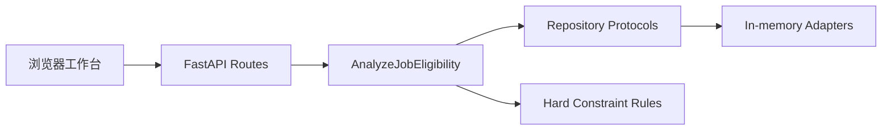

# Lina 首个可操作 MVP：实现日志与知识库

> 记录日期：2026-08-23
> 里程碑：从项目构想到可在浏览器实际完成一次岗位硬条件匹配
> 隐私边界：只记录匿名样例和工程事实，不记录真实姓名、联系方式或完整简历正文

## 1. 里程碑定义

“API 存在”不等于“产品可操作”。本里程碑将首个 MVP 定义为用户无需编写代码即可完成以下闭环：

1. 输入候选人的毕业年份、学历、经验、技能和意向地点。
2. 输入岗位描述及毕业年份、学历、经验和地点门槛。
3. 分别保存候选人和岗位。
4. 运行确定性硬条件匹配。
5. 看到是否通过以及具体失败原因。

本阶段刻意不包含 LLM、自动简历解析、语义评分、数据库和岗位自动采集。原因是先验证最短用户价值链，再增加概率性和基础设施复杂度。

## 2. 从需求到范围

### 2.1 原始目标

Lina 需要逐步支持岗位筛选、简历优化、就业方向咨询和学习建议，并同时满足三个目的：

- 解决真实求职问题；
- 学习 Agent 工程；
- 形成与目标 Agent 研发 JD 对应的作品证据。

### 2.2 第一刀为什么是岗位硬条件匹配

岗位筛选中同时存在三类决策：

| 决策类型 | 示例 | 第一版处理方式 |
| --- | --- | --- |
| 确定性规则 | 毕业年份、学历、经验、地点 | Python 领域函数 |
| 概率性判断 | 项目能否证明 Agent 工程能力 | 留到语义匹配阶段 |
| 人工决策 | 是否值得投递、是否接受建议 | 保留给用户 |

毕业年份等规则可以精确计算、容易构造反例，也最适合建立测试和分层架构基线。若一开始全部交给 LLM，会同时引入模型波动、成本和难以定位的错误。

## 3. 实现时间线

### 3.1 工程基线

首先建立 Python 3.12、FastAPI、Pydantic、pytest、Ruff、Pyright strict、pre-commit 和 GitHub Actions。应用使用 `create_app` 工厂接收配置，使测试可以注入独立设置，而不依赖进程环境。

这一阶段留下的核心证据：

- `/health` 验证应用、路由和配置注入；
- 领域输入由 Pydantic 在边界处校验；
- CI 统一执行格式、Lint、类型和测试检查；
- 真实简历置于 `data/private/`，公开测试使用匿名 Fixture。

### 3.2 确定性领域内核

建立 `CandidateProfile`、`JobPosting`、`JobConstraints` 和 `EducationLevel`。硬条件匹配函数保持纯函数性质：无网络、无数据库、无 LLM，相同输入得到相同输出。

首版规则：

- 岗位指定毕业年份集合时，候选人年份必须命中；
- 候选人学历必须达到最低学历；
- 候选人经验必须达到最低年限；
- 岗位地点与意向地点必须存在交集；
- 一次返回所有失败原因，而不是遇到首项失败就停止。

返回全部原因是为了支持解释、筛选调整和后续学习建议，而不是只给用户一个不可行动的布尔值。

### 3.3 Repository 与应用服务

业务层依赖 `CandidateProfileRepository` 和 `JobPostingRepository` Protocol，不依赖具体数据库。第一版实现 app 级内存 Repository，并在保存和读取时使用 Pydantic 深拷贝，防止调用方修改对象后污染存储。

`AnalyzeJobEligibility` 应用服务只负责：

1. 根据 ID 读取候选人；
2. 根据 ID 读取岗位；
3. 调用领域匹配函数；
4. 对不存在的实体返回明确错误。

这使未来 PostgreSQL 适配器可以替换内存实现，而无需修改领域规则和 API 用例。

### 3.4 三项 API

实现以下外部契约：

| API | 职责 | 成功响应 |
| --- | --- | --- |
| `POST /profiles` | 保存候选人画像 | `201` + 完整画像 |
| `POST /jobs` | 保存岗位与约束 | `201` + 完整岗位 |
| `POST /matches` | 根据两个 ID 运行匹配 | `200` + 资格和原因 |

未知候选人或岗位返回 `404`。API 测试按真实顺序创建两个实体，再使用响应中的 ID 发起匹配，避免测试依赖实现内部状态。

### 3.5 浏览器工作台

API 跑通后，首个产品缺口变成“用户仍需编写 curl 或理解 Swagger”。因此增加由 FastAPI 直接托管的单页工作台：

- 候选人和岗位使用独立表单；
- 保存成功后展示明确状态；
- 两个实体都保存后才允许运行匹配；
- 后端原因码在展示层翻译为可读中文；
- 提供匿名示例，一分钟内可复现完整闭环；
- 桌面和手机使用同一响应式页面；
- 不增加 Node 构建链，降低 MVP 的启动成本。

静态资源被纳入 Python package data，保证安装后的包也包含工作台，而不是只在源码检出目录中可用。

## 4. 测试驱动过程

浏览器工作台先新增根路径契约测试：

```text
GET /
-> 200
-> 包含“Lina 求职决策台”
-> 引用 /assets/styles.css 和 /assets/app.js
```

第一次有效运行返回 `404`，证明当前缺口确实是产品入口。加入静态资源挂载和首页响应后，同一测试转绿。

实施中还出现过一次测试补丁作用域错误：新测试意外嵌套在原测试中，导致 `NameError`。处理方式不是绕过，而是让新测试沿用文件已有的 `asyncio.run` 风格并立即重跑。这提醒我们：红灯必须来自预期业务缺口，否则它不能指导实现。

浏览器验收使用真实 HTTP 和 Playwright，而不是只检查 HTML 字符串：

1. 打开 `/`；
2. 载入匿名示例；
3. 保存候选人；
4. 保存岗位；
5. 运行匹配；
6. 断言显示“暂不满足硬条件”和“毕业年份不符合”；
7. 检查浏览器控制台无错误；
8. 切换手机视口并检查无横向溢出。

## 5. 关键技术决策

### 5.1 确定性逻辑不使用 LLM

**选择**：毕业年份、学历、经验和地点由普通 Python 规则计算。
**理由**：结果稳定、成本为零、易于穷举测试、错误可定位。
**代价**：规则需要显式维护，不能自然理解模糊表达。
**演进**：未来 LLM 负责从原文抽取结构化约束，规则层继续负责最终判定。

### 5.2 Repository Protocol + 内存适配器

**选择**：先定义业务需要的接口，再提供内存实现。
**理由**：快速验证闭环，同时保留数据库替换边界。
**代价**：服务重启后数据清空，不支持跨会话使用。
**演进**：增加 PostgreSQL 适配器和迁移，应用服务不变。

### 5.3 首个 UI 不引入 React

**选择**：HTML、CSS、原生 JavaScript 由 FastAPI 托管。
**理由**：当前只有三步线性流程，引入独立构建、部署和状态库不能增加核心验证价值。
**代价**：组件复用、复杂状态和前端测试能力有限。
**升级条件**：出现多岗位对比、简历版本 Diff、投递看板或共享组件后迁移 React/Vite。

### 5.4 API 与展示原因分离

后端返回稳定原因码，例如 `graduation_year`；前端负责显示“毕业年份不符合”。这样 API 不与中文文案耦合，也便于未来统计失败原因和支持多语言。

## 6. 遇到的问题与处理

| 问题 | 根因 | 处理 | 可复用经验 |
| --- | --- | --- | --- |
| API 测试最初为 404 | 三个路由尚未实现 | 先固定契约，再接入应用工厂 | 外部契约优先于内部抽象 |
| 覆盖率一度为 99% | 存在未执行的占位依赖 | 删除占位路径，使用 app state 注入 | 不为未来设计保留不可达代码 |
| Uvicorn 8000 端口冲突 | 已有热重载服务运行 | 检查 OpenAPI 和进程状态，复用已有服务 | 先确认现状再启动第二个服务 |
| 原始简历含个人信息 | 真实资料不应进入公开仓库 | 私有目录 + `.gitignore` + 匿名 Fixture | 隐私边界应进入工程约束 |
| 浏览器入口最初 404 | 后端只有 API | 增加首页契约和静态资源托管 | 可调用不等于可使用 |
| 首页测试首次出现 `NameError` | 测试被错误嵌套且缺少导入 | 调整作用域并重跑同一检查 | 先确认红灯原因正确 |

## 7. 当前架构



依赖方向从外向内：Web 和存储可以替换，领域规则不依赖它们。

## 8. 当前边界与风险

- 数据只存在于当前服务进程，重启即清空；
- 用户需要手工结构化输入，尚不能粘贴原始简历后自动抽取；
- 当前只判断硬条件，没有技能语义匹配、证据覆盖率和投递排序；
- 只有一个匿名 JD 基线，无法代表真实岗位分布；
- 没有身份认证，当前只能本地使用，不应直接暴露到公网；
- 匿名示例用于演示流程，不是用户真实能力结论。

这些不是隐藏缺陷，而是明确的 MVP 边界。下一阶段优先解决“输入成本”和“结果深度”，而不是继续装饰界面。

## 9. 面试素材

### 9.1 30 秒项目介绍

> Lina 是我为真实求职流程开发的可解释 Career Agent。第一版没有急着接大模型，而是先把候选人、岗位和硬条件建模成确定性领域内核，通过 Repository 隔离存储，再用 FastAPI 和浏览器工作台打通完整闭环。当前毕业年份、学历、经验和地点规则都有自动化测试，匹配会返回全部失败原因。下一步让模型只负责简历和 JD 的结构化抽取与语义映射，最终结论仍由规则和验证节点约束。

### 9.2 STAR 讲述

**Situation**：求职筛选同时包含明确门槛和模糊语义，直接使用聊天模型容易产生不稳定结论，也难以回归测试。
**Task**：构建一个能实际使用、可解释，并能逐步演进为 Agent 的最小产品。
**Action**：我把决策分成确定性、概率性和人工三类；先实现纯函数硬规则，用 Protocol 隔离存储，通过契约测试实现三项 API，再增加浏览器工作台和真实端到端验收。
**Result**：用户可以在本地一分钟内完成画像、岗位和匹配闭环；匿名样例稳定识别毕业年份不匹配；类型检查、Lint、测试与浏览器控制台检查均可自动验证。

### 9.3 高频追问

**为什么不用 LLM 判断毕业年份？**
因为这是完全可计算的规则。LLM 会增加成本和波动，却没有增加能力。我让 LLM 后续负责从非结构化文本中抽取年份，最终判断仍交给确定性代码。

**为什么先用内存存储？**
首个风险是业务闭环是否成立，不是数据库吞吐。Repository Protocol 已经固定业务契约，所以可以快速使用内存实现；当需要跨会话历史时，再增加 PostgreSQL 适配器，不改应用服务。

**这个项目现在算 Agent 吗？**
当前是 Agent 的确定性内核和产品基线，还没有模型驱动的规划或工具选择，因此不会把它包装成完整 Agent。后续会增加结构化抽取、状态图、验证节点和人工确认，并用固定评测集证明每一步提升。

**如何避免简历优化产生幻觉？**
每项能力和改写都必须引用原始证据；模型输出先过 Pydantic Schema，再做事实一致性检查；事实性改动需要用户逐条批准，未批准内容不能导出。

## 10. 后续迭代顺序

1. 将匿名评测集扩展到至少 5 个真实 JD，并人工标注预期结果。
2. 实现文本 JD 导入与确定性规则抽取，减少手工结构化输入。
3. 实现 PDF、DOCX 和 Markdown 简历解析，所有字段保留来源证据。
4. 增加 PostgreSQL 持久化，让工作台可跨会话使用。
5. 引入模型 Provider 和结构化语义匹配，但不替代硬规则。
6. 使用 LangGraph 组织状态、验证、重试和人工确认。

## 11. 后续日志模板

每个增量都追加以下内容，保证知识库可用于复盘：

```markdown
### YYYY-MM-DD：增量名称

- 用户问题：这次解决什么真实问题？
- 验收标准：什么行为证明完成？
- 初始假设：预期由哪条代码路径控制？
- 首个失败：测试或真实操作如何失败？
- 实现取舍：选择了什么，放弃了什么，为什么？
- 验证证据：测试、类型检查、截图、评测指标或真实反馈。
- 遗留风险：哪些边界仍然存在？
- 面试表达：如何用 30 秒说明本次增量？
```