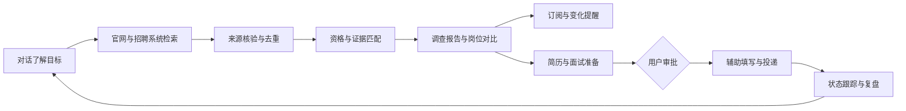

# Lina 产品愿景与边界

> 状态：目标产品定义
> 当前实现版本：0.2.40
> 事实边界：本文件描述目标体验与产品原则；当前可用能力以 [使用手册](USER_GUIDE.md) 为准，实施顺序以 [Coding Plan](CODING_PLAN.md) 为准。

## 1. 产品定义

Lina 是服务单个求职者的主动型求职 Agent。用户通过对话表达目标后，Lina 持续从可信招聘来源发现岗位，结合个人资料与证据完成筛选和解释，主动提醒值得关注的变化，并在用户确认后协助准备材料、投递和跟踪。

Lina 的核心价值不是生成一段泛化建议，而是减少完整求职流程中的重复劳动，同时让重要结论可追溯、外部操作可控制。

## 2. 目标体验

用户可以直接表达：

- “找上海或杭州的 Agent、LLM 应用实习，每周能到岗 4 天。”
- “每天检查我关注的大厂官网，只提醒值得申请的新岗位。”
- “比较这三个岗位的匹配度、薪资、成长空间和主要风险。”
- “为这个岗位准备简历版本和面试计划。”
- “检查投递内容，确认后帮我提交。”

Lina 将请求转为类型化工作流：

## 3. 产品支柱

### 3.1 对话式求职入口

- 保存稳定的求职偏好、限制、目标公司和职业方向；
- 将自然语言转成搜索、筛选、比较、规划或投递准备任务；
- 对缺失的高影响事实提出明确问题；
- 对话不能绕过字段校验、证据要求和审批节点。

### 3.2 可信岗位发现

- 优先接入公司官网、公开招聘 API、RSS 和受支持招聘系统；
- 每条岗位记录官方 URL、来源、获取时间、内容指纹和有效状态；
- 统一规范化、跨来源去重并区分新增、更新、关闭和不确定；
- 来源失败不能伪装成“没有岗位”。
- 首页只展示最多 6 条、状态为 live 且有可访问详情/投递入口的推荐岗位；不足 6 条时展示真实数量，不使用失效或未知岗位补足。
- 公司池、召回配额和去重键属于内部实现，不作为用户界面或公共 API 概念。

### 3.3 个性化决策支持

- 先检查毕业年份、学历、经验、地点和到岗时间等硬条件；
- 再分析技能证据、方向偏好、成长空间和机会成本；
- 输出匹配理由、缺口、风险、置信度和来源，而不是只给总分；
- 支持岗位、公司、薪资、地点和长期发展横向比较。

### 3.4 主动监控与推送

- 用户可保存公司、关键词、地点、岗位类型和匹配阈值；
- 定时发现新增、更新、关闭和临近截止岗位；
- 先提供站内 Inbox，再扩展邮件等外部渠道；
- 去重、静默期和摘要频率由用户控制。

### 3.5 求职准备与职业发展

- 基于真实经历生成简历改写建议，禁止虚构；
- 从 JD 和个人证据生成面试清单、模拟问题和 STAR 素材；
- 聚合岗位缺口，生成有时间预算、产出物和验收方式的学习计划；
- 使用收藏、投递和面试反馈更新推荐与职业路线。

### 3.6 受控投递

- Lina 可以准备附件、填写字段并展示最终预览；
- 用户确认公司、岗位、简历版本、字段和隐私声明后才能提交；
- 验证码、登录、歧义字段、法律声明或网站限制必须暂停并交还用户；
- 保存提交时间、使用材料和官方回执，不保存账号密码或会话秘密。

## 4. 自治与风险等级

| 等级 | 行为 | 默认策略 |
| --- | --- | --- |
| L0 只读 | 搜索公开岗位、读取本地资料、生成报告 | 可自动执行并记录来源 |
| L1 本地写入 | 收藏、创建草稿、保存订阅、更新看板 | 可执行，支持撤销和审计 |
| L2 外部通知 | 发送邮件或消息提醒 | 用户按渠道显式授权，可随时关闭 |
| L3 外部提交 | 提交申请、发送招聘沟通、创建外部日程 | 每次显示预览并最终确认 |
| L4 禁止 | 绕过验证码/访问控制、伪造经历、无人值守海投 | 不实现 |

## 5. 保留的现有资产

方向调整不推翻当前代码。以下能力直接成为新产品的决策内核：

- `SourceEvidence`、文档指纹和精确 offset；
- TXT、Markdown、DOCX 文档摄取；
- JD 目录解析、技能 taxonomy 和岗位方向；
- 硬条件三态、明确 `unmet` veto 和用户确认模型；
- Top-K、gap、证据计划、Planner 与确定性 Reviewer；
- SQLite Repository、脱敏 Run Snapshot、输入版本和 Diff；
- FastAPI/Pydantic 契约、评测集、100% 核心覆盖和 Playwright 回归。

这些模块需要被新的搜索、订阅、对话和投递工作流复用，而不是复制一套平行业务逻辑。

## 6. 需要新增的产品域

- `SearchProfile`：长期求职目标、地点、岗位族、公司和提醒偏好；
- `JobSource`：来源能力、访问策略、健康状态和游标；
- `JobLead`：规范化岗位身份、来源、生命周期和原始快照引用；
- `SavedSearch`：可重复执行的类型化搜索条件；
- `JobEvent`：新增、更新、关闭、重开、临近截止或不确定；
- `Recommendation`：岗位、匹配报告、推荐原因和用户处置；
- `Notification`：站内或外部推送状态、去重键和投递结果；
- `ApplicationDraft`：岗位、简历版本、表单字段和审批状态；
- `ApplicationRecord`：提交回执、流程阶段、事件和反馈；
- `Conversation`：消息、意图、工具调用引用和待确认动作。

## 7. 成功指标

| 产品环节 | 核心指标 |
| --- | --- |
| 获取 | 官方来源成功率、有效链接率、抓取新鲜度 |
| 数据质量 | 去重准确率、变化检测准确率、字段证据覆盖率 |
| 推荐 | 硬条件错误率、推荐采纳率、收藏率、投递转化率 |
| 推送 | 重复通知率、打开率、静默率、从发现到提醒的延迟 |
| 投递 | 字段准确率、人工修改率、提交成功率、回执完整率 |
| 职业支持 | 建议采纳率、任务完成率、面试转化和用户纠错率 |
| 可靠性 | 失败可见率、恢复成功率、敏感信息泄漏事件数 |

点击率和投递量不能单独代表成功。Lina 应优化“值得关注的机会被及时、准确地处理”，而不是鼓励海投。

## 8. 非目标

- 不构建招聘方 ATS 或多租户招聘平台；
- 不承诺预测录用概率；
- 不以未经核验的聚合站内容替代官方事实；
- 不出售或上传用户隐私资料；
- 不通过高频访问、登录绕过或验证码破解获取岗位；
- 不自动生成不存在的经历、薪资事实或公司评价。
