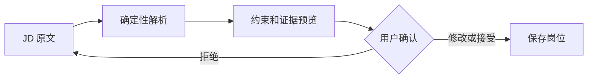

# 迭代 002：JD 硬条件解析与证据预览

> 日期：2026-08-23
> 阶段：Phase 2 第一增量
> 状态：已完成并通过全量质量门禁

## 1. 用户问题

首个 MVP 要求用户手工把 JD 中的毕业年份、学历、经验和地点重复录入结构化字段。这既增加输入成本，也可能让结构化值与原文不一致。

本次目标是：用户粘贴岗位描述后，Lina 自动提取文本中明确写出的硬条件，展示对应原文证据，用户确认后再保存岗位。

本次不做：

- 不使用 LLM 理解隐含要求；
- 不从 URL 抓取招聘网页；
- 不自动保存解析结果；
- 不提取技能、职责、加分项或隐含能力；
- 不声称规则覆盖所有中文 JD 表达。

## 2. 验收标准

使用以下文本作为主样例：

```text
工作地点：上海。面向 2027、2028 届毕业生，要求本科及以上学历，具备 3 年以上工作经验。
```

系统必须：

1. 提取毕业年份 `2027`、`2028`；
2. 将“本科及以上”映射为 `bachelor`；
3. 提取最低经验 `3.0`；
4. 提取地点“上海”；
5. 为每个结论返回文档 ID、原文、起始偏移和结束偏移；
6. 保证 `description[start_offset:end_offset] == evidence.text`；
7. 对没有明确约束的文本保持空值并提示人工确认；
8. 在浏览器中先预览、后确认、再保存和匹配。

## 3. 核心知识要点

### 3.1 信息抽取不等于信息推断

“熟悉 Agent 框架”是技能要求，“2027 届”是毕业年份约束。前者可能需要语义模型，后者可以用确定性模式识别。本次解析器只处理有明确表面形式的约束。

保守抽取遵守三条规则：

- 原文没写就不补；
- 无法稳定映射就留空；
- 每个提取值必须能回到原文片段。

这与后续 LLM 抽取并不冲突。未来可将规则解析器作为高精度基线或 Verifier，用来检查模型是否遗漏或虚构明确门槛。

### 3.2 字符偏移是最小证据链

只返回“本科”无法证明结论来自哪段文本。`SourceEvidence` 保存：

- `document_id`：标识本次原始文档；
- `text`：用于展示的原文片段；
- `start_offset`：片段起点，包含；
- `end_offset`：片段终点，不包含。

采用 Python 切片语义 `[start_offset:end_offset)`，因此可以直接用切片等式验证证据。后续做高亮、引用跳转和抽取评测时也能复用。

### 3.3 正则适合高精度窄规则，不适合完整语言理解

本次正则覆盖：

- `2027 届`、`2027、2028 届`；
- `本科及以上学历`、`硕士以上`；
- `3 年以上工作经验`、`0 年工作经验`；
- `工作地点：上海`、多个显式分隔地点。

它不应扩展成无限规则库。出现以下情况时应升级为“规则 + 结构化模型抽取 + Verifier”：

- 表达方式高度分散；
- 约束跨句组合；
- 需要理解“优先”“可放宽”“应届生”等语义强度；
- 规则维护成本超过固定评测集带来的收益。

### 3.4 预览接口应无副作用

`POST /jobs/parse` 只解析文本并返回 `JobConstraintExtraction`，不写 Repository。用户在工作台检查自动填充字段和证据后，再调用 `POST /jobs` 保存。

这是一个简化的 Human-in-the-loop：



解析器可能不完整，因此系统不应把自动结果直接当成事实写入业务状态。

### 3.5 业务值与存在性不能混用

最低经验 `0` 是合法且明确的业务值，但在 Python 中是假值。最初使用 `any(constraint_values)` 判断“是否识别到任何约束”，导致 `0 年工作经验` 被错误警告为未识别。

正确做法是根据匹配对象或证据是否存在来判断提取成功，而不是根据提取值的布尔转换判断。这条经验适用于金额 `0`、空集合的显式配置、布尔值 `False` 等场景。

## 4. 实现结构

### 4.1 领域层

- `JobConstraintEvidence`：按字段组织证据；
- `JobConstraintExtraction`：组合约束、证据和警告；
- `parse_job_constraints`：纯函数解析器，无网络、数据库或 LLM 依赖。

解析器先收集正则匹配，再分别构建业务值和证据。两者来源相同，降低“值更新但证据忘记更新”的风险。

### 4.2 API 层

`POST /jobs/parse` 请求：

```json
{
  "description": "工作地点：上海。要求 2027 届本科及以上学历。"
}
```

响应包含 `constraints`、`evidence` 和 `warnings`。请求正文为空时由 Pydantic 在 API 边界拒绝。

### 4.3 产品层

工作台新增：

- “从描述提取硬条件”命令；
- 自动填充的结构化字段；
- 原文证据标签；
- “提取结果不会自动保存”的人工确认说明；
- 没有明确约束时的警告。

用户修改已保存的画像或岗位后，前端会使旧 ID 失效并禁用匹配，避免界面显示新字段、后端却使用旧对象的状态错位。

## 5. 测试驱动与失败记录

### 5.1 失败一：解析模块不存在

先编写领域测试后运行，测试收集阶段得到：

```text
ModuleNotFoundError: No module named 'lina_agent.domain.job_parser'
```

这是预期红灯，证明测试确实约束了一个尚不存在的生产能力。实现最小解析器后，值和证据偏移测试转绿。

### 5.2 失败二：解析 API 返回 404

先写 `POST /jobs/parse` 契约测试，得到 `404 Not Found`。随后只在岗位路由增加无副作用端点，原测试转绿。

### 5.3 失败三：演示数据没有证据

真实浏览器验收时，匿名示例的结构化字段包含“2027 届、本科”，但描述正文只写了 Agent 职责。解析器返回空约束和人工确认警告，这是正确行为，却暴露出演示数据不一致。

修复不是放宽解析器，而是让匿名示例正文明确包含“工作地点：上海”“2027 届”“本科及以上学历”。这说明端到端验收能发现单元测试看不到的数据质量问题。

### 5.4 失败四：零年经验被当成未识别

增加 `0 年工作经验` 测试后，约束值正确为 `0.0`，但仍产生“未识别”警告。根因是使用值的真假性判断匹配存在。改为检查正则匹配对象后，解析器三项测试全部通过。

### 5.5 失败五：中文标点触发 Ruff `RUF001`

最终 Lint 将中文全角逗号、冒号和分号报告为易混淆字符。对于普通 Python 标识符这类检查有价值，但本项目需要解析真实中文 JD，正则和测试文本必须保留这些字符。

处理方式是在 Ruff 配置中只允许 `，`、`：`、`；` 三个业务必需字符，而不是全局关闭 `RUF001`，也不把真实输入改写成 ASCII。这样既保留其余易混淆字符检查，也让测试数据忠于生产输入。

## 6. 开发心得

1. **先建立高精度基线，再引入概率模型。** 明确规则既是可用能力，也是未来评测 LLM 的参照物。
2. **证据应与值同时生成。** 事后再寻找证据容易错配，也无法保证偏移准确。
3. **预览和提交是不同用例。** 解析可能失败或不完整，不能因为 UI 方便就隐式持久化。
4. **演示 Fixture 也是产品数据。** 它必须满足与生产数据相同的事实一致性约束。
5. **边界值优先检查存在性语义。** `0`、`False` 和空集合经常在“有值”判断中制造缺陷。
6. **浏览器验收不能被 API 测试替代。** 本次只有真实操作才发现示例正文与结构化字段冲突。
7. **静态检查规则需要结合语言域配置。** 对中文文本应精确放行必需字符，而不是关闭整类规则。

## 7. 验证证据

- 领域测试覆盖多年份、学历、经验、地点、证据偏移、无约束和零经验；
- API 测试验证响应结构以及原文切片可回查；
- 浏览器真实路径验证“载入示例 -> 自动提取 -> 查看证据 -> 保存 -> 匹配”；
- 浏览器结果为“毕业年份不符合”，控制台无错误；
- pytest：`26 passed`；
- 分支覆盖率：`100%`，246 条 Python 语句无遗漏；
- Ruff format、Ruff check、Pyright strict：全部通过；
- VS Code 编辑器诊断：解析器、模型、路由和前端脚本均无错误。

## 8. 遗留风险

- 正则只覆盖有限中文表达，召回率尚未测量；
- 地点表达可能包含“远程”“全国”“base 上海”等未支持形式；
- 只返回字段级证据，没有证据置信度和冲突处理；
- 文档 ID 目前只在响应中存在，尚未持久化原始 JD 快照；
- 没有 5 个以上人工标注 JD，无法计算 Precision、Recall；
- 自动填充后依赖用户自行确认，尚无逐字段批准状态。

## 9. 面试素材

### 9.1 30 秒表达

> 在 Lina 的第二个增量里，我先解决 JD 手工结构化成本。我没有直接接 LLM，而是为毕业年份、学历、经验和地点建立高精度确定性解析器，每个值都返回可用字符偏移回查的原文证据。解析 API 无副作用，用户在工作台预览和确认后才保存。测试过程中还发现了零年经验的真假值缺陷，以及演示 JD 原文与结构化字段不一致的问题，分别通过边界测试和真实浏览器验收定位。

### 9.2 STAR 表达

**Situation**：用户必须重复填写 JD 原文中已有的门槛，且结构化数据可能与原文不一致。
**Task**：降低输入成本，同时保证自动结果可解释、可回查且不会未经确认写入。
**Action**：设计带字符偏移的提取结果，使用纯函数规则解析明确表达，提供无副作用预览 API，并在工作台增加证据展示和人工确认。通过契约测试、零值边界测试和浏览器端到端操作验证。
**Result**：用户可以从 JD 文本自动填充四类硬条件，逐项看到原文依据，再保存并执行已有匹配流程；解析与匹配仍保持确定性和可测试。

### 9.3 高频追问

**为什么此处使用正则而不是 LLM？**
当前字段有稳定、明确的表面形式，正则能提供高精度、零模型成本和精确字符偏移。正则不会承担隐含语义；当固定评测集证明召回率不足时，再加入结构化模型抽取，并用规则和证据验证器兜底。

**为什么解析接口不直接创建岗位？**
解析结果可能遗漏或冲突。把预览与保存分开，让概率性或不完整的机器结果先经过人工确认，避免污染后续匹配状态。

**如何评估下一版解析器？**
准备至少 5 到 10 个匿名真实 JD，逐字段标注值和证据跨度，计算字段级 Precision、Recall、Exact Match 和证据跨度准确率，并把规则与模型版本放在同一回归集比较。

## 10. 下一步

1. 扩充匿名真实 JD 标注集，先测当前规则的精确率和召回率；
2. 建立原始文档模型并持久化 JD 快照与证据；
3. 支持 Markdown、PDF、DOCX 简历文本提取；
4. 在固定评测集上比较规则解析与结构化 LLM 抽取；
5. 增加冲突检测和逐字段人工批准状态。